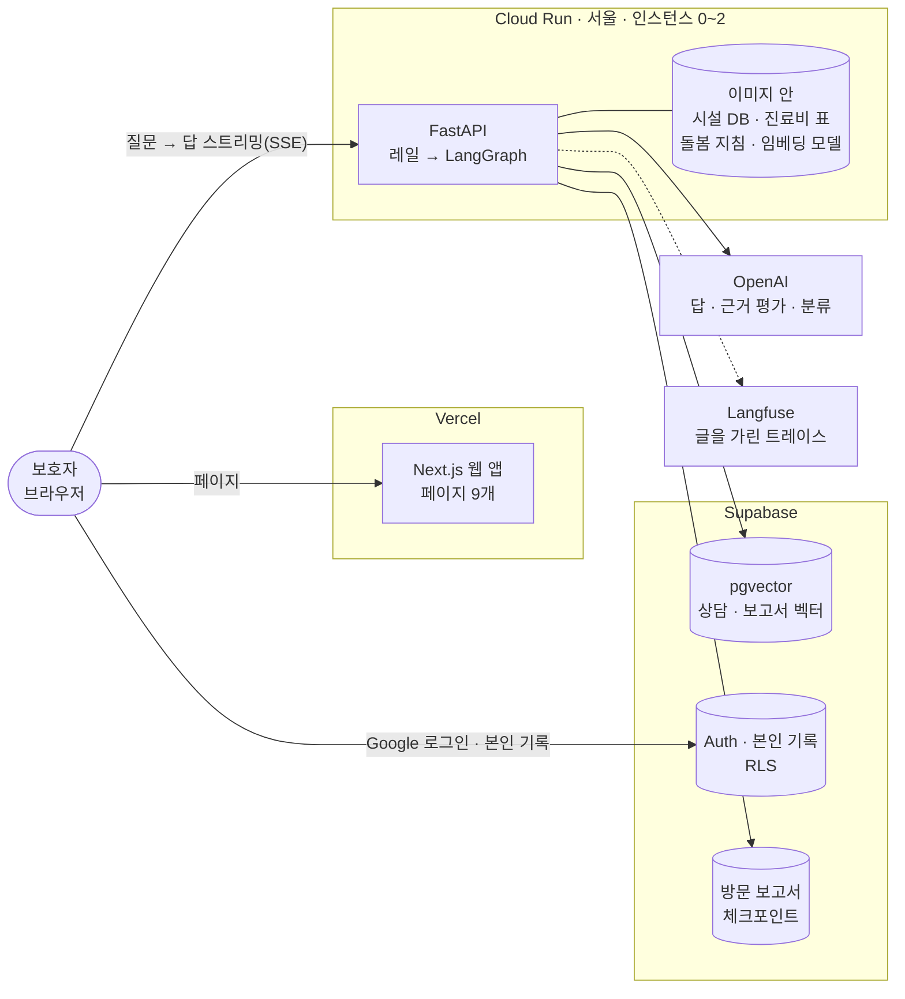
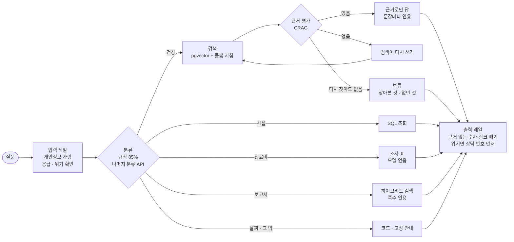
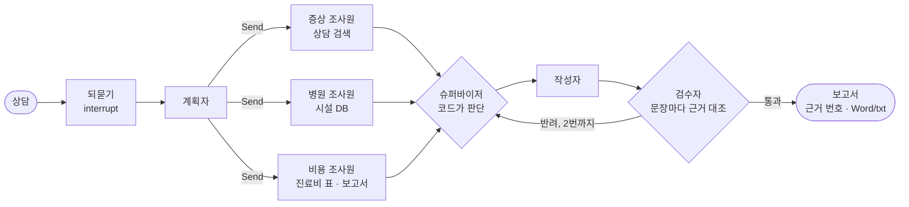

# 🐾 라그도그 (RagDog)

> 반려견 건강 상담 RAG 서비스입니다. 수의사 상담 19,206건을 근거로 답하고, **근거가 없으면 지어내지 않고 보류합니다.** 시설 찾기(38,529곳), 지역별 진료비, 반려동물 보고서 분석, 수의사 방문 준비 보고서(멀티에이전트), 관리 일정을 함께 제공합니다. 모든 개선은 같은 평가 세트로 전후를 재서 결정했습니다.

- **웹 앱:** <https://ragdog-rndigkwks-projects.vercel.app> · Next.js(Vercel) + FastAPI(Google Cloud Run 서울) + Supabase
- **문서:** [구조](docs/architecture/README.md) · [개선 기록](docs/improvement-log.md) · [실험 wiki](docs/wiki/README.md) · [ADR 11개](docs/adr/README.md) · [보안](docs/security/README.md) · [데이터 명세](docs/data-sources.md) · [실행 방법](docs/development.md)
- 엔코아 AI 캠퍼스 4인 팀 프로젝트(2026-08)를 발표 뒤 **오현탁이 혼자 이어서**(2026-09~10, PR 340여 개) 측정하며 개선했습니다. 의료 판단이나 응급 처치를 대신하지 않습니다.

## 데모

| 건강 상담: 문장마다 인용 번호, 펼친 근거 | 홈: 질문부터 |
| --- | --- |
|  |  |
| **시설 찾기: 목록과 지도** | **지역별 진료비: 시·도 중간값과 전국** |
|  |  |
| **보고서 분석: 5종 통합 질문** | **소개: 데이터와 출처** |
|  |  |

| 이렇게 물으면 | 이렇게 동작합니다 |
| --- | --- |
| 강아지가 이틀째 설사를 해요 | 비슷한 상담 사례를 근거로 답하고, 문장마다 인용 번호와 근거 목록 |
| 햄스터가 해바라기 씨를 먹어도 되나요? | 강아지 자료에 근거가 없어 **보류**. 찾아본 것과 없던 것을 알려 줌 |
| 입술 색이 거무스름하고 숨을 몰아쉬어요 | 답보다 먼저 응급 경고와 가까운 동물병원 |
| 설사가 이틀째인데 마포구 동물병원 어디 있어? | 병원 목록을 먼저(0.4초), 아래에 증상 안내 |
| 강남구 엑스레이 얼마야? | 2025 정부 조사의 중간·평균·범위를 모델 없이 표 그대로 |
| (상담 아래) 방문 준비 보고서 만들기 | 빠진 정보를 되묻고, 증상·병원·비용을 병렬 조사해 근거 번호가 달린 보고서(Word·txt) |

휴대폰 화면: [홈](docs/images/web_mobile_home.png) · 더 많은 화면: [데모 상세](docs/details.md#데모-상세)

## 30초 요약

| | |
| --- | --- |
| **문제** | 보호자는 짧게 묻고("강아지 오줌 색이 달라졌어요"), 근거 자료는 길다. 틀린 건강 정보는 답하지 않는 것보다 해롭다 |
| **접근** | 질문 유형별 경로(LangGraph) → 미세조정 임베딩 검색 → 근거 평가(CRAG) → 근거가 없으면 보류. 응급 신호는 답보다 먼저 |
| **내가 한 일** | 평가 세트를 먼저 쓰고, 원인을 숫자로 찾고, 고치고, 다시 쟀다. 효과가 없으면 넣지 않았다(리랭커, 큰 임베딩, Self-RAG 등) |
| **운영** | 답을 바꾸는 PR은 실제 모델 평가를 통과해야 병합. 트래픽 0% 후보 리비전 점검 뒤 배포, 매주 회귀 평가·SLO, 실패하면 이슈와 메일 |

## 핵심 지표

같은 평가 세트로 전후를 비교했습니다. 근거: [개선 기록](docs/improvement-log.md), [wiki](docs/wiki/README.md)

| | 이전 | 이후 |
| --- | ---: | ---: |
| 건강 검색: 쓸모 있는 근거가 상위 3건에 있는 질문 (100문항) | 0.46 | **0.84** |
| 짧은 질문 검색 (120문항) — 보호자 말투로 임베딩 미세조정 | 0.600 | **0.783** (p=0.0001) |
| 보고서 답변 정답 (18문항 × 2회) — 하이브리드 검색 | 23/36 | **30/36** (p=0.016) |
| 근거 없는 질문 보류 / 답할 질문을 잘못 보류 (60문항) | 0/20 / – | **16/20 / 1/38** |
| 응급 신호 감지, 미리 써 둔 평가셋 | 1/20 | **19/20, 오탐 0** |
| 위기 표현에 상담 번호 — 다른 모델이 새로 쓴 문항 | 0/5 | **5/5** (오탐 0/305) |
| 방문 준비 보고서 검수 통과율 / 중앙 시간 (상담 12개) | 0.70 / 68초 | **1.00 / 49초** |
| 건강 답변 시간 p90 (40문항) | 18.5초 | **11.4초** |
| 앱 최고 메모리 — 검색을 Supabase로 옮김 | 910MB | **442MB** (검색 품질 같음) |

## 아키텍처

- **화면과 API를 나눴다:** 브라우저가 API를 직접 부르고 답을 SSE로 받습니다. 로그인한 보호자의 기록은 브라우저가 사용자 토큰으로 Supabase에 읽고 쓰고, RLS가 본인 행만 허용합니다. API 계정은 사용자 표에 권한이 없습니다([ADR-0008](docs/adr/0008-nextjs-frontend-fastapi-backend.md)).
- **검색은 DB에, 질문 임베딩은 API 안에:** 미세조정한 ko-sroberta(ONNX int8)가 질문 벡터를 만들고 pgvector가 찾습니다. OpenAI가 멈춰도 건강 검색은 돌고, DB가 멈추면 이미지 안의 저장소로 답합니다([검색](docs/architecture/retrieval.md)).
- **배포:** 병합하면 이미지를 빌드해 트래픽 0% 후보로 올리고, 건강 질문까지 4가지를 물어 통과해야 트래픽을 넘깁니다. 비밀은 Secret Manager, 인증은 키 파일 없는 Workload Identity입니다([운영](docs/architecture/operations.md)).

## 에이전트 구조

### 상담 그래프 (LangGraph)

- 의료 상담에서 그럴듯한 지어내기는 답하지 않는 것보다 위험해서, 근거 평가를 통과한 문서의 사실만 씁니다. 증상과 병원을 함께 물으면 두 경로를 다 돕니다.
- 숫자(진료비·시설·날짜)는 모델이 옮기지 않고 코드가 표와 DB에서 꺼냅니다.
- 레일은 NeMo Guardrails의 구조(단계와 규칙 id)를 따르되 함수로 구현했습니다. NeMo·Llama Guard·Prompt Guard는 레드팀 68문항에서 앱이 놓친 공격을 막지 못해 넣지 않았습니다. 자세히: [상담 그래프](docs/architecture/answer-pipeline.md), [API와 레일](docs/architecture/api.md)

### 방문 준비 보고서 팀 (멀티에이전트)

- 조사원은 자기 도구 하나만 받고, 작성자는 검색 도구가 없습니다. 근거 없이 쓴 문장은 검수에서 걸립니다.
- 조사 하나가 실패해도 나머지로 쓰고, 필수 조사(증상)가 실패하면 쓰지 않고 사람 확인으로 넘깁니다. 같은 지적이 반복되면 일찍 멈춥니다.
- 멈춘 실행(되묻기, 오류)은 Supabase 체크포인트로 30분 두어, 어느 인스턴스에서든 끝낸 단계부터 이어 갑니다. 자세히: [팀 구조](docs/architecture/visit-prep-team.md)

## 문제를 숫자로 찾고 고친 사례

| 발견 | 측정 → 결정 | 결과 |
| --- | --- | --- |
| 질문에서 추론한 나이·진료과 **필터가 검색을 망쳤다** | 라벨이 본문과 34%·59%만 일치 → 필터 제거 | 적중 0.141 → 0.264 |
| 짧은 질문과 긴 상담 글이 **임베딩에서 멀었다** | 보호자 말투 질의 생성($3.37) → Colab T4 미세조정 → ONNX int8 | 짧은 질문 0.600 → 0.783 ([기록](docs/wiki/embedding-finetune.md)) |
| 보고서 오답의 원인이 **PDF에서 사라진 숫자** | 숫자를 전용 글꼴로 넣은 쪽 → OCR 조각 추가, 오독은 쪽 그림과 대조 | 오답 → 정답 ([기록](docs/wiki/retrieval-experiments.md)) |
| 에이전트 팀이 **얻을 수 없는 정보를 계속 요청** | 추가 조사 1번, 같은 지적 반복이면 사람 확인 | 검수 통과 0.70 → 1.00 ([기록](docs/wiki/visit-prep-team.md)) |
| 응급 판단이 **실제 질문의 32.5%에 경고** | 2택 → "지금 응급 / 곧 진료 / 아님" 3택 | 경고 9%, 응급 19/20 |
| 평가 비용 때문에 **운영 챗봇이 멈췄다** | 한도 오류만 골라 검색 근거를 보여 주고, 한도 소진을 알림으로 | 장애 중에도 상담 사례가 보임 ([ADR-0011](docs/adr/0011-degrade-on-model-quota.md)) |

## 측정했지만 넣지 않은 것

| 후보 | 측정 | 넣지 않은 이유 |
| --- | --- | --- |
| Cross-Encoder 리랭커 | 가장 나은 모델도 useful@3 +4%p | 질문당 +8초 ([ADR-0005](docs/adr/0005-no-reranker.md)) |
| 큰 임베딩(KURE-v1) 미세조정 | 0.805 vs 앱 0.809 (p=1.0) | 같은 정확도에 8배 느림 |
| 근거 평가를 작은 모델로 증류 | 질문 판단 일치 0.80 | 후보를 모두 쓰는 기준선(0.88)보다 낮음 ([기록](docs/wiki/grader-distill.md)) |
| Self-RAG 답 검수 | 충실도 0.927 → 0.941 (판정 흔들림 안) | 답 시간 8.5 → 16.1초 |
| RAG-Fusion | 보고서 정답 23/36 그대로 | 검색 +2.8초 |
| Mem0식 자동 기억 | 설계 비교 | 서버가 건강 기록을 모은다 → 보호자가 고른 노트만 ([ADR-0009](docs/adr/0009-consultation-memory.md)) |

## 평가·운영·보안

- **평가:** 고치기 전에 dev와 holdout 세트를 쓰고, 같은 질문끼리 McNemar 검정으로 비교합니다. LLM 판사도 반복 일치(κ 0.79)·편향·사람 라벨로 검증합니다([판사 검증](docs/wiki/judge-validation.md)).
- **병합 게이트:** 답변 경로가 바뀐 PR은 실제 모델로 CRAG 60·라우팅 41문항을 돌려 완전성·절대 하한·기준선 대비 하한·안정 문항 회귀를 모두 통과해야 병합됩니다.
- **운영:** 매주 회귀 평가(레드팀·방문 팀 포함)와 SLO(오류율, p95, 보류율, 질문당 비용), 8시간마다 점검, 장애 로그 메일 알림, 롤백 워크플로. 평가 전 모델 호출 수를 세고 많으면 멈춥니다.
- **보안·개인정보:** Google 로그인(PKCE)과 JWKS 검증, 사용자 표는 RLS로 본인만, 모델에 보내기 전 개인정보 가림, 트레이스에는 글의 길이만. 권한 검사 41개를 실제 DB에서 돌립니다([보안](docs/security/README.md)).

## 기술 스택

- **LLM·RAG:** LangGraph, LangChain, OpenAI, ko-sroberta 미세조정(ONNX int8), pgvector, BM25 + RRF
- **백엔드:** FastAPI(SSE), Supabase(Postgres, pgvector, Auth, RLS), SQLite, LangGraph Postgres 체크포인터
- **프론트엔드:** Next.js 15, React 19, TypeScript, Tailwind CSS, Leaflet
- **인프라·MLOps:** Docker, Cloud Run, Secret Manager, Vercel, GitHub Actions, Langfuse, MLflow(DagsHub), Colab

## 한계

- **사람 검수 부족:** 주 지표는 LLM 판정이고, 응급 평가셋과 답은 수의사 검토를 받지 않았습니다.
- **작은 평가 세트:** 18~120문항이라 한 번에 ±2문항 흔들립니다. 그래서 차이가 작은 기법은 넣지 않았습니다.
- **데이터:** 시설은 인허가 기준이라 영업 여부를 모르고, 건강 자료는 강아지 상담뿐입니다. KB 보고서 OCR에는 오독이 남아 있어 "스캔 글(OCR)"로 표시합니다.
- 전체: [미해결 과제](docs/wiki/open-questions.md), [한계와 다음 단계](docs/details.md#한계와-다음-단계)

## 팀과 역할

**팀 프로젝트 (2026-08, 4인):** 백관민(팀장, RAG·검색·평가) · 오현탁(RAG·검색·평가) · 봉기람(데이터 수집·전처리·EDA) · 차성종(Streamlit UI·시각화·배포)

**발표 이후 (2026-09~10, 오현탁):** 이 저장소의 측정, 개선, Next.js·FastAPI 전환, 로그인·보안, 운영 자동화 전부입니다. 발표 당시: [앱](https://mle-01-p1-team2-f5fqyncuwejycn4hyrp64b.streamlit.app/rag) · [발표 자료](docs/presentation/RAG-DOG_발표.pdf) · [노션](https://app.notion.com/p/3b5fceb573c380ea8488c7936f77f6d5) · [수업 과제 정리](docs/course-assignment.md)

### 작업 방식과 AI 도구

발표 이후 작업은 AI 코딩 도구(Claude Code)와 함께 했습니다.

- **도구가 한 일:** 코드와 테스트, 문서 초안, 커밋 메시지와 PR 설명 대부분을 작성했습니다.
- **제가 정한 일:** 배포한 앱을 직접 써 보며 무엇을 고칠지 찾았고, 평가 세트를 먼저 쓰는 규칙·병합 조건·평가 비용 한도를 정했습니다. 측정을 보고 채택과 기각을 정했고, 데이터 이용 조건 판단과 운영 변경(DB, 데이터 업로드, 키)을 맡았습니다. 도구의 권고를 거절한 결정도 남겼습니다([ADR-0004](docs/adr/0004-no-shared-db.md)).
- **도구가 쓴 코드를 그대로 믿지 않으려고:** 코드보다 먼저 쓴 평가 세트, 실제 모델로 도는 병합 게이트, 테스트 약 700개, 병합 뒤 운영 앱 직접 확인.

AI Hub 「반려견 성장 및 질병관련 말뭉치 데이터」(과학기술정보통신부·한국지능정보사회진흥원 사업 결과)를 활용했습니다. 돌봄 지침은 농림수산식품교육문화정보원 동물사랑배움터 교육자료와 농림축산식품부 보도자료(공공누리 제1유형)에서 출처를 밝혀 인용합니다.
