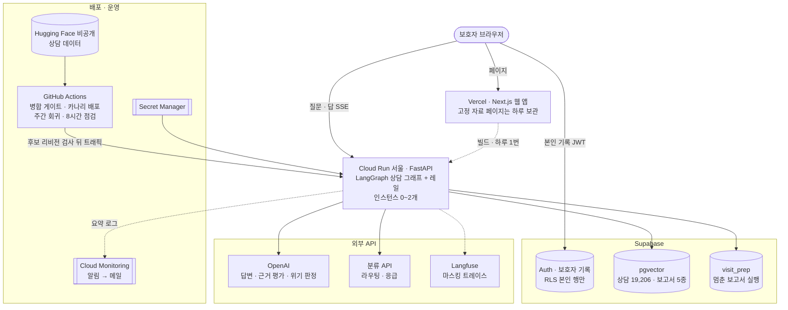
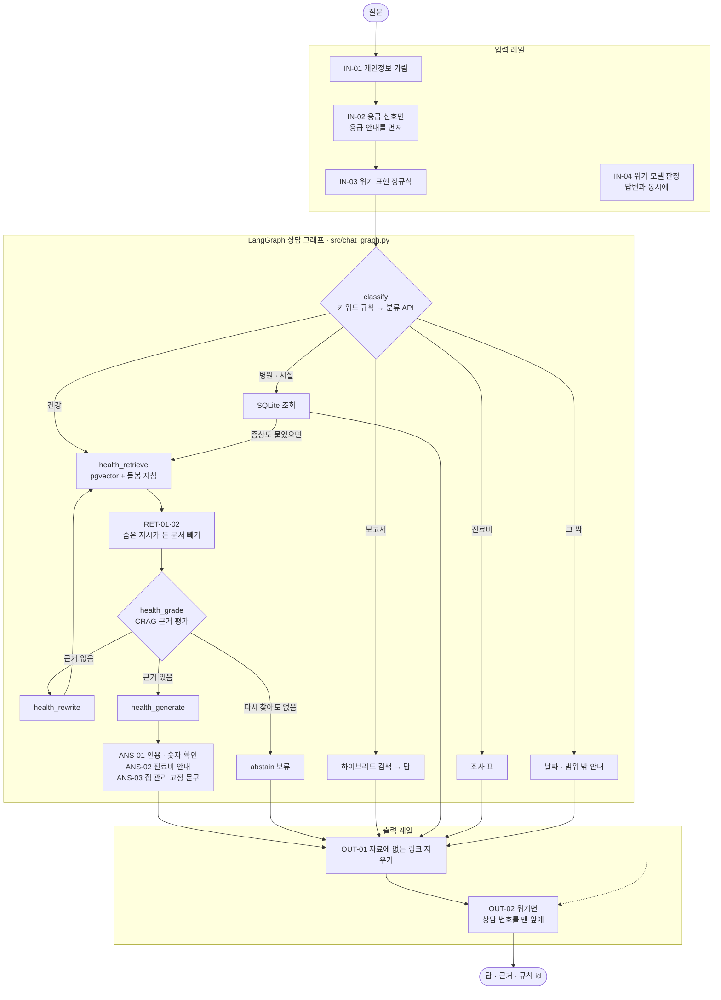
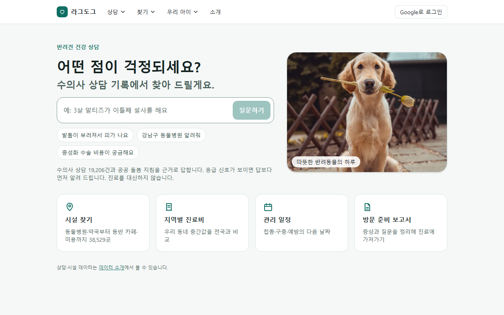
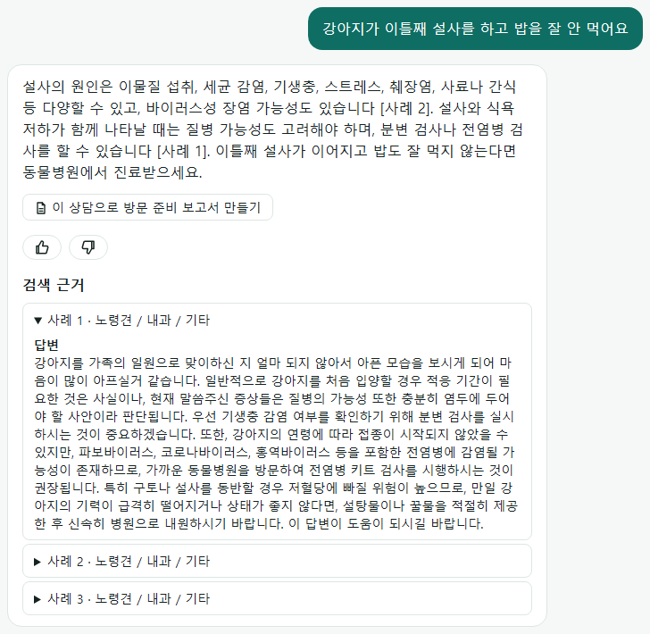
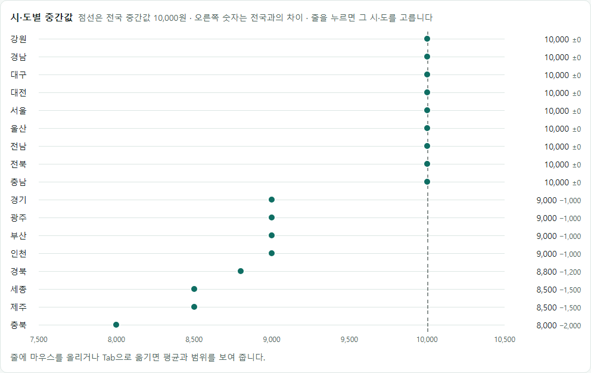
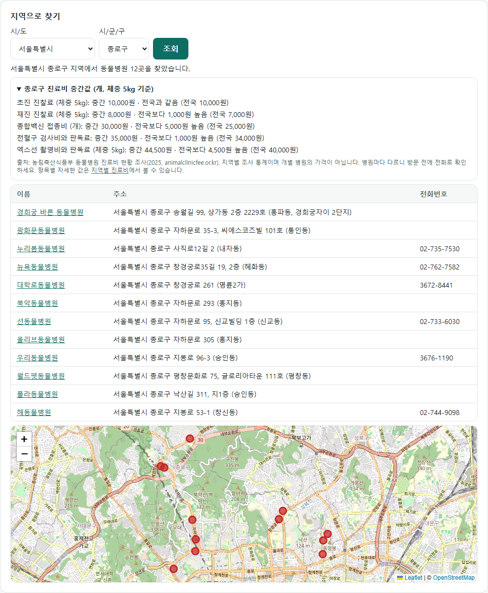
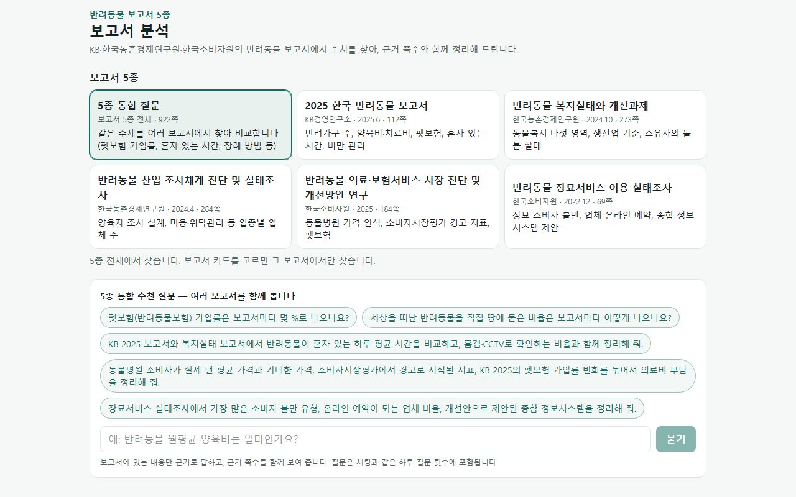
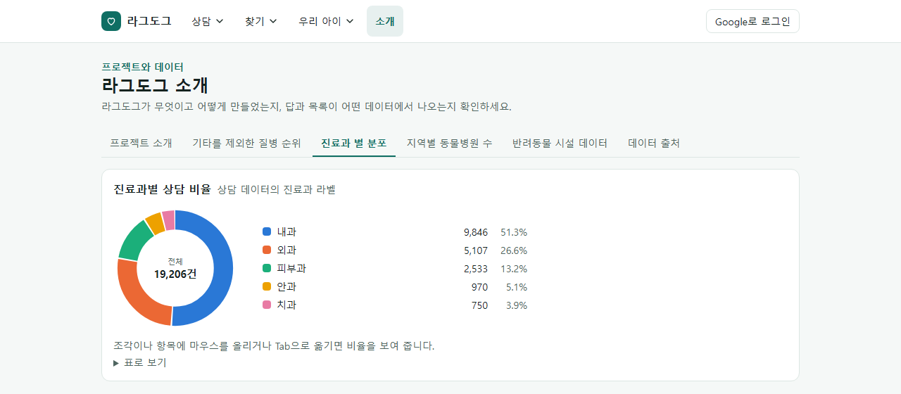

# 🐾 라그도그 (RagDog)

> 반려견 건강 상담, 반려동물 시설 찾기(38,529곳), 지역별 진료비, 반려동물 보고서 분석, 수의사 방문 준비 보고서, 예방·접종 관리 일정을 하나로 묶은 RAG 서비스입니다. **근거가 없으면 지어내지 않고 보류하고, 모든 개선은 같은 평가 세트로 전후를 재서 결정했습니다.**

- **웹 앱:** <https://ragdog-rndigkwks-projects.vercel.app> (Next.js, Vercel) · **API:** FastAPI on Google Cloud Run(서울) · 옛 Streamlit 화면은 2026-10-23부터 새 웹 앱 안내만 보여 줍니다(코드는 `app_pages/`에 남김)
- **문서:** [수동 배포·복구](docs/runbook-manual-deploy.md) · [개선 기록](docs/improvement-log.md) · [실험 wiki](docs/wiki/README.md) · [ADR 11개](docs/adr/README.md) · [보안 정리](docs/security/README.md) · [데이터 명세](docs/data-sources.md)
- 엔코아 AI 캠퍼스 4인 팀 프로젝트(2026-08)를 발표 뒤 **오현탁이 혼자 이어서**(2026-09~10, PR 300여 개) 측정하며 개선했습니다. 의료 판단이나 응급 처치를 대신하지 않습니다.

## 30초 요약

| | |
| --- | --- |
| **문제** | 보호자는 짧게 묻고("강아지 오줌 색이 달라졌어요"), 근거 자료(수의사 상담 19,206건)는 길다. 틀린 건강 정보는 해롭다 |
| **접근** | 질문 유형별 경로(LangGraph) → 하이브리드 검색 → 근거 평가(CRAG) → 근거가 없으면 보류. 응급 신호는 답보다 먼저 |
| **내가 한 일** | 평가 세트를 먼저 만들고, 원인을 숫자로 찾고, 고치고, 다시 쟀다. 효과가 없으면 넣지 않았다(리랭커, 큰 임베딩 모델 등) |
| **운영** | Next.js(Vercel) + FastAPI(Cloud Run) + Supabase(pgvector, Google 로그인, RLS). 답변을 바꾸는 PR은 실제 모델로 병합 게이트, 매주 회귀 평가·SLO 보고, 실패 시 이슈 자동 생성, API 롤백 워크플로 |

## 핵심 지표

모두 같은 평가 세트로 전후를 비교했습니다. 숫자의 근거는 [개선 기록](docs/improvement-log.md)과 [wiki](docs/wiki/README.md)에 있습니다.

| | 이전 | 이후 |
| --- | ---: | ---: |
| 건강 검색: 쓸모 있는 근거가 상위 3건에 있는 질문 (100문항) | 0.46 | **0.84** |
| 건강 검색, 짧은 질문 (120문항) — 임베딩 미세조정 | 0.600 | **0.783** (p=0.0001) |
| 보고서 답변: 기준 답과 맞음 (18문항 × 2회) — 하이브리드 검색 | 23/36 | **30/36** (p=0.016) |
| 근거 없는 질문 보류 / 답할 질문을 잘못 보류 (60문항) | 0/20 / – | **16/20 / 1/38** |
| 일상 관리 질문(발톱 주기·열사병 예방 등 30문항) 핵심을 답함 — 공공 돌봄 지침 추가 | 20/30 | **26/30** |
| 응급 신호 감지, 미리 써 둔 평가셋 (응급 20 / 비응급 20) | 1/20, 오탐 0 | **19/20, 오탐 0** |
| 방문 준비 보고서 검수 통과율 / 중앙 시간 (상담 12개) | 0.70 / 68초 | **1.00 / 49초** |
| 앱 최고 메모리 — 검색을 Supabase로 옮김 | 910MB | **442MB** (검색 품질 같음) |
| 위기 표현에 상담 번호 안내 — 다른 모델(Claude)이 새로 쓴 문항, 모델 판정 추가 | 0/5 | **5/5** (오탐 0/305) |
| 건강 답변 시간 p90 (40문항) — 답변 생성 추론 low, 사람 블라인드 판정으로 결정 | 18.5초 | **11.4초** |
| 건강 답변 중 병원·수의사 이야기 문장 (20문항) — 사용자 피드백, 병원 권고는 끝에 한 번 | 48% | **31%** (근거 없는 숫자 0 유지) |
| 보호자 질문 속 검사 수치를 주소로 잘못 가린 곳 (상담 자료 19,206건 스캔) | 16곳 | **0곳** (실제 주소는 그대로 가림) |
| 웹 앱 접근성 (Lighthouse 모바일, 9개 페이지) — 대비·흔들림 수정과 리디자인 | 95~100 | **모두 100** (채팅 흔들림 CLS 0.123 → 0.001) |

## 아키텍처

### 전체 구성



- **화면 / API 분리** ([ADR-0008](docs/adr/0008-nextjs-frontend-fastapi-backend.md)): 브라우저는 API를 직접 부르고 답을 SSE로 받습니다. 로그인 사용자의 기록은 브라우저가 사용자 JWT로 Supabase에 직접 읽고 쓰며, RLS가 본인 행만 허용합니다. API 계정(`ragdog_app`)은 사용자 표에 권한이 없습니다([최소 권한 점검](docs/security/least-privilege.md)).
- **배포:** 병합하면 이미지를 빌드해 트래픽 0%인 후보 리비전으로 올리고, health·표·날짜·건강 질문을 물어 통과해야 트래픽을 넘깁니다. 실패하면 이전 리비전이 계속 받고 이슈가 열립니다([수동 배포·복구](docs/runbook-manual-deploy.md)).

### API 안: 레일과 LangGraph



- **레일** ([`rails/rails.yml`](rails/rails.yml), [위협 표](docs/security/threat-model.md)): 교안의 NeMo Guardrails 레일 구조(입력·검색·출력·실행, 규칙 id)를 따르되 NeMo 라이브러리는 쓰지 않고 함수로 구현했습니다. NeMo·Prompt Guard·Llama Guard는 레드팀 68문항으로 비교했지만 앱이 놓친 공격을 막지 못하고 정당한 질문을 막아 넣지 않았습니다. 모델을 부르는 레일은 위기 판정(IN-04) 하나입니다. 그림 밖의 **실행 레일**은 모든 요청에 걸립니다: 질문 한도(EXE-01), 모델 요청마다 제한 시간과 재시도 1번(넘기면 검색 근거만 보여 줌, EXE-02), 방문 준비 에이전트는 역할마다 읽기 도구 하나(EXE-03).
- **LangGraph:** 경로마다 노드가 다르고, 건강 경로는 CRAG(근거 평가 → 검색어 다시 쓰기 → 보류)입니다. 신호가 하나뿐인 질문(약 85%)은 키워드 규칙으로, 나머지는 분류 API(약 0.3초)로 경로를 고릅니다. 시설과 진료비는 벡터 검색 대신 SQL·표 조회로 정확히 답합니다.
- **LangChain:** 모델 호출(`ChatOpenAI`, 근거 평가·위기 판정은 `with_structured_output`), 프롬프트(`ChatPromptTemplate`), 검색 문서(`Document`)에 씁니다. 하이브리드 검색(Dense + BM25, RRF)과 Supabase 저장소는 직접 구현했습니다.
- **방문 준비 보고서** (`team/`): 별도 LangGraph 멀티에이전트 팀입니다. 빠진 정보를 보호자에게 되묻고(`interrupt`), 증상·병원·비용을 `Send`로 병렬 조사하고, 문장마다 근거와 대조해 검수합니다. 멈춘 실행은 Supabase에 30분 두어 어느 인스턴스에서든 이어 갑니다. [팀 상세](docs/details.md#멀티에이전트-팀-상세)

## 문제를 숫자로 찾고 고친 사례

| # | 발견 | 측정 → 결정 | 결과 |
| --- | --- | --- | --- |
| 1 | 질문에서 추론한 나이·진료과 **필터가 검색을 망쳤다** | 필터가 기대는 라벨이 본문과 34%·59%만 일치 → 필터 제거 | 적중률 0.141 → 0.264 ([실험 8·9](docs/wiki/retrieval-experiments.md)) |
| 2 | 보고서 답변의 병목은 생성이 아니라 **검색** | Parent-Child·문맥 압축은 효과 없음 → 하이브리드 검색 | 정답 23 → 30/36 ([실험 10·12·13](docs/wiki/retrieval-experiments.md)) |
| 3 | 사용자 질문은 짧은데 **임베딩은 긴 글에 맞춰져** 있었다 | 상담마다 보호자 말투 질의 2개를 LLM으로 생성($3.37) → Colab T4 미세조정 → ONNX int8 | 짧은 질문 0.600 → 0.783 ([기록](docs/wiki/embedding-finetune.md)) |
| 4 | 보고서 오답의 원인은 검색이 아니라 **PDF에서 사라진 숫자** | KB 보고서는 숫자를 전용 글꼴로 넣어 112쪽 중 91쪽에서 숫자가 빠짐 → OCR 조각 추가 | "펫보험 가입률" 오답 → 정답 ([기록](docs/wiki/retrieval-experiments.md)) |
| 5 | 로컬에서 맞은 검색 수정이 **운영에서 틀렸다** | 로컬(Kiwi BM25)과 운영(PGroonga)의 순위가 다름 → 보고서별로 주제어로 찾고, 운영 검색으로 다시 잼. 뒤에 운영 키워드 검색을 메모리 안 BM25로 옮겨 차이를 없앰 | 두 보고서 질문 부분 정답 → 3/3 정답 ([기록](docs/wiki/retrieval-experiments.md)) |
| 6 | 에이전트 팀이 **얻을 수 없는 정보를 계속 요청** | 재조사를 한 번으로 제한하고, 같은 지적이 반복되면 사람 확인으로 | 검수 통과 0.70 → 1.00 ([기록](docs/wiki/visit-prep-team.md)) |
| 7 | 응급 판단 **오탐을 실제 질문 분포로** 쟀다 | "응급/아님" 2택은 32.5%에 경고 → "지금 응급/곧 진료/아님" 3택 | 경고 9%, 응급 19/20 ([기록](docs/wiki/safety-and-evidence.md)) |
| 8 | 자체 보안 점검에서 **질문 한도 우회 2건** | User-Agent 위조, `X-Forwarded-For` 위조로 한도 무력화 → 비밀 헤더, 오른쪽 프록시 값 사용 | 배포 뒤 같은 공격으로 막힌 것 확인 ([보안](docs/security/README.md)) |
| 9 | "심장사상충 약 얼마나 자주?" 같은 **일상 관리 질문의 1/4을 못 답했다** | 원인은 검색 순위가 아니라 자료 구성(증상 상담 위주) → 공공기관 지침 5종을 이용 조건을 따져 추가, 이미지 PDF는 모델로 옮겨 적고 원본과 대조 | 30문항 핵심 답함 20 → 26, 지침 질문 15/16 ([기록](docs/wiki/data.md#돌봄-지침-2026-10-19)) |
| 10 | 평가에 쓴 비용 때문에 **운영 챗봇이 멈췄다** (OpenAI 사용 한도) | 평가와 운영이 같은 키를 씀 → 한도 오류만 골라 모델 없이 도는 검색 결과와 안내를 보여 줌, 키 분리 절차, 데이터 변경도 병합 게이트에 | 장애 중에도 상담 사례·지침이 보임 ([SLO](docs/slo.md#모델-한도-소진-2026-10-19)) |

## 측정했지만 넣지 않은 것 (트레이드오프)

| 후보 | 측정 | 넣지 않은 이유 |
| --- | --- | --- |
| Cross-Encoder 리랭커 | 가장 나은 모델도 useful@3 +4%p, 질문당 +8초 | 지연 대비 이득이 작다 ([ADR-0005](docs/adr/0005-no-reranker.md)) |
| 큰 임베딩(KURE-v1) 미세조정 | 하이브리드 0.805 vs 앱 0.809(p=1.0), MLflow에 기록 | 정확도가 같고 질문 임베딩이 8배 느리다 ([기록](docs/wiki/embedding-finetune.md)) |
| 챗봇 답변 Self-RAG 검수 | 충실도 0.927 → 0.941(판정 흔들림 범위 안) | 응답 시간 8.5 → 16.1초 |
| RAG-Fusion | 보고서 정답 23/36 그대로 | 검색 +2.8초, 같은 문서를 다시 찾음 |
| Mem0식 자동 기억 | 설계 비교 | 질문마다 호출이 늘고 서버가 건강 기록을 모은다 → 보호자가 고른 노트만 ([ADR-0009](docs/adr/0009-consultation-memory.md)) |
| Cloud Run us-central1 | 답변 완료 8.6초(서울) vs 9.4초 | 서울 유지 ([ADR-0006](docs/adr/0006-cloud-run-region-seoul.md)) |
| Cohere 리랭킹 API | useful@3 0.80 vs 지금 0.84 | 나아지지 않고 외부 호출이 늘어난다 ([기록](docs/wiki/retrieval-experiments.md)) |
| 지침 문맥 700 → 500자 | 지침 문항 토큰 약 6% 절약 | 긴 안내(재난 키트 목록)가 잘린다. 운영 사용 비율을 본 뒤 다시 정한다 |

## 평가와 운영

- **평가 세트를 먼저 쓴다.** 고치기 전에 질문과 기대 답을 쓰고, 규칙을 다듬은 세트(dev)와 미리 써 둔 세트(holdout)를 나눠 잰다. 두 방식은 같은 질문끼리 McNemar 검정으로 비교한다.
- **판사(LLM)도 검증한다.** 같은 답 두 번 판정 일치율(86.5%, κ 0.79), 자리 바꾸기·길이 편향, 사람 라벨 대조를 기록한다([기록](docs/wiki/judge-validation.md)). 판사가 만점이어도 답을 직접 읽는다(노트 날짜 오판을 판사가 놓친 사례가 있었다).
- **CI 게이트:** PR마다 테스트(Python 610, vitest 59, Playwright 84)를 돌린다. 답변 경로(라우터·검색·프롬프트·데이터 버전)가 바뀐 PR은 실제 모델로 CRAG 60문항·경로 41문항을 돌리고 네 조건(완전성, 절대 하한, 기준선 대비 하한, 안정 문항 회귀)을 통과해야 병합된다. 실패한 안정 문항은 두 번 더 물어 흔들림과 회귀를 가른다.
- **운영:** 매주 회귀 평가와 SLO 보고(오류율, p95 지연, 보류율, 질문당 비용)를 돌리고, 실패하면 GitHub 이슈가 열린다. 배포 뒤 릴리스 점검 6항목, 문제가 있으면 롤백 워크플로로 이전 리비전에 되돌린다.
- **비용 관리:** 평가 전에 모델 호출 수를 세고, 하루 200번을 넘으면 멈춘다(`scripts/cost_guard.py`). 질문 한도는 계정·브라우저·네트워크별로 센다.
- **관측:** Langfuse 트레이스(사용자 문장은 길이만 남김), 배포 앱 점검(병합 직후와 8시간마다).

## 보안과 개인정보

- Google 로그인(PKCE)만 쓰고, API는 JWKS로 토큰을 검증한다(위조 토큰 7종 거부). service_role 키를 두지 않고, 계정 삭제는 본인만 지우는 DB 함수로 한다.
- 사용자 표 3개(대화, 반려견 정보, 상담 노트)는 RLS로 본인만 접근하고, 공개 키와 API 계정은 접근할 수 없다. 권한 검사 41개를 실제 DB에서 롤백 트랜잭션으로 돌린다.
- 모델에 보내기 전 개인정보를 가리고, 멈춘 상담은 30분, 피드백은 3년 뒤 지운다. 전체: [보안 정리](docs/security/README.md)

## 데모

| 질문 예시 | 동작 |
| --- | --- |
| 강아지가 이틀째 설사를 해요 | 유사 상담 사례를 근거로 답하고 근거 목록을 보여 줌 |
| 햄스터가 해바라기 씨를 먹어도 되나요? | 강아지 자료에 근거가 없어 **보류**하고, 찾아본 것·없던 것·다시 묻는 법을 안내 |
| 설사가 이틀째인데 마포구 동물병원 어디 있어? | 병원 목록을 먼저(0.4초) 보여 주고, 아래에 증상 안내 |
| 입술 색이 거무스름하게 변하고 숨을 몰아쉬어요 | 답변 전에 응급 경고와 가까운 동물병원 |
| 강아지 발톱은 얼마 만에 깎아 줘야 해요? | 공공 지침을 인용("동물사랑배움터 「…윤리 가이드라인」에 따르면 2~3주")하고 근거에 쪽·원문 링크 |
| 강남구 엑스레이 얼마야? | 2025 진료비 조사의 중간·평균·범위(모델 없이 표 그대로). 웹의 진료비 탭은 시·도 그래프와 시·군·구 표 |
| KB 2025와 2024 복지실태 보고서에서 혼자 있는 하루 평균 시간은? | 보고서마다 근거를 찾아 쪽수와 함께(5시간 54분 42쪽, 5.1시간 170쪽) |
| (건강 답변 아래) 이 상담으로 방문 준비 보고서 만들기 | 빠진 정보를 되묻고, 증상·병원·비용을 병렬 조사해 근거 번호가 달린 보고서(Word·txt 저장, 인쇄·PDF). 고른 지난 상담 노트를 넣을 수 있고, 멈추면 끝낸 단계부터 이어 만듦 |
| 관리 일정 탭 | 마지막 접종·구충·발톱 손질 날짜를 넣으면 지침 주기로 다음 날짜와 "지났어요/지금 할 때" 표시(모델 없음) |

| 홈: 질문부터 | 건강 상담: 인용 번호와 검색 근거 |
| --- | --- |
|  |  |
| **지역별 진료비: 시·도 중간값과 전국** | **시설 찾기: 지역 진료비와 지도** |
|  |  |
| **보고서 분석: 5종 통합 질문과 보고서별 추천 질문** | **소개: 프로젝트·데이터·출처 탭, 진료과 비율** |
|  |  |

화면은 2026-10-24 운영 웹 앱(Next.js)입니다(보고서·소개는 2026-10-26). 휴대폰 화면: [홈](docs/images/web_mobile_home.png)

더 많은 화면: [데모 상세](docs/details.md#데모-상세)

## 기술 스택

- **LLM·RAG:** LangGraph, LangChain, OpenAI(`gpt-6-luna`, `text-embedding-3-small`), ko-sroberta 미세조정(ONNX int8), Kiwi + BM25, RRF
- **백엔드:** FastAPI(SSE), SQLite, Supabase(Postgres, pgvector halfvec, Auth, RLS), LangGraph Postgres 체크포인터
- **프론트엔드:** Next.js 15, React 19, TypeScript, Tailwind CSS, Leaflet
- **인프라·MLOps:** Docker, Google Cloud Run(Artifact Registry, Secret Manager, Workload Identity), Vercel, GitHub Actions, Langfuse, MLflow(DagsHub), Colab T4

## 한계와 다음 단계

- **사람 검수 부족:** 주 지표는 LLM 판정이고, 응급 평가셋과 답변은 수의사 검토를 받지 않았다.
- **작은 평가 세트:** 18~120문항이라 한 번 돌릴 때 ±2문항 흔들린다. 그래서 차이가 작은 기법은 넣지 않았다.
- **데이터:** 시설은 인허가 기준이라 영업 여부·시간을 모르고, 원본에 전화번호가 없는 곳이 많다(동물병원 44%, 약국 55%, 미용 72%, 위탁 75%; 목록에는 "없음"으로 표시, 지역번호가 빠진 421곳은 주소의 시·도 번호를 붙임), 건강 자료는 강아지 상담뿐이다. KB 보고서 OCR에는 오인식이 남아 근거에 "스캔 글(OCR)"로 표시한다. 공공 돌봄 지침 중 4종은 공공누리 표시가 없어 원문을 비공개 데이터에만 두고 짧은 인용·출처·원문 링크로만 쓴다(1종은 공공누리 제1유형이라 저장소에 둠).
- **외부 모델 의존:** 답변 생성과 보고서 검색은 OpenAI에 기댄다. 한도가 떨어지면 건강 검색 결과만 보여 주는 수준으로 낮아진다.
- 전체: [미해결 과제](docs/wiki/open-questions.md), [한계와 다음 단계](docs/details.md#한계와-다음-단계)

## 실행 방법

AI Hub 데이터는 재배포할 수 없어 저장소에 없습니다. 앱은 비공개 데이터셋에서 `HF_TOKEN`으로 받습니다(`src/private_data.py`). 데이터 없이도 단위 테스트는 돌고, 데이터가 필요한 테스트는 건너뜁니다.

```bash
uv sync
```

```bash
uv run uvicorn api.main:app --port 8000
```

```bash
npm --prefix web install
```

```bash
npm --prefix web run dev
```

```bash
uv run python -m unittest discover -s tests
```

- 웹은 `NEXT_PUBLIC_RAGDOG_API_URL=http://localhost:8000`으로 로컬 API를 씁니다. 키는 `.env`(OpenAI, Supabase)에 두고 Git에 올리지 않습니다.
- Streamlit 화면: `uv run streamlit run main.py`는 새 주소 안내만 띄웁니다. 전체 화면은 `STREAMLIT_FULL_APP=1`을 함께 줍니다. 컨테이너: [Docker·배포 설계](docs/docker-deployment.md)
- 평가 스크립트(`scripts/evaluate_*.py`)는 실제 모델을 불러 비용이 듭니다.

<details>
<summary>프로젝트 구조</summary>

```text
.
├── web/                    # Next.js 화면: 질병 문의, 시설 찾기, 진료비, 방문 준비, 관리 일정, 보고서 분석, 기억
├── api/                    # FastAPI: /chat(SSE), /visit-prep, /places, /fees, /memory, /stats
├── src/
│   ├── chat_graph.py       # LangGraph 챗봇: 라우팅, CRAG, 복합 질문, 보류
│   ├── tools/              # 그래프의 도구: router, health, report, places, fees, history, urgency, notes …
│   ├── hybrid_retrieval.py # BM25 색인, RRF
│   ├── supabase_store.py   # pgvector 검색, 장애 시 로컬 대체
│   ├── model_outage.py     # 모델 한도 소진 시 검색 결과만 보여 주기
│   ├── visit_prep_store.py # 멈춘 방문 준비 실행(Postgres 체크포인터)
│   ├── auth.py · rate_limit.py · pii.py · tracing.py
│   └── storage/            # 대화·반려견 정보 모델
├── team/                   # 멀티에이전트 팀: core → tools → agents → graph → main
├── app_pages/ · main.py    # Streamlit 화면(지금은 안내만, STREAMLIT_FULL_APP=1이면 전체)
├── scripts/                # 평가, 실험, 회귀 판정, 릴리스 점검, SLO, 돌봄 지침 빌드, OCR, MLflow, sql/(RLS와 테스트)
├── tests/                  # 단위·회귀 테스트, 평가 문항(tests/data/)
├── .github/workflows/      # 테스트, PR 품질 검사, 주간 회귀, 배포 점검, Cloud Run 배포
└── docs/                   # ADR, wiki, 보안, 개선 기록, 데이터 명세
```

</details>

## 팀과 역할

**팀 프로젝트 (2026-08, 4인):** 백관민(팀장, RAG·검색·평가) · 오현탁(RAG·검색·평가) · 봉기람(데이터 수집·전처리·EDA) · 차성종(Streamlit UI·시각화·배포)

**발표 이후 (2026-09~10, 오현탁):** 이 저장소의 측정, 개선, Next.js·FastAPI 전환, 로그인·보안, 운영 자동화 전부입니다. 수업 과제용 정리는 [docs/course-assignment.md](docs/course-assignment.md)로 옮겼습니다. 발표 당시: [앱](https://mle-01-p1-team2-f5fqyncuwejycn4hyrp64b.streamlit.app/rag) · [발표 자료](docs/presentation/RAG-DOG_발표.pdf) · [노션](https://app.notion.com/p/3b5fceb573c380ea8488c7936f77f6d5)

### 작업 방식과 AI 도구

발표 이후 작업은 AI 코딩 도구(Claude Code)와 함께 했습니다. 어디까지가 도구의 몫이고 어디까지가 제 판단인지 나눠 적습니다.

- **도구가 한 일:** 코드와 테스트, 문서 초안, 커밋 메시지와 PR 설명 대부분을 작성했습니다. 커밋 문체가 고른 것은 그 때문입니다.
- **제가 정한 일:**
  - 무엇을 고칠지: 배포한 앱을 직접 써 보며 문제를 찾았습니다.
  - 일하는 규칙: 고치기 전에 평가 세트를 먼저 쓰고, 병합 조건과 평가 비용 한도를 정했습니다.
  - 채택과 기각: 측정 결과를 보고 넣을지 말지 정했습니다.
  - 공공 자료의 이용 조건 판단과 운영 변경(DB 적용, 데이터 업로드, 키 관리)도 제가 했습니다.
  - 도구의 권고를 거절한 결정도 남겼습니다([ADR-0004](docs/adr/0004-no-shared-db.md)).
- **도구가 쓴 코드를 그대로 믿지 않으려고 둔 장치:**
  - 코드보다 먼저 쓴 평가 세트(dev/holdout)
  - 실제 모델로 도는 병합 게이트
  - 테스트 약 700개
  - 병합 뒤 운영 앱 직접 확인
- 면접에서는 위 결정의 이유와 핵심 모듈(`src/chat_graph.py`, `src/crag.py`, `scripts/check_regression.py`)을 코드 없이 설명할 수 있도록 준비했습니다.

AI Hub 「반려견 성장 및 질병관련 말뭉치 데이터」(과학기술정보통신부·한국지능정보사회진흥원 사업 결과)를 활용했습니다. 돌봄 지침은 농림수산식품교육문화정보원 동물사랑배움터 교육자료와 농림축산식품부 보도자료(공공누리 제1유형)에서 출처를 밝혀 인용합니다.
