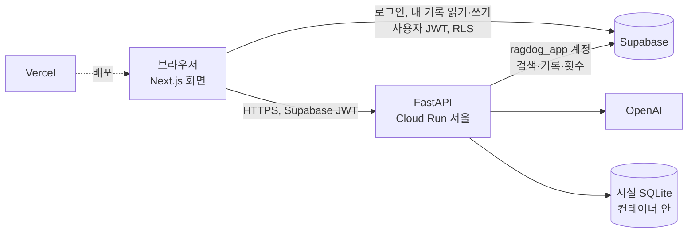

# ADR-0008: 화면을 Next.js로, 앱 로직을 FastAPI로 나누고, 로그인은 Supabase Auth + RLS로

- **상태:** 제안 (2026-10-15). 화면을 Next.js로 옮기는 것은 소유자가 정했다("포트폴리오 가치", 수업 요건 없음). 아래 구조와 단계는 이 문서의 제안이다. 아래 "정할 것"에 답이 오면 채택한다.
- **이전 기록:** 마지막 Streamlit 버전은 `streamlit-backup` 브랜치(보호됨)와 `streamlit-final` 태그(337b3df)에 고정했다. 그 버전은 Streamlit Cloud 백업 앱에서 자체 Chroma 검색으로 돈다([docker-deployment.md](../docker-deployment.md)).

## 맥락

**지금 구조:** Streamlit 한 프로세스가 화면과 앱 로직을 모두 맡는다. Cloud Run에 하나, 백업으로 Streamlit Cloud에 하나 있다.
- 화면 코드는 Streamlit 전용이다. 페이지 6개, 사이드바, 브라우저 저장소·위치 부품, 약 2,600줄이다.
- 화면 테스트도 Streamlit AppTest로 되어 있다.
- 앱 로직은 `src/`에 있고 Streamlit에 묶여 있지 않다. LangGraph 챗봇, 검색, 시설 DB, 방문 준비 팀, 안전 규칙, 개인정보 가림, 질문 횟수 제한이 여기 있다. 평가 스크립트와 CI도 이 함수를 직접 부른다.

**옮기는 이유:**
1. **로그인과 서버 장기 기억.** 사용자별 기록을 DB가 직접 지키게 하려면 사용자 신원이 DB까지 가야 한다(Supabase Auth의 `auth.uid()`와 행 단위 정책).
   - 지금은 앱이 하나의 계정으로 접속한다. 그래서 사용자 구분을 앱 코드만 지킨다. 조회 하나가 사용자 조건을 빠뜨리면 남의 기록이 보인다.
   - Streamlit의 `st.login`(Google)은 Supabase Auth와 맞물리지 않는다.
2. **화면 제어.** 모바일, 스트리밍, 상태 관리를 마음대로 하기 어렵다.
   - Streamlit은 위젯을 바꿀 때마다 스크립트 전체를 다시 실행한다.
   - 배포 뒤 예전 모듈이 남는 문제가 세 번 있었다(ImportError, AttributeError).
3. **포트폴리오 가치** (소유자 결정).

**지켜야 할 것:**
- 답변 품질은 그대로여야 한다. 지금 평가 세트와 주간 회귀가 기준이다.
- 비용: 무료 한도 안(Supabase 500MB, Langfuse, Cloud Run 무료 사용량), 질문 횟수 제한 유지.
- 안전 장치 유지: 응급 안내가 먼저, 개인정보 가림, 근거 없으면 보류, 공개 API 차단, 앱 전용 DB 계정.

## 결정 (제안)

### 1. 구성

| 부분 | 선택 | 이유 |
| --- | --- | --- |
| 화면 | **Next.js(App Router, TypeScript)를 Vercel에 배포** | PR마다 미리보기 주소가 생긴다. 무료 플랜. Next.js 기본 배포처 |
| 앱 로직 | **FastAPI가 `src/`를 그대로 감싼다. Cloud Run 서울(ADR-0006)** | 파이썬 로직, 평가, 데이터 파이프라인을 다시 짜지 않는다. 지금 Docker 이미지와 배포 흐름을 그대로 쓴다 |
| 답변 스트리밍 | **POST + Server-Sent Events 형식 응답**(`fetch`로 읽음) | 질문이 길고 대화 이력과 프로필을 함께 보내야 해서 GET 기반 `EventSource`는 맞지 않는다. 이벤트 종류: `step`(진행 단계), `token`(답변 글자), `urgent`(응급 안내, 답보다 먼저), `result`(경로·근거·trace id), `error` |
| 로그인 | **Supabase Auth(Google)** | 브라우저와 API가 같은 JWT를 쓴다. DB 정책이 `auth.uid()`로 사용자별 접근을 막는다 |
| 사용자 기록 | **화면이 사용자 JWT로 Supabase에 직접 읽고 쓴다. 표마다 `user_id = auth.uid()` 정책** | 앱 로직(API)은 사용자 기록 표를 아예 만지지 않는다. API 코드 버그로 남의 기록이 샐 길이 없다 |
| 검색 표 | 지금처럼 `ragdog_app`만 읽는다. 공개 API는 계속 막는다 | ADR-0007, 앱 전용 계정(2026-10-15) |
| 비로그인 사용자 | 지금처럼 **브라우저에만 저장**. 로그인하면 "이 기기의 기록을 계정으로 옮길까요?"를 묻는다 | 로그인은 선택이다. 서버 저장은 동의한 사람만 |
| 브라우저가 API를 부르는 방식 | **브라우저에서 API로 직접**(CORS: Vercel 주소만 허용) | Vercel 함수를 거치면 스트리밍 시간 제한과 비용이 붙는다 |

### 2. API (첫 판)
| 경로 | 하는 일 | 지금의 대응 |
| --- | --- | --- |
| `POST /chat` (스트림) | 질문, 대화 이력(최근 6턴 + 요약), 반려견 프로필, 위치(선택) → 답변 | `chatbot()` + `on_token`/`on_step`, 응급 규칙, 질문 횟수 제한 |
| `POST /memory/suggest` | 질문 + 지금 프로필 → 기억할 새 사실 | `profile.suggest_memory` |
| `POST /feedback` | 👎 이유, 동의한 대화 저장 | `tracing.record_feedback*`, `feedback_store` |
| `GET /places` | 지역·종류·좌표로 시설 검색 | `app_pages/hospital.py`의 SQLite 조회, `places.emergency_hospitals` |
| `GET /stats/*` | 데이터 소개 차트 수치 | `app_pages/data.py`, `src/data_charts.py` |
| `POST /visit-prep` → `GET /visit-prep/{id}` | 방문 준비 보고서(1~2분, 모델 호출 10~20회)를 작업으로 시작하고, 진행과 결과를 받는다 | `run_team`, 세션당 3번 제한 |
| `GET /health` | 배포 확인 | keep-alive |

- **질문 횟수 제한:** 로그인했으면 계정 ID로, 아니면 브라우저 ID(헤더)로 센다. 같은 IP 상한도 그대로 둔다(`src/rate_limit.py`).
- **개인정보 가림과 응급 규칙**은 API 안에서 지금처럼 모델 호출 전에 한다. 화면은 규칙을 갖지 않는다.

### 3. 같은 결과인지 확인 (이전하는 동안 답변 로직은 바꾸지 않는다)
- **API 계약 테스트:** `/chat`이 `chatbot()`과 같은 경로·보류 여부·근거 ID를 내는지 본다. 모델은 가짜로 바꿔 끼운다(호출 0).
- **실제 모델로 확인:** CRAG 60 + 라우팅 36을 **API를 거쳐** 한 번 돌린다. 지금 주간 회귀 기준을 넘는지 본다. 모델 호출 약 250번이고, 비용 미리 보기(`scripts/cost_guard.py`)로 확인을 받은 뒤 돌린다.
- **화면 확인:** Playwright로 페이지별 동작을 본다. 질문 → 스트리밍 답 → 근거 → 👎 → 기억 제안. 지금의 AppTest 화면 테스트를 이것으로 옮긴다.
- **배포 확인:** keep-alive를 새 화면 주소로 바꾼다. 커밋 일치, 날짜·건강 질문을 그대로 확인한다.

### 4. 단계
| 단계 | 내용 | 끝났다고 보는 기준 |
| --- | --- | --- |
| **P1 API** | `api/`(FastAPI)를 같은 저장소에 둔다. `ragdog-api`라는 별도 Cloud Run 서비스로 배포한다. Streamlit 서비스는 그대로 둔다 | 계약 테스트 통과, API로 돌린 CRAG·라우팅이 주간 기준 이상, 스트리밍 첫 글자 지연이 지금 수준 |
| **P2 질병 문의 화면** | `web/`(Next.js)에서 채팅, 스트리밍, 근거, 응급 안내, 👎, 기억 제안, 대화 기록(브라우저 저장)을 만든다. Vercel 미리보기 배포 | Playwright 흐름 통과, 모바일 폭 확인 |
| **P3 나머지 화면** | 홈, 데이터 소개(차트), 시설 찾기(위치·지도), 방문 준비 보고서 | 페이지별 흐름 통과 |
| **P4 로그인** | Supabase Auth(Google), 사용자 기록 표와 정책, 기기 기록을 계정으로 옮기기, 내 기록 보기·모두 지우기, 개인정보 안내 | 다른 사용자 JWT로 기록을 읽으면 0행인 테스트, 로그아웃·공용 PC 확인 |
| **P5 전환** | keep-alive와 문서를 새 주소로 바꾸고, Cloud Run의 Streamlit 서비스를 내린다(백업은 Streamlit Cloud에 그대로). `app_pages/`·Streamlit 화면 코드 삭제 | 새 주소로 일주일 운영, 주간 회귀 통과 |

- P1~P3 동안 Cloud Run의 Streamlit 서비스는 지금처럼 주 배포로 남는다. 사용자는 바뀌는 걸 모른다.
- **PR은 단계 안에서도 작게 나눈다**(한 PR = 한 작업). 예: P1을 "API 뼈대와 /health", "/chat 스트림", "/places·/stats", "/visit-prep", "Cloud Run 배포"로 나눈다.

## 정할 것 (소유자)
1. **화면 배포처:** Vercel(추천) 또는 Cloud Run 하나로 통일. Vercel 무료 플랜은 비상업용이다. 상업용으로 바꾸면 유료 플랜이나 Cloud Run으로 옮긴다.
2. **API 냉시동:** Cloud Run을 0개까지 줄이면 첫 질문이 15~27초다(keep-alive 기록). 최소 1개를 켜 두면 사라지지만 상시 비용이 든다. 처음에는 0개(지금처럼)를 제안한다.
3. **로그인 범위(P4):** Google만인지, 이메일 로그인도 넣을지. 처음에는 Google만 제안한다.
4. **저장소 구조:** 같은 저장소에 `web/`과 `api/`(추천: 평가·CI·문서가 한곳에 남음), 또는 화면 저장소 분리.

## 결과

**좋아지는 것**
- 사용자 기록을 DB가 직접 지킨다. 앱 코드 버그가 있어도 남의 기록이 읽히지 않는다.
- 화면과 앱 로직을 따로 배포하고 따로 테스트한다. Streamlit 재실행 모델과 예전 모듈 문제가 사라진다.
- 같은 API를 나중에 앱이나 다른 화면이 재사용할 수 있다.

**나빠지는 것**
- 배포가 둘(Vercel + Cloud Run)이 되고, 둘 사이 인증(JWT 검증)과 CORS를 관리해야 한다.
- 화면 코드를 새로 쓰는 몇 주 동안 Streamlit과 두 벌을 유지한다.
- TypeScript, Next.js 의존성과 화면 테스트 도구가 늘어난다.

**다시 검토할 조건**
- P1의 API로 돌린 품질이 주간 기준 아래면 원인을 찾을 때까지 P2로 가지 않는다.
- Vercel 무료 플랜 조건이 바뀌거나 상업적으로 쓰게 되면 화면 배포처를 다시 정한다.
- 로그인 사용자가 거의 없으면 P4(서버 기록)를 미루고, "기억 내보내기·가져오기"로 대신한다.
- 이전이 실패하면 `streamlit-final`로 돌아간다. Streamlit Cloud 백업 앱과 보호 브랜치가 그 대비다.

## 구현하며 바꾼 것 (P1, 2026-10-15)
- **방문 준비 보고서:** "작업 시작 + 진행 조회(폴링)" 대신 `/chat`처럼 **요청 하나를 스트리밍**한다(`POST /visit-prep`).
  - 보호자에게 물을 질문이 생기면 `paused`로 끝나고, `POST /visit-prep/{id}/answer`로 이어 만든다.
  - 작업 저장소가 필요 없어 더 단순하다.
  - 멈춘 실행은 서버 메모리에만 있으므로, **API 서비스는 인스턴스 1개(`max-instances=1`)로 운영한다.**
- **기억 제안:** 별도 `/memory/suggest` 대신 `/chat`의 결과 뒤에 `memory` 이벤트로 보낸다(화면이 `suggest_memory`로 요청할 때만).
  - 답변 뒤라는 시점이 지금 화면과 같고, 답을 늦추지 않는다.
  - 따로 부를 수 있는 경로가 없어, 그 경로만 반복 호출해 모델을 쓰게 하는 길도 없다.
- **피드백:** `POST /feedback`(👍/👎), `/feedback/reason`(이유), `/feedback/review`(동의한 대화 저장). 모델은 부르지 않지만 Langfuse·Supabase에 쓰므로 브라우저당 시간당 60번으로 막는다.
- **화면 코드에서 옮긴 것:** 진행 문구·응급 병원(`src/chat_events.py`), 시설 조회(`src/places_search.py`), 데이터 수치(`src/data_stats.py`), 방문 준비 실행(`src/visit_prep_runs.py`). Streamlit 화면도 이것을 써서 두 화면의 결과가 같다.

## P1 품질 확인 (2026-10-15)
배포된 `ragdog-api`(커밋 141a11a, Supabase 검색)에 `/chat`으로 CRAG 60문항과 시설 라우팅 36문항을 물었다(`scripts/evaluate_api.py`).

| 세트 | 지표 | 배포 API | 주간 기준 | 로컬 병합 시 |
| --- | --- | ---: | --- | ---: |
| CRAG | accuracy | 0.867 | ≥ 0.85 | 0.900 |
| CRAG | over_abstain | 0.000 | ≤ 0.10 | 0.026 |
| CRAG | missed_abstain | 0.364 (8/22) | ≤ 0.35 | 0.227 (5/22) |
| CRAG | latency_p90_s (네트워크 포함) | 11.6 | ≤ 25 | 12.6 |
| 라우팅 | route_accuracy / kind_accuracy | 1.000 / 1.000 | ≥ 0.94 / 1.0 | 1.000 / 1.000 |

- missed_abstain이 한 문항 차이로 기준을 넘었다. 원인을 갈랐다.
  - 보류할 22문항을 로컬에서 같은 Supabase 검색으로 돌리면 5/22(u02·u04·u06·u16·r19)로, 로컬 Chroma 실행들(4~5/22)과 같다. 검색 백엔드 탓이 아니다.
  - 이번에 새로 놓친 u01·u08·u16·u20을 API로 다시 물으면 u01·u08·u20은 보류했고, u16만 다시 답했다(로컬에서도 놓치는 문항).
  - 따라서 근거 평가가 실행마다 달라지는 잡음이다. API 코드는 같은 `chatbot()`을 같은 설정으로 부른다.
- 다시 검토할 조건("API 품질이 주간 기준 아래면 P2로 가지 않는다")은 해당하지 않는다고 보고 P2로 간다.
- 차이: API는 CRAG decision을 돌려주지 않아 partial을 answer로 센다(지표는 같다). 개수만 답한 시설 질문 8개는 장소 목록이 없어 kind를 채점하지 않았다.

## 구현하며 바꾼 것 (P2·P3, 2026-10-16)
- **화면 주소:** Vercel 프로젝트 `ragdog`(루트 `web/`)입니다.
  - 정식 주소: https://ragdog-rndigkwks-projects.vercel.app (공개)
  - 미리보기: PR마다 생기고 Vercel 로그인이 필요합니다.
- **화면 목록:** `/` 홈, `/data`, `/chat`, `/places`, `/visit-prep`. Streamlit의 다섯 화면을 모두 옮겼습니다.
- **CORS:** 저장소 변수 `RAGDOG_WEB_ORIGINS`(정식 주소 + `http://localhost:3000`)와 `RAGDOG_WEB_ORIGIN_REGEX`(미리보기)로 정합니다.
  - 변수를 정하면 기본값 localhost를 대신하므로, localhost를 함께 적습니다.
- **Next.js 15.5.28 / React 19.1.10:** Vercel이 15.5.4의 보안 권고(React flight RCE 등)로 배포를 막았습니다.
- **기록:** 대화·반려견 정보는 지금처럼 브라우저(localStorage)에만, Streamlit과 같은 형식으로 둡니다.
  - 채팅에서 방문 준비 보고서로 넘기는 상담 글은 URL이 아니라 sessionStorage로 넘깁니다(브라우저 기록·서버 로그에 남지 않게).
- **차트:** plotly 대신 라이브러리 없는 막대입니다(한 색, 값은 막대 끝, 표로 보기). 진료과 비율은 도넛 대신 막대로 그립니다.
- **지도:** pydeck 대신 Leaflet + OpenStreetMap 타일입니다.
- **화면 확인:** Playwright 흐름 테스트(데스크톱·모바일, API는 가짜, 모델 호출 0)가 `web-ci.yml`에서 돕니다.
  - 실제 모델로는 PR마다 질문 1개나 보고서 1번만 확인했습니다.
- **남은 것:** P4(로그인)와 P5(전환: keep-alive를 새 주소로, Streamlit 서비스 내리기). 그 전에 새 화면으로 주간 회귀를 한 번 돌려 확인합니다.
