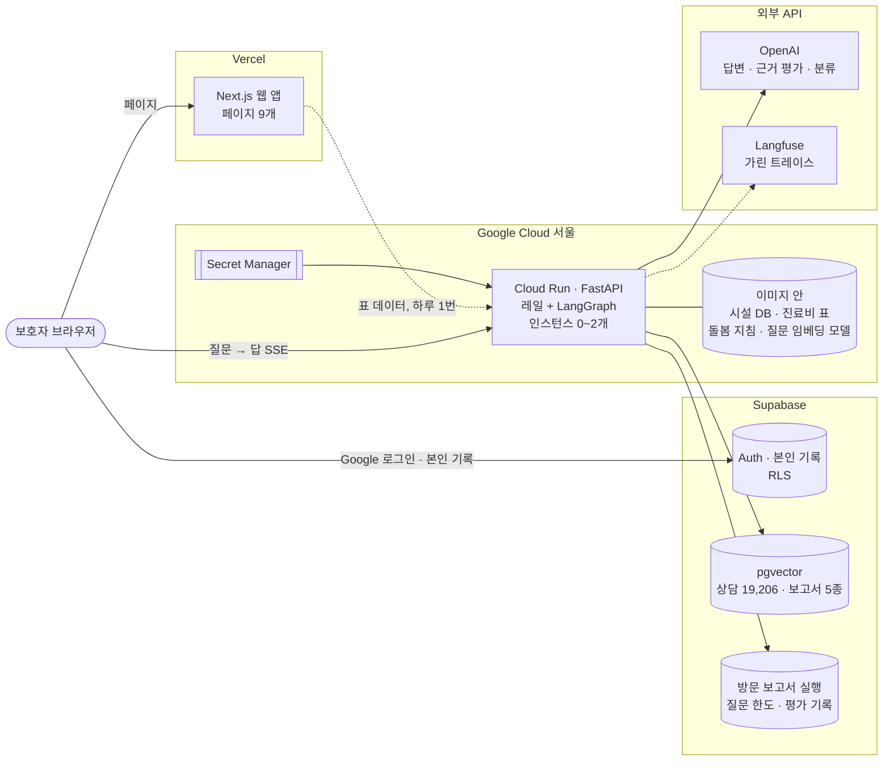

# 라그도그 구조

라그도그가 **지금 어떻게 동작하는지**를 구성 요소별로 정리한 문서입니다(2026-10-26 기준, `main`의 코드). 이 페이지는 전체 그림과 요약이고, 구성 요소마다 아래 문서에 부품별 기능·처리 흐름·선택한 이유를 자세히 적었습니다.

| 문서 | 다루는 것 |
| --- | --- |
| [frontend.md](frontend.md) | Next.js 웹 앱: 페이지 9개, 답 스트리밍, 로그인과 본인 기록, 하루 단위 캐시 |
| [api.md](api.md) | FastAPI(Cloud Run): 엔드포인트, 레일, 질문 한도, 모델 장애 대응, 로그 |
| [answer-pipeline.md](answer-pipeline.md) | LangGraph 상담 그래프: 라우터, 건강 RAG와 CRAG, 시설·진료비·보고서, 응급·위기, 대화 기억 |
| [retrieval.md](retrieval.md) | 검색: 미세조정 임베딩, Supabase pgvector, 보고서 하이브리드, 돌봄 지침, DB 장애 시 로컬 검색 |
| [visit-prep-team.md](visit-prep-team.md) | 방문 준비 보고서 멀티에이전트 팀 |
| [data.md](data.md) | 데이터 원천, 비공개 데이터셋, 이미지에 넣는 파일, Supabase 테이블 |
| [operations.md](operations.md) | 배포·롤백, 병합 게이트, 주간 회귀·SLO, 관측(Langfuse), 알림, 비용 관리 |

다른 문서와의 역할 나눔:

| 문서 | 답하는 질문 |
| --- | --- |
| `docs/architecture/` (여기) | 지금 어떻게 동작하나 |
| [`docs/adr/`](../adr/README.md) | 왜 이렇게 정했나 (결정 하나씩) |
| [`docs/wiki/`](../wiki/README.md) | 무엇을 재 봤나 (실험과 숫자) |
| [`docs/improvement-log.md`](../improvement-log.md) | 언제 무엇이 바뀌었나 |
| [`docs/security/`](../security/README.md) | 무엇을 지키고 어떻게 점검했나 |

이 문서들의 숫자는 요약입니다. 측정 조건과 원래 수치는 링크한 wiki·ADR에 있고, 숫자가 바뀌면 그쪽을 먼저 고칩니다.

## 전체 그림

한 질문이 지나가는 길:

1. 브라우저가 API의 `POST /chat`을 직접 부르고, 답을 SSE로 조각조각 받습니다(웹 서버를 거치지 않음).
2. API는 입력 레일(개인정보 가림, 응급·위기 표현)을 지나 LangGraph 상담 그래프를 돌립니다.
3. 그래프가 질문을 경로 하나로 보내고, 경로마다 검색이나 표 조회를 한 뒤 답을 씁니다. 건강 경로는 근거를 평가해 쓸 근거가 없으면 보류합니다.
4. 출력 레일(자료에 없는 링크 지우기, 위기면 상담 번호를 맨 앞에)을 지나 답·근거·적용된 레일 id가 화면에 갑니다.
5. 실행 하나가 Langfuse 트레이스 하나로 남습니다. 질문과 답의 글은 길이로만 남습니다.

## 구성 요소 요약

### 웹 앱 (Next.js, Vercel) → [frontend.md](frontend.md)

- **하는 일:** 홈, 상담, 시설 찾기, 진료비, 보고서 분석, 방문 준비 보고서, 관리 일정, 상담 기록, 소개 페이지.
- **흐름:** 질문은 브라우저에서 API로 바로 가고 답은 스트리밍으로 받습니다. 표가 큰 페이지(소개·시설·진료비)는 Vercel이 서버에서 미리 받아 하루 동안 보관합니다.
- **선택한 이유:** 로그인한 보호자의 기록을 DB 정책(RLS)이 직접 지키려면 사용자 신원이 DB까지 가야 하는데, Streamlit 한 프로세스 구조로는 맞물리지 않았습니다. 위젯마다 스크립트 전체를 다시 실행하는 구조라 스트리밍·모바일 화면도 다루기 어려웠습니다. 그래서 화면과 API를 나눴습니다([ADR-0008](../adr/0008-nextjs-frontend-fastapi-backend.md)).

### API (FastAPI, Cloud Run) → [api.md](api.md)

- **하는 일:** 상담(`/chat`), 방문 준비 보고서(`/visit-prep`), 시설·진료비·통계 조회, 피드백, 상담 노트.
- **흐름:** 요청마다 질문 한도 확인 → 레일 → 그래프 → 이벤트 스트림. 모델 요청에는 제한 시간과 재시도 1번이 있고, 넘기면 검색 결과만 보여 줍니다.
- **선택한 이유:** 검색·모델·데이터를 한 프로세스에 두되, 요청이 없을 때는 0개로 줄어 비용이 들지 않는 Cloud Run을 썼습니다. 서울 리전은 답변 완료가 8.6초로 미국(9.4초)보다 빨랐습니다([ADR-0006](../adr/0006-cloud-run-region-seoul.md)).

### 상담 그래프 (LangGraph) → [answer-pipeline.md](answer-pipeline.md)

- **하는 일:** 질문을 6개 경로(건강, 시설, 진료비, 보고서, 날짜, 그 밖) 중 하나로 보내 답합니다. 증상과 시설을 함께 물으면 두 경로를 다 돕니다.
- **흐름:** 신호가 하나뿐인 질문(약 85%)은 키워드 규칙이, 나머지는 분류 API(약 0.3초)가 경로를 정합니다. 건강 경로는 검색 → 근거 평가 → (없으면) 검색어 다시 쓰기 → 답 또는 보류입니다.
- **선택한 이유:** 의료 상담에서 그럴듯한 지어내기는 답하지 않는 것보다 위험합니다. 근거 평가(CRAG)로 근거 없는 질문 보류가 0 → 16/20이 됐습니다. 시설과 진료비는 뜻 검색이 아니라 정확한 조건 조회라 SQL과 표로 답합니다.

### 검색 → [retrieval.md](retrieval.md)

- **하는 일:** 상담 19,206건, 보고서 5종 1,344조각, 공공 돌봄 지침에서 근거를 찾습니다.
- **흐름:** 질문 벡터는 API 안의 미세조정 ko-sroberta(ONNX int8)가 만들고, 검색은 Supabase pgvector가 합니다. 보고서는 벡터 검색에 메모리 안 bigram BM25를 RRF로 합칩니다. DB가 실패하면 이미지 안의 로컬 저장소로 답합니다.
- **선택한 이유:** 보호자 말투로 미세조정해 짧은 질문 useful@3이 0.600 → 0.783이 됐습니다. 검색을 Supabase로 옮겨 앱 최고 메모리가 910MB → 442MB가 됐습니다([ADR-0007](../adr/0007-search-in-supabase.md)).

### 방문 준비 보고서 팀 → [visit-prep-team.md](visit-prep-team.md)

- **하는 일:** 상담 하나로 수의사에게 보여 줄 보고서를 만듭니다. 진단은 하지 않습니다.
- **흐름:** 빠진 정보 되묻기 → 계획 → 증상·병원·비용 병렬 조사 → 작성 → 문장별 검수 → (반려면) 다시 쓰기·다시 조사, 두 번 넘으면 사람 확인.
- **선택한 이유:** 조사·작성·검수를 한 모델에 맡기면 근거 없는 문장이 섞입니다. 역할마다 도구를 하나로 묶고 검수를 따로 둬서 검수 통과율 1.00, 중앙 시간 49초가 됐습니다.

### 데이터 → [data.md](data.md)

- **하는 일:** 상담(AI Hub), 보고서 5종, 공공 시설 6종 38,529곳, 2025 진료비 조사, 공공 돌봄 지침.
- **흐름:** 재배포가 금지된 데이터는 비공개 Hugging Face 데이터셋(리비전 고정)에서 이미지를 만들 때 받고, 벡터는 Supabase에 올립니다.
- **선택한 이유:** AI Hub 약관이 원본·가공 데이터의 재배포를 막고, 데이터와 벡터는 짝이 맞아야 해서 리비전을 코드에 고정했습니다.

### 운영 → [operations.md](operations.md)

- **하는 일:** 배포, 병합 게이트, 주간 회귀 평가, SLO 보고, 관측, 알림, 롤백, 비용 관리.
- **흐름:** 병합 → 이미지 빌드 → 트래픽 0% 후보 리비전 → 점검 4가지 통과 → 트래픽 전환. 매주 월요일 실제 모델로 평가 세트를 돌리고, 실패하면 이슈가 열립니다.
- **선택한 이유:** 답을 바꾸는 코드는 실제 모델로 재기 전까지 좋아졌는지 알 수 없습니다. 그래서 답변 경로가 바뀐 PR은 실제 모델 평가를 통과해야 병합됩니다.

## 공통 원칙

- **근거가 없으면 보류한다.** 건강 답은 근거로 고른 문서의 사실만 쓰고, 문장마다 인용 번호를 답니다.
- **숫자는 모델이 옮기지 않는다.** 진료비·시설·날짜는 코드가 표와 DB에서 그대로 꺼냅니다.
- **사용자 글을 모으지 않는다.** 모델에 보내기 전 개인정보를 가리고, 기록(Langfuse·로그)에는 길이와 해시만 남깁니다. 로그인한 보호자의 기록은 RLS로 본인만 읽습니다.
- **재 보고 넣는다.** 리랭커, 큰 임베딩, Self-RAG, RAG-Fusion은 재 봤지만 효과가 없거나 비용이 커서 넣지 않았습니다(각 문서의 "넣지 않은 것").
