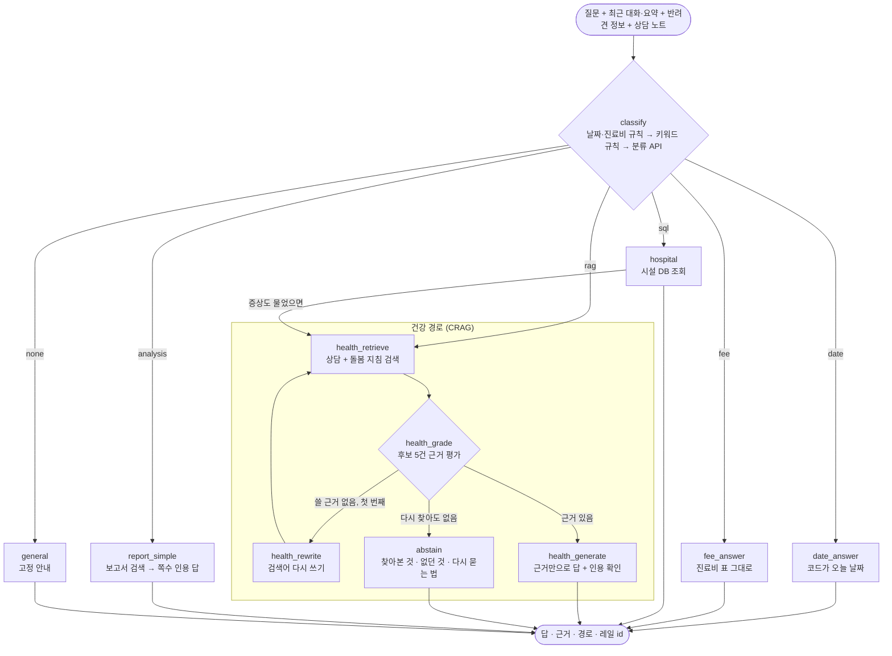

# 상담 그래프 (LangGraph)

[구조 개요](README.md)의 한 부분입니다. 코드는 [`src/chat_graph.py`](../../src/chat_graph.py)(그래프), [`src/tools/`](../../src/tools)(경로마다 하나), [`src/crag.py`](../../src/crag.py)(근거 평가)에 있습니다. 실험 기록은 [router.md](../wiki/router.md), [safety-and-evidence.md](../wiki/safety-and-evidence.md), [retrieval-experiments.md](../wiki/retrieval-experiments.md)에 있습니다.

## 그래프

- 노드마다 무엇을 했는지 `trace`에 쌓고, 화면 진행 표시(`step` 이벤트)와 Langfuse 트레이스에 그대로 씁니다.
- 그래프는 도구 묶음(`src/tools/toolset.py`)을 받아서 씁니다. 테스트에서는 가짜 도구를 넣어 모델·DB 없이 경로를 시험합니다.
- 운영 설정: 건강 CRAG 켜짐(`ENABLE_CRAG=true`), 보고서 CRAG 꺼짐, 답 다시 검토(Self-RAG) 꺼짐. 꺼진 기능도 코드에 남아 있고(`report_retrieve`·`report_grade`·`report_generate`, `health_review`, `health_simple`), 설정으로 켭니다.

**선택한 이유:** 처음에는 한 파일(`pages/rag.py`)에 화면과 로직이 섞여 있어, 경로가 늘수록 어느 단계에서 틀렸는지 알기 어려웠습니다. 노드로 나누자 단계마다 시간과 판정을 따로 재고, 문항별로 어디서 틀렸는지 볼 수 있게 됐습니다([modular-tools 설계](../design/modular-tools-and-conversation-memory.md)).

## 부품별 설명

### 1. 라우터 (`classify`, `src/tools/router.py`)

- **기능:** 질문을 `date`, `fee`, `rag`(건강), `sql`(시설), `analysis`(보고서), `none` 중 하나로 보냅니다.
- **흐름:**
  1. 날짜 질문("오늘 며칠이야")과 진료비 질문("강남구 엑스레이 얼마")을 다른 판단보다 먼저 규칙으로 잡습니다. "며칠 전부터"는 날짜 질문이 아닙니다.
  2. 건강·시설·보고서 신호가 **하나뿐이면**(약 85%) 키워드 규칙이 0ms에 정합니다.
  3. 신호가 없거나 충돌하면 OpenAI Decisions(분류 전용 API)에 HTTP로 묻습니다(약 0.3초). 실패하거나 거절하면 채팅 모델 라우터가 정합니다.
  4. 증상과 시설 요청이 함께 있으면("설사하는데 마포구 병원 어디?") 시설을 먼저 찾고 건강 경로로 이어 갑니다.
  5. 긴 상담 글은 키워드 하나로 정하지 않고, 일상 돌봄·노령·이별 질문은 건강 경로로 보냅니다.
- **선택한 이유:**
  - 규칙은 빠르고 틀리면 고치기 쉽습니다. 애매한 질문만 모델에 맡겼습니다.
  - 채팅 모델 폴백은 1.34~1.45초였는데 Decisions는 0.36초이고 정답 수는 같았습니다(134/136). 전체 p95는 1.5 → 0.29초입니다.
  - 신호가 충돌하는 질문을 고정 우선순위로 처리하던 때는 60문항 중 4개를 잘못 보냈습니다("닭 뼈를 삼켰는데 병원에 갈 수 없어요"가 시설로 감). 충돌을 모델에 맡겨 0/60이 됐습니다.
- **넣지 않은 것:** Jev 라우터(비슷하게 빠르지만 공급자가 하나 늘어남), 작은 분류기로 Decisions 대신하기(2026-10-21 시험, 적용 안 함).
- **한계:** 규칙은 처음 보는 말투에 약해서, 규칙을 고칠 때마다 고치기 전에 써 둔 holdout 세트로 다시 잽니다.

### 2. 건강 경로: 검색 (`health_retrieve`)

- **기능:** AI Hub 상담 19,206건과 공공 돌봄 지침에서 후보를 찾습니다. 검색 방식은 [retrieval.md](retrieval.md)에 있습니다.
- **흐름:**
  1. 다른 동물(햄스터, 고양이 등)의 건강 질문이면 검색 전에 거절합니다. 자료가 반려견 상담뿐이기 때문입니다.
  2. 첫 검색에서 가장 가까운 상담의 유사도가 0.4보다 낮고 맞는 지침도 없으면, 근거 평가와 재검색(모델 2번)을 건너뛰고 바로 보류합니다.
  3. 상담 후보 5건과 가까운 지침(최대 2건, 유사도 0.52 이상)을 합칩니다.
- **검색어:** 앞선 대화가 있으면 혼자 읽히는 검색어로 바꿉니다([7. 대화 기억](#7-대화-기억-srctoolshistorypy-srctoolsprofilepy-srctoolsnotespy)).
- **필터를 쓰지 않는 이유:** 질문에서 나이·진료과를 추론해 거르면 정확할 것 같았지만, 말뭉치 라벨이 질문 본문과 34%·59%만 맞았습니다. 필터를 빼자 적중률이 0.141 → 0.264가 됐습니다. 추론한 조건은 답 프롬프트의 참고로만 씁니다.

### 3. 건강 경로: 근거 평가와 보류 (`health_grade`, `health_rewrite`, `abstain`, `src/crag.py`)

- **기능:** 검색은 항상 무언가를 돌려주므로, 후보가 질문에 실제로 쓸 만한지 모델이 판정합니다.
- **흐름:**
  1. 후보 5건을 발췌(400자)로 보여 주고 문서마다 쓸 수 있는지 구조화 출력으로 받습니다. 추론은 끕니다.
  2. 쓸 근거가 없으면 검색어를 한 번 다시 써서 다시 찾습니다.
  3. 그래도 없으면 보류합니다. 보류 글에는 찾아본 것(후보 수, 재검색 여부), 확인하지 못한 것(판정 모델의 설명을 그대로, 추가 호출 없음), 다시 물어볼 방법을 적습니다.
- **선택한 이유:**
  - 의료 상담에서 그럴듯한 지어내기는 답하지 않는 것보다 위험합니다. 근거 없는 질문 보류 0 → 16/20, 답할 질문을 잘못 보류한 것 1/38.
  - 첫 버전(v1)은 너무 엄격하고 호출이 많았습니다(토큰 3.9배). 기준을 풀고, 근거가 하나도 없을 때만 다시 쓰고, 후보와 발췌를 줄여 v2는 2.0배입니다.
  - 판정의 추론을 끄자 첫 글자가 9.1 → 6.0초로 빨라졌고 정확도는 60문항 중 1문항 차이였습니다.
- **보고서에는 켜지 않은 이유:** 표와 수치가 많은 조각을 모델이 잘못 걸러 정답 페이지가 12 → 10/18로 줄었습니다.
- **넣지 않은 것:**
  - 근거가 없을 때 웹 검색으로 보완하기. 출처를 검증할 수 없는 의료 정보라서 넣지 않았습니다.
  - 근거 평가를 작은 cross-encoder로 대신하기(2026-10-26). CPU 1초 안에 드는 모델이 질문 판단 일치 0.80으로, 후보를 모두 쓰는 기준선 0.88보다 낮았습니다([grader-distill.md](../wiki/grader-distill.md)).

### 4. 건강 경로: 답 (`health_generate`, `src/tools/health.py`, `src/citations.py`)

- **기능:** 고른 근거의 사실만으로 답하고, 문장마다 인용 번호를 답니다.
- **흐름:**
  1. 근거, 반려견 정보, 최근 대화와 요약, (로그인했으면) 최근 상담 노트 5개를 넣어 답을 씁니다. 노트는 보호자의 기록이지 근거로 쓰지 않습니다. 추론은 `low`입니다.
  2. 인용 확인(ANS-01): 인용 번호가 실제 근거를 가리키는지, 근거·반려견 정보·대화에 없는 숫자가 없는지 모델 없이 확인합니다.
  3. 비용 이야기가 있으면 진료비 페이지 안내(ANS-02), 집에서 할 관리가 없는 답이면 고정 문구(ANS-03)를 붙입니다. 응급 안내가 뜬 질문에는 붙이지 않습니다.
  4. 시설도 물었으면 시설 목록이 위에, 증상 답이 아래에 갑니다. 모델에는 질문의 증상 부분만 줍니다.
- **선택한 이유:**
  - 충실도 평가에서 나온 지어내기 유형(검사 이름, 빈도, 약 이름)을 프롬프트 규칙으로 막아 0.79 → 0.94가 됐습니다.
  - 답 추론을 `low`로 낮추자 p90이 18.5 → 11.4초가 됐고, 사람이 어느 쪽인지 모르게 읽고 비교해 품질 차이가 없다고 판단했습니다.
  - 사용자 피드백("병원에 가라는 말만 한다")으로 병원 권고를 끝에 한 번만 두게 해, 병원·수의사 문장이 48% → 31%가 됐습니다(근거 없는 숫자 0 유지).
- **넣지 않은 것:** 답을 근거와 다시 대조해 고치는 Self-RAG. 충실도 0.927 → 0.941은 판정 흔들림 안인데 시간은 8.5 → 16.1초였습니다.
- **한계:** 일상 관리 질문의 일부는 자료에 사실이 없거나 다른 상담의 답 속에만 있습니다. 공공 돌봄 지침을 더해 30문항 중 핵심을 답한 것이 20 → 26이 됐지만 남은 4개는 자료가 없습니다.

### 5. 응급과 위기 (`src/tools/urgency.py`, `src/health_safety.py`, `src/crisis.py`)

- **응급:**
  1. 규칙이 호흡곤란, 쓰러짐, 경련, 독성 물질 섭취 등을 찾습니다. 부정("경련은 없었고")과 가정("~하면")은 거릅니다.
  2. 규칙이 놓친 질문만 분류 API가 "지금 응급 / 곧 진료 / 아님" 셋 중 하나로 판단합니다.
  3. 응급이면 답보다 먼저 경고와 가까운 동물병원을 보여 줍니다.
  - **이유:** 놓치는 쪽이 더 위험하지만, 경고가 너무 많으면 아무도 믿지 않습니다. "응급/아님" 둘 중 하나로 고르게 했더니 실제 보호자 질문의 32.5%에 경고가 떴고, 셋으로 나누자 9%가 됐습니다. 규칙을 만들기 전에 써 둔 holdout2 기준 1/20 → 19/20, 오탐 0입니다.
- **위기(보호자 자신의 자해 표현):** 정규식이 먼저 보고, 맞지 않으면 모델이 답변과 동시에 판정합니다(늦어도 기다리지 않음). 위기면 상담 번호를 답 맨 앞에 둡니다. 실패나 늦은 판정은 "아님"으로 다뤄 답을 막지 않습니다.
- **한계:** 응급 평가셋과 경고 문구는 수의사 검토를 받지 않았습니다.

### 6. 시설, 진료비, 보고서, 그 밖

| 노드 | 기능 | 흐름 | 선택한 이유 |
| --- | --- | --- | --- |
| `hospital` (`src/tools/places.py`) | 동물병원·약국·동반 시설·미용·위탁·장묘 38,529곳 찾기 | 지역·종류·개수를 규칙으로 뽑아 정해진 SQL로 조회(읽기 전용). 짧은 지역 이름("수원", "일산")도 읽음. 위치가 있으면 직선거리순. 그 밖의 질문만 모델이 SQL을 쓰고, 질문한 종류 조건이 없으면 버림 | "마포구 동물병원"은 뜻 검색이 아니라 조건 검색이다. 모델이 SQL을 쓰면 4~9초에 14개 지역 중 3개를 놓쳤고, 지역 사전으로 바꾸자 모델 없이 16/16, 0.01초 |
| `fee_answer` (`src/tools/fees.py`) | 2025 진료비 조사의 지역·전국 중간·평균·최저·최고 | 항목 19종을 규칙으로 찾고 체중은 조사 기준(5·10·20kg) 중 가까운 값. 모델 없이 표를 그대로 옮기고, 병원 가격이 아니라고 매번 밝힘 | 금액은 모델이 옮기다 틀리면 안 된다. 판별 규칙은 dev 24/24였지만 holdout 23/30이라, 고친 뒤 미리 써 둔 holdout2로 20/20 |
| `report_simple` (`src/tools/report.py`) | 보고서 5종에서 통계·추이·비교 답 | 하이브리드 검색으로 조각을 찾고 보고서 이름과 쪽수를 인용. 여러 보고서를 비교하면 보고서마다 찾음. 근거가 없으면 모델을 부르지 않음 | 병목은 생성이 아니라 검색이었다. 페이지 통째로 답하기(25 → 23/36)와 문맥 압축(차이 없음, +1.6초)은 효과가 없었다 |
| `date_answer` | 오늘 날짜 | 코드가 답함 | 모델은 오늘 날짜를 모른다 |
| `general` (`src/tools/general.py`) | 인사, 감사, 기능 문의, 범위 밖 | 고정 안내, 모델 없음 | 답할 근거가 없는 질문에 모델 비용을 쓰지 않는다 |

### 7. 대화 기억 (`src/tools/history.py`, `src/tools/profile.py`, `src/tools/notes.py`)

- **단기 기억:** 최근 6턴은 그대로 넣고, 그보다 오래된 대화는 3턴마다 요약해 쌓습니다. API는 대화를 저장하지 않고, 화면이 대화와 요약을 보내면 바뀐 요약을 돌려줍니다.
- **검색어:**
  - 앞선 건강 질문이 있으면 저비용 호출 하나로 혼자 읽히는 검색어를 만듭니다. 이때 건강 답을 받은 질문만 넘기고, 시설 후속 질문("24시 하는 곳은?")은 뺍니다(앞선 건강 질문 목록 0/30 → 30/30).
  - 요약 속 지병을 검색어에 반영해, 긴 대화에서 그 지병을 다룬 근거가 잡힌 대화가 2/6 → 5/6이 됐습니다.
  - 시설 질문은 자기 지역이 있으면 그 지역을, 없으면 지역이 나온 앞 질문을 이어받습니다.
- **반려견 정보:** 나이·체중·지병을 답과 검색에 반영합니다. 건강 답 뒤에 대화에서 새로 알게 된 사실을 저장할지 제안합니다(`memory` 이벤트, 보호자가 고름).
- **상담 노트(로그인):** 보호자가 "이 상담 기억하기"를 누르면 2~3문장 노트를 만들어 보여 주고, 보호자가 고친 뒤 본인 표에 저장합니다. 다음 질문은 최근 5개를 보호자의 기록으로 읽습니다([ADR-0009](../adr/0009-consultation-memory.md)).
- **선택한 이유:** 앞선 질문을 모두 붙이던 방식은 새 주제의 검색을 망쳤습니다(holdout 0.38 → 1.0). 질문마다 자동으로 기억을 뽑는 방식(Mem0식)은 호출이 늘고 서버가 건강 기록을 모으게 되어, 보호자가 고른 것만 저장합니다.
- **한계:** 앞 질문을 이어받는 질문의 검색은 0.72 → 0.64로 조금 나빠졌습니다.

## 모델 호출 수

| 경로 | 호출 | 내용 |
| --- | ---: | --- |
| 날짜, 진료비, 일반, 규칙으로 정한 시설 | 0 | 코드와 표 |
| 분류 API가 필요한 질문 | +1 | Decisions |
| 건강 (근거 있음) | 2~3 | 근거 평가, 답 (+ 앞선 대화가 있으면 검색어) |
| 건강 (보류) | 2~3 | 근거 평가 2번, 검색어 다시 쓰기 (유사도가 낮으면 0) |
| 보고서 | 1~2 | 답 (+ 비교 질문이면 분해) |
| 모든 질문 | +0~1 | 위기 모델 판정(정규식이 맞으면 0), 응급 두 번째 판단(규칙이 놓친 질문만) |

모델은 모두 `gpt-6-luna`입니다. 프롬프트마다 8자리 지문을 트레이스와 평가 기록에 남겨, 점수가 바뀌면 어느 프롬프트가 바뀌었는지 봅니다(`src/prompt_versions.py`).
