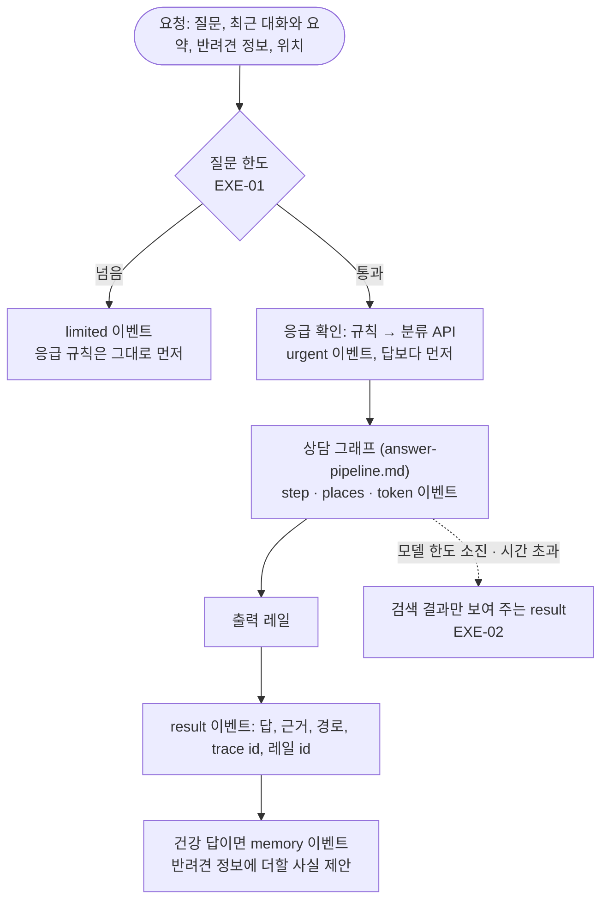

# API (FastAPI, Cloud Run)

[구조 개요](README.md)의 한 부분입니다. 코드는 [`api/`](../../api)(HTTP)와 [`src/`](../../src)(앱 로직)에 있습니다. 결정은 [ADR-0006](../adr/0006-cloud-run-region-seoul.md)(서울 리전), [ADR-0008](../adr/0008-nextjs-frontend-fastapi-backend.md)(화면·API 분리), [ADR-0011](../adr/0011-degrade-on-model-quota.md)(모델 한도 소진 시)에 있습니다.

| 항목 | 내용 |
| --- | --- |
| 서비스 | Cloud Run `ragdog-api`, 서울(`asia-northeast3`) |
| 크기 | CPU 1개, 메모리 2GiB, 인스턴스 0~2개, 요청 제한 900초, 시작 시 CPU 부스트 |
| 이미지 | 앱 코드 + 비공개 데이터 + 질문 임베딩 모델을 함께 굽는다([data.md](data.md)) |
| 비밀 | Secret Manager에서 주입: OpenAI, Anthropic(대체 모델), Langfuse, Supabase DB 주소 |
| 상태 | API는 대화를 저장하지 않는다. 화면이 대화와 요약을 보내고, 바뀐 요약을 돌려받는다 |

## 엔드포인트

| 경로 | 하는 일 | 모델 호출 |
| --- | --- | --- |
| `POST /chat` | 질문 하나를 이벤트 스트림으로 답함 | 0~6번 (경로마다 다름) |
| `POST /visit-prep`, `/{id}/answer`, `/{id}/retry` | 방문 준비 보고서를 스트림으로 만들고, 되묻기에 답하거나 실패한 실행을 이어 감 | 10~20번 |
| `POST /memory/note` | 로그인한 보호자가 고른 상담을 2~3문장 노트로 만듦 (저장은 화면이 본인 표에) | 1번 |
| `POST /feedback`, `/reason`, `/review` | 👍/👎를 트레이스에 점수로, 이유와 (동의하면) 질문·답을 검토용으로 저장 | 없음 |
| `GET /places/*` | 시설 종류·지역 목록, 지역·현재 위치·응급 병원 검색, 시설 하나 | 없음 |
| `GET /fees/*` | 진료비 항목 목록, 지역·전국 수치 | 없음 |
| `GET /stats/overview` | 소개 페이지의 상담·시설 통계 | 없음 |
| `GET /health` | 살아 있는지와 배포된 커밋. 화면이 페이지를 열 때 불러 잠든 인스턴스를 깨움 | 없음 |
| `GET /me` | 보낸 토큰이 누구로 인정되는지 (본인 id만) | 없음 |

운영에서는 `/docs`(자동 API 문서)를 끕니다. 경로와 스키마 목록을 공개하지 않기 위해서입니다.

## `POST /chat`의 처리 순서

## 부품별 설명

### 1. 레일 (`rails/rails.yml`, `src/rails.py`)

- **기능:** 보호자와 모델 사이의 검사를 단계별(입력·검색·답·출력·실행)로 묶고, 규칙마다 id를 붙입니다. 답에 어떤 레일이 걸렸는지 `result`의 `guards`로 함께 보냅니다.

| 단계 | id | 하는 일 | 모델 |
| --- | --- | --- | --- |
| 입력 | IN-01 | 전화번호·주소 등 개인정보를 가린 뒤 모델에 보냄 (`src/pii.py`) | 없음 |
| | IN-02 | 응급 신호면 응급 안내와 가까운 병원을 답보다 먼저 | 규칙 뒤 분류 API |
| | IN-03 | 위기(자해) 표현 정규식 | 없음 |
| | IN-04 | 위기 표현을 모델이 판정, 답변과 동시에 돌림 | 1번 |
| 검색 | RET-01·02 | 문서·노트 안에 숨은 지시문("이전 지시를 무시")이 있으면 근거에서 뺌 (`src/untrusted.py`) | 없음 |
| 답 | ANS-01 | 문장마다 인용 번호가 근거와 맞는지, 근거에 없는 숫자가 없는지 확인 (`src/citations.py`) | 없음 |
| | ANS-02 | 건강 질문에 비용 이야기가 있으면 진료비 페이지 안내 | 없음 |
| | ANS-03 | 집에서 할 관리가 없는 답에 고정 문구 | 없음 |
| 출력 | OUT-01 | 자료에 없는 링크 지우기 | 없음 |
| | OUT-02 | 위기면 상담 번호(109, 1577-0199)를 맨 앞에 | 없음 |
| 실행 | EXE-01 | 질문 한도 | 없음 |
| | EXE-02 | 모델 요청마다 제한 시간과 재시도 1번, 넘기면 검색 결과만 | 없음 |
| | EXE-03 | 방문 준비 에이전트는 역할마다 읽기 도구 하나 | 없음 |

- **선택한 이유:**
  - 교안의 NeMo Guardrails 레일 구조(단계와 규칙 id)를 따르되 라이브러리는 쓰지 않고 함수로 구현했습니다.
  - NeMo, Prompt Guard, Llama Guard를 레드팀 68문항으로 비교했는데, 앱이 놓친 공격을 막지 못하고 정당한 질문을 막았습니다([safety-and-evidence.md](../wiki/safety-and-evidence.md)).
  - 위기 판정만 모델을 씁니다. 다른 모델(Claude)이 새로 쓴 위기 문항을 정규식은 패턴을 고친 뒤에도 0/5로 놓쳤고, 모델 판정을 더해 새 문항 5/5, 오탐 0/305가 됐습니다([개선 기록](../improvement-log.md)). 답변과 동시에 돌려 기다리는 시간이 늘지 않습니다.
- 위협과 대응 전체: [threat-model.md](../security/threat-model.md)

### 2. 질문 한도 (`src/rate_limit.py`, `src/auth.py`)

- **기능:** 질문마다 모델 비용이 들어서, 한 사람이 반복해 물어 예산을 쓰지 못하게 합니다. 방문 준비 보고서도 질문 하나로 세고, 따로 하루 2개입니다.

| 단위 | 1시간 | 하루 |
| --- | ---: | ---: |
| 사람 (로그인 계정, 아니면 브라우저 id) | 10 | 30 |
| 네트워크 (IP) | 60 | 200 |

- **흐름:**
  - 로그인했으면 Supabase 토큰을 검증해 계정으로 셉니다. JWKS의 공개 키(ES256)로 서명을 확인하고, 발급처·대상·만료를 봅니다. HS256이나 `alg: none` 토큰은 키를 찾기 전에 거부합니다. 검증에 실패하면 오류가 아니라 비로그인으로 다룹니다.
  - 로그인하지 않았으면 브라우저 localStorage의 무작위 id로 셉니다. 지우면 새 id가 생기므로 IP에도 느슨한 한도가 따로 있습니다.
  - 횟수는 Supabase 표에 소금 친 해시와 시각만 저장하고 48시간 뒤 지웁니다. DB가 실패하면 프로세스 메모리로 셉니다.
- **선택한 이유:** IP 하나만 쓰면 학원·회사처럼 주소를 나눠 쓰는 사람들이 10번을 함께 써야 합니다. 그래서 사람 단위가 기본이고 IP는 보조입니다.
- **보안 점검에서 고친 것:** User-Agent 위조와 `X-Forwarded-For` 위조로 한도를 피하는 길 2건을 찾아, 배포 점검은 비밀 헤더로 구분하고 IP는 프록시가 붙인 오른쪽 값을 쓰게 했습니다([보안 점검](../security/README.md)).

### 3. 모델 장애 대응 (`src/model_outage.py`, `src/resources.py`)

- **기능:** 모델 공급자가 멈춰도 상담 사례와 지침은 보여 줍니다.
- **흐름:**
  - 모델 요청마다 제한 시간이 있습니다: 근거 평가·위기 판정 20초, 채팅 30초, 스트리밍 답은 조각 사이 45초. 재시도는 1번입니다(기본값은 600초에 2번이었음).
  - 한도 소진·속도 제한(429), 시간 초과, 연결 실패, 5xx면 같은 호출을 **Claude Haiku 5.5**가 한 번 대신 받습니다(근거 평가, 채팅, 건강 답변. [ADR-0012](../adr/0012-claude-fallback.md)).
  - Claude도 실패하거나 Anthropic 키가 없으면 답 대신 가까운 상담 사례와 지침을 그대로 보여 주고 "답변이 잠시 멈췄다"고 알립니다.
  - 질문 벡터는 API 안의 모델이 만들고 검색은 Supabase가 하므로, 이 길에는 OpenAI가 필요 없습니다.
- **선택한 이유:** 2026-10-19 평가에 쓴 비용 때문에 OpenAI 사용 한도가 차서 인사에도 오류가 났습니다. 앱은 멀쩡했고 검색은 모델 없이 돌 수 있었습니다([ADR-0011](../adr/0011-degrade-on-model-quota.md), [SLO 기록](../slo.md#모델-한도-소진-2026-10-19)).

### 4. 시작 준비와 스트리밍 (`api/main.py`, `api/chat.py`)

- **시작 준비(warm-up):** 인스턴스가 요청을 받기 전에 질문 임베딩 모델, 검색 저장소와 첫 Supabase 연결, 답 표, 모델 클라이언트를 불러옵니다(4~7초). Cloud Run은 시작 중에만 CPU를 넉넉히 주므로(부스트) 백그라운드가 아니라 시작 안에서 합니다. 화면이 페이지를 열 때 `/health`를 불러, 보호자가 질문을 쓰는 동안 인스턴스가 깨어납니다.
- **스트리밍:** 그래프는 별도 스레드에서 돌고, 단계·글자 이벤트를 큐로 넘겨 `text/event-stream`으로 보냅니다.
- **CORS:** 운영 웹 주소와 PR 미리보기 주소만 허용합니다. 토큰은 쿠키가 아니라 `Authorization` 헤더로 받습니다.

### 5. 로그 (`src/request_log.py`, `src/run_log.py`)

- **기능:** 답 하나가 끝나면 한 줄 요약을 JSON으로 남깁니다: 어떻게 끝났는지(result, error, limited, paused), 경로, 시간, 검색이 로컬로 갔는지, 한도 안내였는지, trace id.
- **선택한 이유:** Cloud Logging이 JSON 줄을 필드로 읽어서 결과별로 세고 알림을 걸 수 있습니다([operations.md](operations.md) "알림"). 질문과 답의 글은 남기지 않습니다.

### 6. 피드백과 자료 공백 (`api/feedback.py`, `src/feedback_store.py`, `src/data_gaps.py`)

- 👍/👎는 그 답의 Langfuse 트레이스에 점수로 붙습니다. 👎에 이유를 고르고 동의하면 질문과 답을 검토용 표에 3년 둡니다.
- 답이 "자료에 없다"고 한 질문은 자료 공백 표에 모아, 매달 평가 세트에 무엇을 더할지 검토합니다([operations.md](operations.md) "월간 검토").

## 넣지 않은 것

| 후보 | 넣지 않은 이유 |
| --- | --- |
| 작업 큐 + 폴링으로 방문 준비 보고서 | ADR-0008의 첫 계획. 스트리밍 요청 하나로 같은 일을 하고 작업 표가 필요 없다 |
| us-central1 리전 | 답변 완료 9.4초로 서울(8.6초)보다 느렸다 ([ADR-0006](../adr/0006-cloud-run-region-seoul.md)) |
| 항상 켜진 인스턴스 (min 1) | 요청이 적은 포트폴리오 서비스라 비용이 든다. 대신 시작 준비와 `/health` 깨우기, 8시간마다 점검 |

## 한계

- 잠든 인스턴스가 깨는 데 15~27초 걸립니다. 첫 페이지에서 `/health`로 미리 깨우지만, 바로 질문하면 기다립니다.
- 방문 준비 팀은 인스턴스마다 한 번에 하나만 돕니다(최대 인스턴스 2개).
