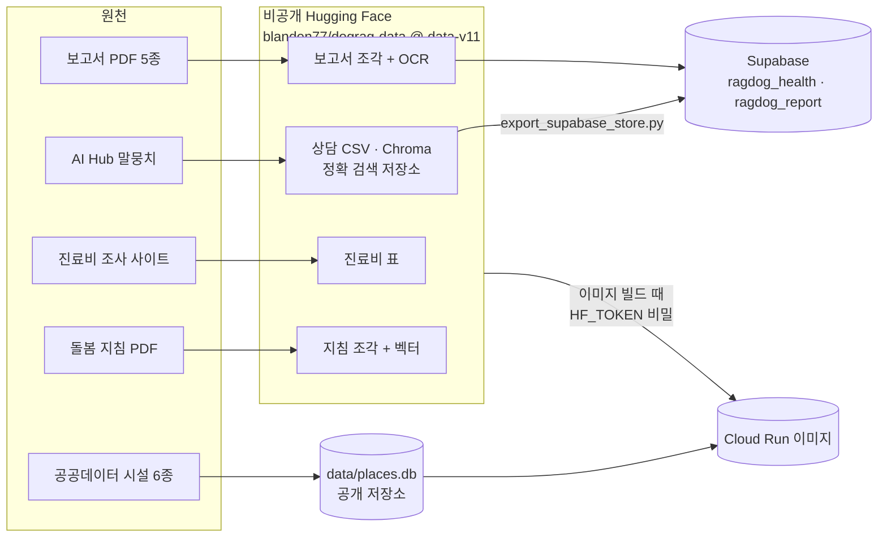

# 데이터

[구조 개요](README.md)의 한 부분입니다. 출처별 이용 조건과 가공 내역은 [data-sources.md](../data-sources.md)(데이터 명세서)에, 시설·진료비 정제 기록은 [places-data.md](../wiki/places-data.md), [vet-fees.md](../wiki/vet-fees.md)에 있습니다. 이 문서는 데이터가 **어디에 있고 앱이 어떻게 받는지**를 다룹니다.

## 한눈에

| 데이터 | 규모 | 쓰는 곳 | 어디에 |
| --- | --- | --- | --- |
| AI Hub 반려견 성장·질병 말뭉치 | 상담 19,206 (검증 561) | 건강 상담 근거, 검색 평가, 임베딩 미세조정 | 비공개 HF → Supabase 벡터 + 이미지 |
| 반려동물 보고서 5종 (KB, 농촌경제연구원 2, 소비자원 2) | 922쪽, 1,344조각 (OCR 포함) | 보고서 질문, 방문 보고서 비용 조사 | 비공개 HF → Supabase 벡터 + 이미지 |
| 공공 시설 6종 (병원, 약국, 미용, 위탁, 장묘, 동반 시설) | 38,529곳 | 시설 찾기, 응급 시 가까운 병원 | 공개 저장소 `data/places.db` (SQLite) |
| 2025 동물병원 진료비 조사 (농림축산식품부) | 6,413행, 시·군·구 201곳, 항목 19종 | 진료비 질문, 방문 보고서 비용 조사 | 비공개 HF → 이미지 |
| 공공 돌봄 지침 (동물사랑배움터 4종 + 농식품부 보도자료) | 조각 약 760개 | 일상 관리 질문, 방문 보고서 건강 조사 | 비공개 HF → 이미지 |
| 미세조정 임베딩 `blanden77/ko-sroberta-dograg-b` | ONNX int8 | 건강·지침 질문 벡터 | 비공개 HF 모델 → 이미지 |

## 부품별 설명

### 1. 비공개 데이터셋과 리비전 고정 (`src/private_data.py`)

- **기능:** 공개 저장소에 둘 수 없는 파일을 비공개 Hugging Face 데이터셋 `blanden77/dograg-data`에 같은 경로로 둡니다. 앱·CI·스크립트가 `HF_TOKEN`(읽기 권한)으로 없는 파일만 받습니다.
- **흐름:**
  - 코드의 `REVISION`(지금 `data-v11`)이 읽을 데이터셋 브랜치입니다.
  - 받은 뒤 `data/.private_data_revision`에 리비전을 적습니다. 파일이 있어도 리비전이 다르면 다시 받습니다.
  - 벡터와 임베딩 모델처럼 코드와 짝이 맞아야 하는 데이터를 바꾸면, 새 브랜치에 올리고 이 상수를 코드와 함께 옮깁니다.
- **선택한 이유:**
  - AI Hub 이용정책은 학습한 모델·서비스의 배포는 허용하지만, 원본과 단순 가공본(CSV 등)의 공유·재배포는 막습니다. 보고서 PDF도 발간 기관에 저작권이 있습니다.
  - 리비전을 고정하지 않으면, 예전 배포가 새 모델로 만든 벡터를 받아 검색이 깨질 수 있습니다.
- **리비전 기록(요약):** v2 미세조정 모델로 상담 벡터 재생성 → v3 진료비 → v4 장애 대비 정확 검색 저장소 → v5~v8 KB 보고서 OCR 조각과 수작업 보정 → v9~v11 돌봄 지침. 전체는 `src/private_data.py` 주석에 있습니다.

### 2. 이미지에 넣는 데이터 (`Dockerfile`, `scripts/prefetch_image_assets.py`)

- **기능:** Cloud Run 이미지가 시작할 때 아무것도 내려받지 않도록, 빌드할 때 비공개 데이터와 질문 임베딩 모델을 이미지에 넣습니다.
- **흐름:**
  - `HF_TOKEN`은 빌드 비밀(`--secret id=hf_token`)로만 전달돼 이미지 층에 남지 않습니다.
  - 리비전 관련 파일(`src/settings.py`, `src/private_data.py`)만 먼저 복사해 받기 때문에, 리비전이 바뀔 때만 데이터 층을 다시 만듭니다.
  - `.dockerignore`가 `data/*`를 막고 `data/places.db`만 이 PC에서 가져옵니다. 나머지는 빌드 안에서 고정 리비전으로 받습니다.
  - 이미지는 비공개 Artifact Registry에만 올립니다.
- **선택한 이유:** 시작 때 받으면 잠든 인스턴스가 깨는 시간이 길어지고, 받는 중 메모리도 씁니다. 이미지에 넣으면 시작이 빠르고, 배포마다 같은 데이터가 들어갑니다.

### 3. Supabase 벡터 표 (`scripts/export_supabase_store.py`)

- **기능:** 상담 19,206건(`ragdog_health`, 768차원)과 보고서 1,344조각(`ragdog_report`, 1536차원)을 `halfvec`으로 올립니다([retrieval.md](retrieval.md)).
- **흐름:** Chroma에서 뽑은 정확 검색 저장소(`data/vector_store`, `scripts/export_vector_store.py`)의 벡터를 그대로 옮깁니다. 운영 중에는 `scripts/check_supabase_search.py`가 배포 점검 뒤 HNSW 색인의 마지막 사용 시각을 봐서, 배포가 실제로 Supabase로 검색했는지(장애 대비 경로로 빠지지 않았는지) 확인합니다.
- **선택한 이유:** 벡터를 다시 만들지 않고 옮기면, 운영 검색과 장애 대비 검색(이미지 안 정확 검색 저장소)이 같은 벡터를 씁니다.

### 4. 시설 DB (`data/places.db`, `scripts/build_places_db.py`)

- **기능:** 공공데이터 6종을 SQLite 표 하나(`place`)로 합치고, 출처별 행 수와 정제 내역을 `source` 표에 같이 둡니다.
- **흐름:** 영업/정상만 남기고, 좌표를 EPSG:5174 → WGS84로 바꾸고, 시·도 이름을 통일합니다. 앱은 읽기 전용으로 엽니다.
- **선택한 이유:** 공공누리 등 재배포가 되는 공공데이터라 공개 저장소에 둡니다. 정확한 조건 조회라 벡터가 아니라 SQL입니다([answer-pipeline.md](answer-pipeline.md)).
- **한계:** 인허가 기준이라 실제 영업 여부와 영업시간을 모릅니다. 답마다 전화 확인을 안내합니다.

### 5. 진료비 표 (`data/vet_fees/vet_fees.csv`)

- **기능:** 시·군·구별 항목 진료비의 평균·중간·최저·최고입니다. 모델 없이 표의 값을 그대로 옮깁니다.
- **흐름:** 조사 사이트의 화면과 같은 JSON 요청 630번(2초 간격)으로 모으고 응답 원문을 보관했습니다. 보도자료와 겹치는 전국 34행은 4개 값 모두 일치했습니다.
- **이용 조건:** 사이트에 이용약관·저작권 정책이 없어(2026-10-10 확인) 확인될 때까지 비공개 데이터셋에 둡니다.

### 6. 보고서 조각과 OCR

- **기능:** 보고서 PDF를 쪽 단위로 자르고 조각마다 보고서 이름과 쪽수를 붙입니다.
- **OCR 조각:** KB 보고서는 숫자를 전용 글꼴로 넣어 112쪽 중 91쪽에서 PDF 글자로 숫자가 빠졌습니다. 이 쪽들을 Tesseract로 읽은 조각을 더했고, 잘못 읽는 규칙("2023년" → "202344" 등)과 쪽 이미지를 보고 확인한 수치 9개를 손으로 고쳤습니다.
- **선택한 이유:** 보고서 질문의 상당수가 숫자를 묻습니다. 글자만 쓰면 "반려가구 비율"을 물을 때 숫자 없는 문장이 근거로 나옵니다.

### 7. 공공 돌봄 지침 (`scripts/build_care_guides.py`)

- **기능:** 동물사랑배움터 지침 4종과 농식품부 여름철 보도자료를 문장 경계에서 끊은 조각으로 만들고, 건강 검색과 같은 모델로 벡터를 만듭니다.
- **이용 조건:** 공공누리 표시가 없는 4종은 원문을 비공개 데이터셋에만 두고, 짧은 인용·출처·원문 링크로만 씁니다. 보도자료는 공공누리 제1유형입니다([ADR-0010](../adr/0010-public-care-guides.md)).

## Supabase 표

| 스키마.표 | 내용 | 누가 읽고 쓰나 |
| --- | --- | --- |
| `public.ragdog_health`, `ragdog_report` | 검색 벡터와 본문 | API(`ragdog_app`)가 읽기만 |
| `public.ragdog_user_threads`, `ragdog_user_profile`, `ragdog_user_notes` | 로그인한 보호자의 대화·반려견 정보·상담 노트 | 브라우저가 사용자 토큰으로, RLS `user_id = auth.uid()` |
| `public.ragdog_rate_limit` | 질문 한도 (해시와 시각) | API |
| `public.ragdog_feedback`, `ragdog_data_gaps` | 👍/👎, 답하지 못한 질문 유형 (원문 없음) | API |
| `public.ragdog_eval_history` | 매주 회귀 평가 결과 | CI |
| `visit_prep.*` | 방문 보고서 체크포인트, 멈춘 실행, 보고서 시작 기록 | API ([visit-prep-team.md](visit-prep-team.md)) |

- 모든 표에 RLS가 켜져 있습니다. API 계정 `ragdog_app`은 필요한 표에만 권한이 있고, 사용자 표에는 권한이 없습니다([최소 권한](../security/least-privilege.md), `scripts/setup_app_role.sql`).
- 사용자 글이 들어가는 표는 사용자 본인 기록과 30분짜리 멈춘 실행뿐입니다. 운영 기록(한도, 피드백, 데이터 공백)은 해시·시각·분류만 남깁니다.

## 넣지 않은 것

| 후보 | 넣지 않은 이유 |
| --- | --- |
| 원본 데이터를 공개 저장소에 | AI Hub 약관과 보고서 저작권 |
| 시작할 때 데이터 내려받기 | 깨는 시간과 메모리. 빌드 때 이미지에 넣음 |
| 한국관광공사 동반여행 API | 상세 정보 수집이 끝나지 않음 |
| 질문에서 추론한 연령·진료과 필터 | 말뭉치 라벨이 본문과 34%·59%만 맞음 |
