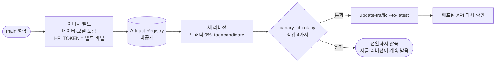

# 운영

[구조 개요](README.md)의 한 부분입니다. 워크플로는 [`.github/workflows/`](../../.github/workflows)에 있습니다. 측정과 사고 기록은 [cloud-run.md](../wiki/cloud-run.md), [observability.md](../wiki/observability.md), [deployment-resources.md](../wiki/deployment-resources.md)에, 목표는 [slo.md](../slo.md)에, 손으로 배포하는 절차는 [runbook-manual-deploy.md](../runbook-manual-deploy.md)에 있습니다.

## 한눈에

| 일 | 언제 | 워크플로 / 도구 | 모델 호출 |
| --- | --- | --- | --- |
| 단위 테스트 (Python) | PR마다 | `streamlit-ci.yml` (필수 검사 `test`) | 없음 |
| 웹 테스트 (vitest, Playwright, 타입, 빌드) | PR마다 | `web-ci.yml` | 없음 |
| 답변 품질 검사 | 답변 경로를 바꾼 PR만 | `pr-quality.yml` | 약 100번 (레일 변경이면 +270) |
| API 배포 | `main` 병합 | `deploy-cloud-run.yml` | 점검 질문 약 4번 |
| 웹 배포 | `main` 병합, PR 미리보기 | Vercel | 없음 |
| 롤백 | 사람이 실행 | `rollback-api.yml` | 없음 |
| 깨어 있음 점검 | 8시간마다 | `keep-alive.yml` | 점검 질문 약 4번 |
| 주간 회귀 평가 | 월요일 09:23 | `regression-eval.yml` | 약 530번 |
| 주간 SLO | 월요일 09:53 | `slo-weekly.yml` | 없음 (Langfuse 기록만) |
| 평가 검토 요청 | 매달 1일 | `eval-review-monthly.yml` | 없음 (이슈만 엶) |
| 실패 알림 | 위 예약·배포가 실패할 때 | `alert-on-failure.yml` → `alert` 이슈 | 없음 |
| 장애 메일 | 앱이 장애 로그를 남길 때 | Cloud Monitoring 로그 알림 | 없음 |

## 부품별 설명

### 1. 배포: 후보 리비전 → 점검 → 전환 (`deploy-cloud-run.yml`)

- **기능:** 새 코드를 트래픽 없이 띄워 보호자의 첫 1분과 같은 질문을 던지고, 모두 통과해야 트래픽을 옮깁니다.
- **점검 4가지** (`scripts/canary_check.py`):
  1. `/health`가 배포 중인 커밋을 알려 줌 (맞는 리비전이 답함)
  2. `/places/kinds`, `/fees/items`가 200 (DB와 표가 있음, 모델 없음)
  3. 날짜 질문 (규칙이 답함): 그래프가 끝까지 돎
  4. 건강 질문: 검색·근거 평가·답변 모델이 돎. 한도 안내("degraded")로 끝나도 실패로 칩니다.
- **설정:** 메모리 2GiB, CPU 1(시작 부스트), 인스턴스 0~2개, 요청 제한 900초. 비밀은 Secret Manager에서 `--set-secrets`로, 키 파일 없이 Workload Identity Federation으로 인증합니다.
- **장애 훈련:** 수동 실행 입력으로 일부러 고장 낸 후보를 띄웁니다. `chat`(답이 깨진 API: 점검이 실패해야 함), `supabase`(DB 끊김: 로컬 검색으로 점검이 통과해야 함). 훈련 후보는 전환하지 않습니다.
- **선택한 이유:** 답을 바꾸는 코드는 단위 테스트로는 확인할 수 없는 고장(키, 데이터 리비전, 모델 설정)을 냅니다. 트래픽 0% 후보는 비용이 거의 없고, 실패하면 보호자는 아무것도 보지 못합니다.

### 2. 롤백 (`rollback-api.yml`)

- Cloud Run은 배포한 리비전을 모두 보관합니다. 다시 빌드하지 않고 트래픽만 이전 리비전으로 몇 초 만에 옮깁니다.
- 입력이 비면 지금 직전 리비전으로, 이름을 주면 그 리비전으로, `to_latest`면 롤백을 되돌립니다. 끝에서 `/health`가 그 리비전의 커밋을 알릴 때까지 기다립니다.
- 롤백은 트래픽을 고정합니다. 다음 배포가 `--to-latest`로 새 리비전에 다시 보냅니다.

### 3. 병합 게이트: 답변 경로 PR의 실제 모델 평가 (`pr-quality.yml`)

- **기능:** 답이 바뀔 수 있는 파일(`ANSWER_PATH`)을 고친 PR, 또는 `quality-check` 라벨이 붙은 PR만 실제 모델로 CRAG 60문항과 라우팅 41문항을 돌립니다. 레일(`GUARD_PATH`)을 고치면 레드팀 68문항도 돌립니다.
- **통과 조건 4가지** (`scripts/check_regression.py`, 기준선 `tests/data/baselines/`):

  | 검사 | 실패하는 경우 |
  | --- | --- |
  | 완전성 | 문항이 빠지거나 오류로 끝남 |
  | 절대 하한 | 예: CRAG accuracy < 0.85, 라우팅 < 0.94 |
  | 상대 하한 | 병합된 코드의 기준선 평균보다 허용 폭 이상 떨어짐 (CRAG −0.05) |
  | 회귀 | 기준선에서 3번 모두 통과한 **안정 문항**이 실패하고, 2번 다시 물어도 한 번 이상 실패 |

- **선택한 이유:**
  - 고정 하한 하나만 보면 문항이 빠지거나, 많이 떨어져도 하한 위면 통과했습니다.
  - 같은 코드도 실행마다 한두 문항이 흔들립니다(근거 평가 판정). 실패한 안정 문항만 다시 물어, 흔들림과 진짜 회귀를 가릅니다.
  - 다른 PR은 건너뛴 작업으로 끝나고, 필수 검사는 이를 통과로 셉니다. 매 PR에 100번씩 부르지 않기 위해서입니다.

### 4. 주간 회귀 평가 (`regression-eval.yml`)

- **기능:** 월요일마다 병합된 코드로 평가 세트 전체를 실제 모델로 돌립니다. 한도를 넘는 값이 있으면 실패하고 알림 이슈가 열립니다.

  | 세트 | 문항 | 대표 한계 |
  | --- | ---: | --- |
  | CRAG 답변/보류 | 60 | accuracy ≥ 0.85, 잘못 보류 ≤ 0.10, p90 ≤ 25초 |
  | 라우팅 | 41 | ≥ 0.94 |
  | 돌봄 지침 | 16 | 답함 ≥ 0.87, 지침 사용 ≥ 0.81 |
  | 레드팀 (공격·위기·개인정보) | 68 | 위기 상담 번호 1.00, 모델로 간 개인정보 0 |
  | 방문 준비 팀 | 12 | 반려견 통과 ≥ 0.8, 반복 의심 ≤ 0.34 ([visit-prep-team.md](visit-prep-team.md)) |
  | 답변 정확도 (수의사 답과 비교) | 100 | ≥ 0.25 |

- **판사 고정:** 판사 모델이 바뀌면 점수 척도가 바뀝니다. 한계를 잰 판사(`gpt-6-luna`)가 아니면 다시 잴 때까지 실패로 둡니다.
- **기록:** 결과는 Supabase `ragdog_eval_history`와 DagsHub MLflow에 남습니다. 프롬프트 해시(`src/prompt_versions.py`)도 함께 남겨, 점수가 바뀐 실행에서 어떤 프롬프트가 바뀌었는지 봅니다.

### 5. SLO (`slo-weekly.yml`, `scripts/slo_report.py`)

| 지표 | 목표 |
| --- | ---: |
| 오류율 | ≤ 2% |
| 건강 상담 p95 지연 | ≤ 25초 |
| 보고서 p95 지연 | ≤ 45초 |
| 건강 상담 보류율 | ≤ 30% |
| 질문당 모델 비용 | ≤ $0.01 |

- 최근 7일 Langfuse 기록으로 판정합니다(모델 호출 없음). 20문항이 안 되면 숫자만 보이고 판정하지 않습니다.
- 지연은 서버의 실행 시간이라, 잠든 인스턴스가 깨는 시간은 들어가지 않습니다.

### 6. 관측: Langfuse 트레이스와 요청 요약 로그

- **Langfuse:** 실행 하나가 트레이스 하나입니다. 경로, 단계별 시간, 토큰, 비용, 피드백, 레일 id, 프롬프트 해시를 남기고, 질문·답 글은 길이로만 남깁니다(`src/tracing.py`의 `SAFE_KEYS`).
- **요청 요약 로그:** 답마다 JSON 한 줄(`ragdog.requests`)을 Cloud Logging에 남깁니다. `outcome`, `latency_ms`, `route`, `trace_id`, `search`(supabase/local), `degraded` 등이고 원문은 없습니다. `trace_id`로 Langfuse 트레이스를 엽니다.
- **선택한 이유:** 건강 상담은 민감한 글이라 원문을 모으지 않습니다. 대신 어떤 질문이 답을 못 받았는지는 `ragdog_data_gaps`(자료에 없던 주제, 원문 없음)로 봅니다.
- **한도:** Langfuse 무료 플랜(월 50,000 이벤트)을 평가 실험이 대부분 썼습니다. 그래서 로컬 평가 스크립트는 추적을 끄고, 자식 없는 LangChain 단계(span)는 보내지 않습니다. 이번 주기를 넘겨 써서, 초기화(11-06)까지는 주간 회귀와 PR 품질 검사도 결과를 로컬 파일로만 남깁니다(판정은 같음).

### 7. 알림

- **실패 이슈:** 예약·배포 워크플로가 `main`에서 실패하면 `alert` 이슈를 열거나, 같은 워크플로의 열린 이슈에 댓글을 답니다. GitHub가 저장소 주인에게 메일을 보냅니다.
- **장애 메일** (`scripts/gcp/alert_policies.json`, `setup_alerts.sh`): 앱 로그의 문구로 잡습니다.

  | 정책 | 의미 |
  | --- | --- |
  | Supabase unavailable | DB가 안 돼 로컬 검색·메모리로 버티는 중 |
  | model out of quota | 모델 한도 소진. 채팅은 검색 근거만, 보고서는 멈춤 |
  | answers failing | 답·보고서가 오류로 실패 |
  | hidden instruction in the material | 검색 레일이 숨은 지시가 든 자료를 뺌 |
  | answer sentences dropped by the citation check | 근거에 없는 숫자가 남아 문장을 뺌 |

  - 정책마다 한 시간에 한 통, 30분 조용하면 닫힙니다.
  - 로그 문구가 바뀌면 알림이 조용히 꺼지므로, `tests/test_alert_policies.py`가 문구가 코드에 실제로 있는지 확인합니다.
  - 위기 안내는 알림을 만들지 않습니다. 익명 사용자라 운영자가 할 일이 없고, 사적인 순간을 메일로 받는 셈이기 때문입니다.

### 8. 비용 관리

- **인프라:** Cloud Run은 요청이 없으면 0개로 줄고, Supabase·Vercel·Langfuse는 무료 플랜입니다. Supabase는 주기적인 점검 질의가 일시 정지를 막습니다(`check_supabase_search.py`).
- **모델 호출:**
  - 질문 한도: 사람(로그인 계정 또는 브라우저)당 1시간 10번·하루 30번, 같은 네트워크 1시간 60번·하루 200번입니다. 방문 보고서는 하루 2개입니다([api.md](api.md)).
  - 평가 스크립트는 실행 전에 예상 호출 수를 보여 주고, 200번을 넘으면 확인을 받아야 진행합니다(`scripts/cost_guard.py`).
  - 반복 실험은 횟수를 낮게 잡습니다. 판정 흔들림을 보려고 2~10번씩 반복한 날, 한도를 넘었습니다(아래).
- **사고에서 배운 것:** 2026-10-19 평가와 운영이 같은 OpenAI 프로젝트 키를 쓰다가 사용 금액 한도에 닿아, 인사말까지 모든 답이 실패했습니다. 그 뒤로 한도 오류를 골라 검색 근거만 보여 주고(ADR-0011), 한도 소진을 알림으로 받습니다.

## 넣지 않은 것

| 후보 | 넣지 않은 이유 |
| --- | --- |
| 모든 PR에 실제 모델 평가 | PR마다 약 100번 호출. 답변 경로 PR만 |
| 최소 인스턴스 1개 (깨는 시간 없애기) | 상시 비용. 대신 8시간마다 점검이 깨는 시간을 기록 |
| 원문을 남기는 로그 | 민감한 건강 상담. 길이·해시·분류만 |
| 위기 안내 알림 | 운영자가 할 수 있는 일이 없음 |
