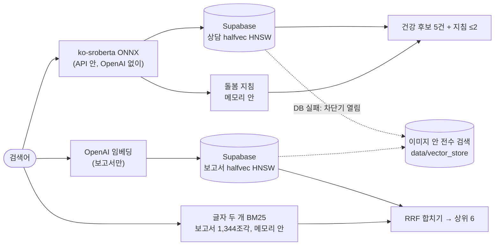

# 검색

[구조 개요](README.md)의 한 부분입니다. 코드는 [`src/resources.py`](../../src/resources.py)(어떤 저장소를 쓸지), [`src/supabase_store.py`](../../src/supabase_store.py)(Supabase 검색과 장애 대비), [`src/hybrid_retrieval.py`](../../src/hybrid_retrieval.py)(BM25, RRF), [`src/onnx_embeddings.py`](../../src/onnx_embeddings.py)(질문 임베딩)에 있습니다. 결정은 [ADR-0001](../adr/0001-embedding-finetuned-ko-sroberta.md), [ADR-0002](../adr/0002-hybrid-dense-bm25-rrf.md), [ADR-0003](../adr/0003-vector-store-faiss-flat.md), [ADR-0005](../adr/0005-no-reranker.md), [ADR-0007](../adr/0007-search-in-supabase.md), [ADR-0010](../adr/0010-public-care-guides.md)에 있습니다.

## 한눈에

| 자료 | 규모 | 질문 임베딩 | 운영 검색 | 장애 시 |
| --- | --- | --- | --- | --- |
| 건강 상담 (AI Hub) | 19,206건 | 미세조정 ko-sroberta, ONNX int8, 768차원, API 안 | Supabase pgvector, 의미 검색만 | 이미지 안 전수 검색(numpy) |
| 공공 돌봄 지침 | 4종, 짧은 조각 | 건강과 같은 모델 | 메모리 안, 최대 2건(유사도 0.52 이상) | 같음 (DB를 쓰지 않음) |
| 보고서 | 5종 922쪽, 1,344조각 (OCR 조각 포함) | OpenAI `text-embedding-3-small`, 1536차원 | Supabase pgvector + 메모리 안 글자 두 개 BM25, RRF | 이미지 안 전수 검색 + 같은 BM25 |

`SEARCH_BACKEND=supabase`가 운영 설정입니다. 설정이 없으면(로컬, 테스트) Chroma + Kiwi BM25 하이브리드로 같은 함수가 돕니다.

## 부품별 설명

### 1. 질문 임베딩: 보호자 말투로 미세조정한 ko-sroberta (`src/onnx_embeddings.py`)

- **기능:** 건강 질문과 돌봄 지침 검색에 쓰는 질문 벡터를 API 안에서 만듭니다. 모델은 `blanden77/ko-sroberta-dograg-b`이고 ONNX int8 파일로 돌려 torch를 불러오지 않습니다.
- **흐름(학습):** 상담마다 보호자 말투 질의 2개를 모델로 만들고($3.37), Colab T4에서 ko-sroberta를 미세조정해, 질문 쪽만 ONNX int8로 바꿨습니다. 상담 벡터는 미세조정한 모델로 다시 만들어 Supabase에 올렸습니다.
- **선택한 이유:**
  - 보호자는 짧게 묻고("강아지가 이틀째 설사해요", 중앙값 23자) 상담 글은 깁니다(중앙값 257자). 기준 모델은 이런 짝을 배운 적이 없어, 원래 상담을 상위 10위에 찾는 비율이 짧은 질의 15%였습니다.
  - 미세조정 뒤 짧은 질문 useful@3 0.625 → 0.800(p=0.0002), 긴 상담 글 0.74 → 0.85(p=0.027).
  - ONNX int8로 바꿔 최고 메모리 1,587 → 985MB가 됐고 검색 품질은 같았습니다.
  - 질문 벡터를 API 안에서 만들기 때문에, OpenAI가 멈춰도 건강 검색은 돕니다([api.md](api.md) "모델 장애 대응").
- **넣지 않은 것:**
  - 건강 상담에 OpenAI 임베딩: 하이브리드 hit@3 0.2674 → 0.2353으로 떨어졌습니다. 그래서 OpenAI 임베딩은 보고서만 씁니다.
  - 큰 한국어 모델 KURE-v1(미세조정 포함): useful@3 0.805로 앱(0.809)과 같고(p=1.0), 질문 임베딩이 8배 느렸습니다. MLflow에 기록했습니다.
  - multilingual-e5-small: 기준 모델보다 낫지 않았습니다.
- 기록: [embedding-finetune.md](../wiki/embedding-finetune.md), [ADR-0001](../adr/0001-embedding-finetuned-ko-sroberta.md)

### 2. Supabase pgvector (`src/supabase_store.py`)

- **기능:** 건강·보고서 컬렉션이 표 하나씩입니다(`id`, `body`, `metadata jsonb`, `embedding halfvec(d)`). 코사인 HNSW 색인을 쓰고, pgvector 0.8의 반복 탐색을 켜서 필터를 걸어도 k건을 채웁니다.
- **흐름:** API가 질문 벡터를 만들어 보내고, 검색만 DB가 합니다. 앱 계정(`ragdog_app`)으로 읽고, 공개 REST API는 이 표를 볼 수 없습니다. 연결 제한 3초, 질의 제한 3초입니다.
- **선택한 이유:**
  - 앱 메모리의 대부분은 벡터가 아니라 Kiwi 형태소 분석기와 BM25 색인(약 320MB)이었습니다. 검색을 DB로 옮겨 앱 최고 메모리가 910 → 442MB가 됐습니다.
  - 검색 1건(질문 임베딩 포함) p50이 459 → 242ms로 빨라졌습니다. 긴 질문을 Kiwi로 분석하는 시간이 빠졌습니다.
  - 벡터는 float16(halfvec)으로 저장합니다. 건강 220문항 모두 상위 12건이 float32와 같고, 공간은 절반입니다.
- **넣지 않은 것:** 메모리 안 전수 검색(ADR-0003)은 910MB로 Streamlit 무료 환경의 보장값을 넘었습니다. 지금은 장애 대비 경로로만 씁니다.

### 3. 건강 검색: 의미 검색만 (`resources.load_health_bm25_index`)

- **기능:** 운영 건강 검색은 문장 임베딩 검색만 씁니다. 처음에는 Dense + BM25 하이브리드였습니다.
- **선택한 이유:** 관련도 세트 100문항의 상위 3개를 모두 채점해 비교했습니다.

  | 운영 건강 검색 | useful@3 | precision@3 |
  | --- | ---: | ---: |
  | 의미 + PGroonga 키워드 | 0.81 | 0.73 |
  | **의미 검색만** | 0.84 (p=0.58) | **0.94** (p=5×10⁻⁹) |
  | 의미 + Kiwi BM25 | 0.83 | 0.86 |

  - 미세조정 전에는 키워드가 핵심 단어(질병·증상 이름)를 보태 hit@3이 0.2264 → 0.2620이 됐습니다([ADR-0002](../adr/0002-hybrid-dense-bm25-rrf.md)).
  - 미세조정 뒤에는 의미 검색이 짧은 질문을 충분히 찾아, 키워드 쪽이 오히려 쓸모없는 사례를 상위 3개에 끼워 넣었습니다.
- **질문 유형마다 전략을 나누지 않는 이유:** 길이 × 질병·약 이름 포함으로 나눈 4개 유형에서 유형마다 가장 좋은 전략을 골라도 0.809 → 0.836(p=0.29, 220문항)뿐이었습니다. 라우터를 하나 더 둘 만큼의 이득이 아닙니다.

### 4. 보고서 검색: 의미 + BM25 하이브리드 (`src/tools/report.py`)

- **기능:** 보고서 5종(KB 2025 반려동물 보고서와 공공 연구 보고서 4종)에서 조각 6건을 찾습니다.
- **흐름:**
  1. Supabase 의미 검색과 메모리 안 BM25(글자 두 개씩 자른 토큰, 1,344조각)가 각각 후보를 냅니다.
  2. RRF로 합쳐 상위 6건을 고릅니다.
  3. 여러 보고서를 비교하는 질문은 보고서마다 따로 찾습니다.
- **OCR 조각:** KB 보고서는 숫자를 전용 글꼴로 넣어 PDF 글자로 숫자가 빠진 쪽이 많습니다. 그래서 112쪽 중 93쪽을 Tesseract OCR로 읽은 조각을 더했고, 근거에 "스캔 글(OCR)"로 표시합니다. 비전 모델(Qwen3-VL-4B)로 다시 읽으면 알려진 오독 9곳을 모두 맞게 읽지만, 같은 문장을 되풀이하는 쪽이 있어 아직 바꾸지 않았습니다([kb-ocr-gpu.md](../wiki/kb-ocr-gpu.md)).
- **선택한 이유:**
  - 보고서 질문은 "델파이 조사", "장묘 불만 유형"처럼 문서에 그대로 나오는 용어를 씁니다. Dense만 쓸 때 정답 23/36이 하이브리드로 30/36이 됐습니다(p=0.016).
  - 키워드 쪽을 PGroonga 대신 메모리 안 BM25로 둔 이유: PGroonga는 질문 말투나 흔한 낱말이 많은 설문 표를 올렸고, holdout 한 문항(산업 조사체계 50쪽)은 10위 안에 들지 못했습니다. BM25로 바꾸자 holdout 16 → 17/17이었습니다. 색인은 34MB, 만드는 데 1.5초, 검색 5ms입니다.
  - 형태소 분석기(Kiwi) 없이 글자 두 개로 자르면 메모리를 거의 쓰지 않고, 정답 페이지 15/18로 Kiwi(16/18)와 비슷했습니다.
- **넣지 않은 것:** RAG-Fusion(정답 그대로, +2.8초), 앞뒤 조각 붙이기(문맥만 3배), HyDE(운영 4/5 → 2/5), 페이지 통째로(25 → 23/36).

### 5. 공공 돌봄 지침 (`src/tools/care_guides.py`)

- **기능:** 상담 자료에 얇은 일상 관리(발톱 손질, 산책, 재난 대비, 노령, 이별)를 공공기관 지침으로 보탭니다.
- **흐름:** 지침 4종을 짧은 조각으로 자르고 건강 검색과 같은 모델로 벡터를 만들어 이미지에 둡니다. 건강 질문마다 가장 가까운 지침을 최대 2건(유사도 0.52 이상) 상담 후보에 더하고, 근거 평가가 상담과 똑같이 남기거나 뺍니다.
- **선택한 이유:** 일상 관리 질문의 1/4을 답하지 못한 원인이 검색 순위가 아니라 자료 구성(증상 상담 위주)이었습니다. 지침을 더해 30문항 중 핵심을 답한 것이 20 → 26, 지침 질문 15/16이 됐습니다. 같은 모델을 써서 새 모델을 불러오지 않습니다.
- **이용 조건:** 공공누리 표시가 없는 4종은 원문을 비공개 데이터에만 두고 짧은 인용·출처·원문 링크로만 씁니다([ADR-0010](../adr/0010-public-care-guides.md), [data.md](data.md)).

### 6. DB 장애 대비 (`FallbackVectorStore`, `FallbackIndex`, `Breaker`)

- **기능:** Supabase 연결이나 질의가 실패하면 이미지 안의 저장소로 답합니다.
- **흐름:**
  1. 프로세스마다 차단기(Breaker) 하나를 네 검색이 함께 씁니다. 한 번 실패하면 차단기가 열려, 정해진 시간 동안 DB를 다시 부르지 않고 로컬로 답합니다. 장애 하나가 제한 시간 한 번만 듭니다.
  2. 로컬 저장소(`data/vector_store`)는 numpy 전수 검색이라 chromadb와 Kiwi를 불러오지 않습니다. 건강은 의미 검색만, 보고서는 같은 글자 두 개 BM25를 씁니다.
  3. 로컬로 답하면 Langfuse 트레이스에 WARNING을 남기고, 답 요약 로그에 표시합니다.
- **장애 훈련:** 배포 후보 리비전에 `RAGDOG_FAULT=supabase`를 걸면 모든 연결이 실패한 것처럼 돌아, 장애 경로를 실제 배포에서 확인합니다([cloud-run.md](../wiki/cloud-run.md)).
- **선택한 이유:** 운영 검색과 장애 경로가 같은 방식(의미 검색만, 같은 BM25)이라, DB 장애 때도 검색 품질이 바뀌지 않습니다.

## 넣지 않은 것 (검색 전체)

| 후보 | 측정 | 넣지 않은 이유 |
| --- | --- | --- |
| Cross-Encoder 리랭커 4종 | 가장 나은 모델도 useful@3 +4%p, 질문당 +8초·0.5GB, 비상업 라이선스 | 지연 대비 이득이 작다 ([ADR-0005](../adr/0005-no-reranker.md)) |
| Cohere 리랭킹 API | useful@3 0.80 vs 지금 0.84 | 나아지지 않고 외부 호출이 는다 |
| 질문에서 추론한 나이·진료과 필터 | 필터를 빼자 0.141 → 0.264 | 말뭉치 라벨이 본문과 34%·59%만 맞는다 |
| RRF 가중치 조정 | 튜닝셋에서 고르고 holdout에서 개선 없음 | |
| 문자 n-gram 재정렬 | hit@3 0.2228 | 개선 없음 |

## 지표

- **useful@3:** 상위 3건 안에 질문에 쓸모 있는 근거가 있는 질문의 비율. 후보를 LLM이 판정합니다(같은 판정 두 번 일치율 86.5%, κ 0.79, [judge-validation.md](../wiki/judge-validation.md)).
- **hit@3:** 상위 3건의 연령·진료과·질병 라벨이 질문과 모두 맞는 비율. 라벨이 본문과 잘 맞지 않아(실험 8) 지금은 보조 지표입니다.
- 검색 실험 전체: [retrieval-experiments.md](../wiki/retrieval-experiments.md)
