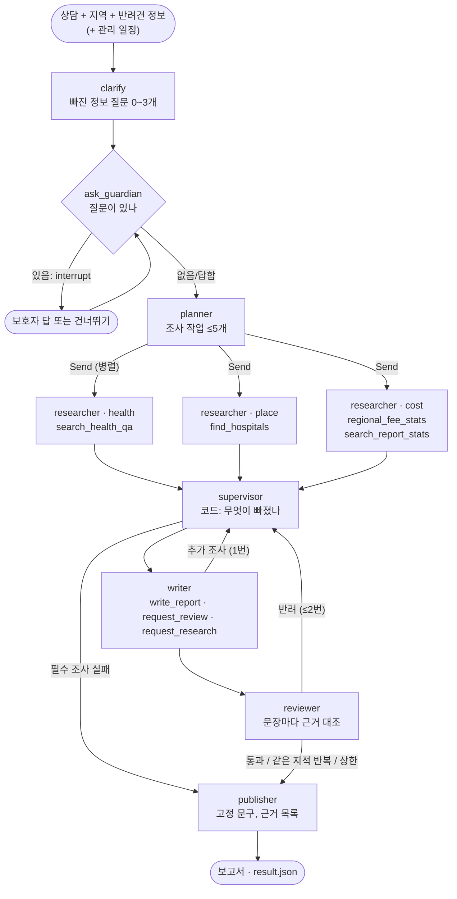

# 방문 준비 보고서 팀

[구조 개요](README.md)의 한 부분입니다. 팀 코드는 [`team/`](../../team)에 있고, 층은 core → tools → agents → graph → main 순서입니다. API는 [`api/visit_prep.py`](../../api/visit_prep.py), 실행 저장소는 [`src/visit_prep_store.py`](../../src/visit_prep_store.py)입니다. 평가와 실패 사례는 [wiki/visit-prep-team.md](../wiki/visit-prep-team.md)에 있습니다.

- **하는 일:** 보호자 상담 하나로 수의사에게 보여 줄 보고서를 만듭니다. 보고서에는 증상 정리, 비슷한 상담 사례, 가까운 동물병원, 지역 진료비 통계, 수의사에게 물어볼 질문이 들어갑니다. 진단은 하지 않습니다.
- **규모:** 보고서 하나에 모델 호출 10~20번, 1~2분이 걸립니다. 그래서 한 사람에 하루 2개로 제한합니다.

## 그래프



## 부품별 설명

### 1. 되묻기: `clarify` + `ask_guardian` (LangGraph `interrupt`)

- **기능:** 계획 전에 빠진 정보(언제부터, 몇 번, 무엇을 먹었는지 등)를 최대 3개 묻습니다. 보호자가 답하면 상담 뒤에 "(보호자 추가 답변)"으로 붙어, 계획·작성·검수가 모두 근거로 씁니다.
- **흐름:** `clarify`가 모델을 한 번 불러 질문을 만들고, `ask_guardian`이 `interrupt`로 멈춥니다. API는 `paused` 이벤트와 질문을 보내고 연결을 닫습니다. 보호자가 답하면 `POST /visit-prep/{thread_id}/answer`가 같은 thread를 `Command(resume=답)`으로 이어 갑니다.
- **선택한 이유:**
  - 노드를 둘로 나눈 이유: 재개하면 멈춘 노드가 처음부터 다시 돕니다. 질문 만들기와 `interrupt`가 한 노드에 있으면 재개할 때 모델을 다시 부르고 질문이 바뀔 수 있습니다. `ask_guardian`에는 모델 호출이 없습니다.
  - 응급 상담은 묻지 않습니다(응급이면 `clarify`가 모델을 부르지 않음). 기다리게 하는 것보다 빨리 병원에 가는 것이 중요합니다.
  - 측정: 상담 12개 중 8개가 질문을 받았고(평균 2.6개), 응급 4개는 0개, 진단·검사를 권하는 질문은 없었습니다.

### 2. 계획과 병렬 조사: `planner` → `Send` → `researcher`

- **기능:** 계획자가 상담을 증상(health)·병원(place)·비용(cost) 조사 작업으로 나누고, 작업마다 조사원 하나가 동시에 돕니다.
- **흐름:**
  - 조사원은 `create_agent`로 만든 하위 에이전트입니다. 출력은 `Finding` 스키마(요약, 근거 id 목록)입니다.
  - 조사원마다 **자기 종류의 도구만** 받습니다(`RESEARCH_TOOLS`). 병원 조사원은 상담 검색을 부를 수 없습니다.
  - 건강 조사원의 `search_health_qa`는 운영 건강 검색에 공공 돌봄 지침 조각(최대 2개)을 더하고, 근거 평가를 거친 것만 돌려줍니다([retrieval.md](retrieval.md)).
  - 비용 조사원은 지역 진료비 표(`regional_fee_stats`)와 보고서 검색(`search_report_stats`)을 씁니다.
- **제한:** 첫 계획 작업 5개, 추가 조사 2개, 조사원당 도구 3번·모델 6번.
- **선택한 이유:** 역할마다 도구를 하나로 묶으면 조사원이 엉뚱한 자료를 섞지 않고, 실패해도 어느 조사가 실패했는지 바로 압니다. 조사는 서로 독립이라 병렬로 돌려 시간을 줄였습니다.

### 3. 슈퍼바이저: 코드가 판단 (`supervisor`)

- **기능:** 조사가 모두 끝나면(병렬 조사를 기다림) 다음 단계를 정합니다. 모델을 부르지 않습니다.
- **흐름:**
  - 필수 조사(증상)가 모두 실패하면 `held`: 쓰지 않고 "필수 조사 실패: 수의사(사람) 확인 필요" 보고서로 끝냅니다.
  - 선택 조사(병원·비용)만 실패하면 `degraded`: 그 절을 빼고 쓰고, 보고서 끝에 "수집하지 못한 자료"를 코드로 붙입니다.
  - 작성자가 추가 조사를 두 번째로 요청하면 "있는 근거로 쓰고 없는 건 '확인할 수 없음'으로"라고 돌려보냅니다.
- **선택한 이유:** 처음(기준선)에는 작성자가 도구로 얻을 수 없는 정보(실시간 영업, 응급 진료 여부)를 계속 요청해 반복 상한에 닿았습니다(반려견 통과율 0.70). 추가 조사를 한 번으로 묶자 통과율 1.00, 시간 p50 68 → 49초가 됐습니다.

### 4. 작성자와 검수자: `writer`, `reviewer`

- **기능:**
  - 작성자는 조사 결과와 상담에 있는 사실만 쓰고, 문장마다 근거 번호를 답니다. 도구는 `write_report`(파일 저장), `request_review`, `request_research`이고, 한 응답에 도구 하나만 부르게 했습니다.
  - 검수자는 보고서를 주장 단위로 나눠 근거와 대조합니다. 근거 없는 주장이 하나라도 있으면 반려하고, 그 문장들을 작성자에게 돌려줍니다.
- **흐름:**
  - 반려는 2번까지(`MAX_ROUNDS`)입니다. 그 뒤에는 사람 확인 문구를 붙여 냅니다.
  - **핑퐁 감지:** 다시 쓴 보고서에서 지적된 문장이 모두 지난번과 같으면, 상한을 기다리지 않고 "같은 지적 반복: 수의사(사람) 확인 필요"로 넘깁니다.
  - 응급 판정, 입력 지역, 관리 일정도 검수 근거에 들어갑니다. "응급 징후가 의심된다"가 근거 없음으로 반려되던 문제를 이렇게 고쳤습니다.
- **선택한 이유:**
  - 한 모델에 조사·작성·검수를 다 맡기면 근거 없는 문장이 섞입니다. 검수를 따로 두면 "검수 통과"를 "모든 문장에 근거가 있다"로 정의할 수 있습니다.
  - 검수 모델의 추론 강도를 low로 낮춰 검수 중앙값이 23.0 → 11.1초가 됐습니다.

### 5. 발행: `publisher`

- **기능:** 코드가 고정 문구를 붙입니다. 진료비는 실제 가격이 아니라는 경고, 지역을 적지 않았을 때의 안내, 수집하지 못한 자료, 근거 목록입니다.
- **선택한 이유:** 꼭 들어가야 하는 안내를 모델에게 맡기면 빠질 수 있습니다.

### 6. 실패 처리

| 실패 | 처리 |
| --- | --- |
| 병렬 조사 하나가 오류 | 조사 노드가 오류를 `failures`에 기록하고 정상 반환합니다. 예외를 올리면 같은 단계의 다른 조사 결과까지 잃습니다 |
| 진료비 조사 실패 | 고정 안내 2문장(`guide-cost-1·2`, 금액 없음)으로 채우고, 실패 사실을 보고서에 적습니다. 고정 안내도 검수가 대조합니다 |
| 조사원이 답 없이 끝남 | API가 응답을 추론 조각 약 100개에서 끊는 경우(`incomplete: max_messages`). 끊긴 대화를 이어 묻지 않고, 도구 결과만 담아 새로 한 번 묻습니다(15/15, 3.9초). 이어 묻던 방식은 6/13이었습니다 |
| 일시 오류 | 재시도는 OpenAI SDK 한 계층(`max_retries=2`)에만 둡니다. 그래프 `RetryPolicy`를 더하면 시도가 곱해집니다(3 × 2 = 6) |
| 실행 중 오류로 멈춤 | 체크포인트를 30분 남기고 오류 이벤트에 `thread_id`를 실어 보냅니다. `POST .../retry`가 마지막으로 끝난 단계부터 이어 갑니다(실행당 2번, 새 보고서로 세지 않음) |

### 7. 실행 저장: Supabase `visit_prep` 스키마 (`src/visit_prep_store.py`)

- **기능:** 멈춘 실행(되묻기, 실패)과 사람별 보고서 수를 요청 사이에 보관합니다.
- **흐름:**
  - 그래프 체크포인트는 LangGraph `PostgresSaver` 표에 둡니다.
  - `paused` 표에는 답을 기다리는 실행과 주인(소금 친 해시, 브라우저 id 아님), 멈춘 시각이 들어갑니다.
  - `report_starts` 표에는 누가 언제 보고서를 시작했는지(해시와 시각만) 남깁니다.
  - 멈춘 실행에는 상담 글이 들어 있어서 30분이 지나면 다음 요청 때 체크포인트와 함께 지웁니다. 멈춘 기록 없이 60분 넘은 체크포인트는 중간에 죽은 실행의 것이라 지웁니다.
  - DB 주소가 없으면(로컬, 테스트) 같은 인터페이스로 프로세스 메모리에 둡니다.
- **선택한 이유:** 처음에는 서버 메모리(`InMemorySaver`)였습니다. 그러면 인스턴스가 하나여야 하고 배포 때마다 멈춘 실행을 잃습니다. Postgres로 옮겨 답이 어느 인스턴스에 가도 이어 가고(Cloud Run 최대 2개), 공개 REST API는 이 스키마를 볼 수 없습니다.
- **한계:** 초안 보고서 파일은 서버 임시 폴더에 있습니다. 다른 인스턴스에서 이어 가면 초안이 없어서 검수자가 "보고서 파일이 없습니다"로 돌려보내고, 작성자가 다시 씁니다.

### 8. 관리 일정 연결

- 웹의 관리 일정에 기한이 지났거나 지금 할 때인 항목이 있으면, 보호자가 체크해 요청에 마지막 날짜를 보냅니다.
- 다음 날짜와 상태는 서버가 웹과 같은 주기 표로 다시 계산합니다(`src/care_schedule.py`, 두 표가 같은지 테스트로 확인). 브라우저가 계산한 숫자를 보고서에 옮기지 않기 위해서입니다.
- 작성자는 해당 항목을 "수의사에게 물어볼 질문"에 `[관리 일정]` 인용과 함께 넣습니다. 응급 판정은 이 절을 읽지 않습니다.

## 평가와 감시

상담 12개(반려견 10, 응급 4, 고양이·토끼 2)를 Langfuse 데이터셋 `ragdog-visit-prep-12`로 실험합니다.

| 지표 | 기준선 | 지금 | 매주 회귀 한계 |
| --- | ---: | ---: | ---: |
| 반려견 상담 검수 통과율 | 0.70 | 1.00 | ≥ 0.80 |
| 대상 처리 (다른 동물은 "확인할 수 없음") | 0.75 | 1.00 | ≥ 0.83 |
| 응급 판정 | 4/4 | 4/4 | 1.00 |
| 지역이 있을 때 병원 목록 | 9/9 | 9/9 | ≥ 0.88 |
| 반복 의심 (노드 방문이 `VISIT_LIMITS` 초과) | - | 0.167 | ≤ 0.34 |
| 다시 묻기 / 끝내 답 없음 | - | 0 / 0 | ≤ 0.25 / ≤ 0.09 |
| 시간 p50 / p90 | 68 / 104초 | 39~54 / 53~83초 | p90 ≤ 120초 |

- **노드 방문 횟수:** `stream_mode="updates"` 이벤트를 세서 모델 호출 없이 반복을 봅니다. 반복 상한·핑퐁 감지가 실제로 멈추는 장치라면, 이 값은 거기 닿기 전에 경향을 보는 경보입니다.
- 진료비 인용은 금액이 조사 행과 맞는지, 지역이 입력 지역인지도 셉니다. 해운대구 상담이 "대구" 통계를 인용한 문제를 이 지표로 찾았습니다.

## 실행

웹의 `/visit-prep` 화면 외에 CLI로도 돌릴 수 있습니다(되묻기 없이, 결과는 `output/visit_prep/`).

```bash
uv run python -m team.main "4살 말티즈가 어제부터 설사를 하고 오늘 아침에 두 번 토했어요. 병원비도 걱정돼요." --region 강남구 --profile "말티즈, 4살, 3.2kg"
```

예시 보고서(2026-10-07, 실제 모델): [말티즈 설사·구토 + 진료비](../visit_prep_examples/normal/visit_report.md), [푸들 경련(응급)](../visit_prep_examples/urgent/visit_report.md), [고양이 식욕 부진(대상 밖)](../visit_prep_examples/out_of_scope/visit_report.md). 이 예시들은 개선 전 코드로 만든 것이라, 고양이 예시는 지금과 달리 반복 상한에서 멈췄습니다.

## 넣지 않은 것

| 후보 | 넣지 않은 이유 |
| --- | --- |
| 작업 표 + 폴링 (ADR-0008의 처음 계획) | 스트리밍 요청 하나로 같은 일을 하고, 관리할 표가 줄어든다 |
| 한 모델이 조사·작성·검수를 다 함 | 근거 없는 문장이 섞이고, 어디서 틀렸는지 알기 어렵다 |
| 그래프 단위 재시도 | SDK 재시도와 곱해진다 |
| 진료비 실패 때 대략의 금액 | 틀린 금액보다 확인 방법(전화, 진료비 게시제)이 안전하다 |
