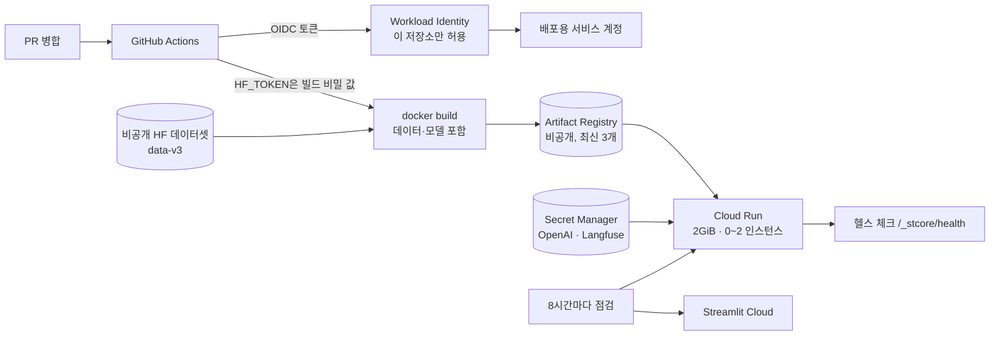

# Docker와 Cloud Run 배포 설계

라그도그는 두 곳에서 운영합니다. 같은 저장소의 같은 코드입니다.

| 배포 | 주소 | 역할 | 배포 방식 |
| --- | --- | --- | --- |
| **Google Cloud Run** | <https://ragdog-892238791473.asia-northeast3.run.app/rag> | 주 배포 | main 병합 → GitHub Actions가 이미지 빌드 → Artifact Registry → Cloud Run |
| Streamlit Community Cloud | <https://dograg-n4gxibufynkgiuixfrkx2v.streamlit.app/rag> | 예비 | Streamlit이 저장소 변경을 감지해 직접 배포 |

작업 순서와 측정 기록은 [wiki/cloud-run.md](wiki/cloud-run.md)에 있습니다. 이 문서는 **왜 이렇게 설계했는지**를 정리합니다.

## 1. 왜 두 곳에서 운영하나

| 문제 (Streamlit Cloud만 쓸 때) | Cloud Run에서 |
| --- | --- |
| 방문이 없으면 앱이 잠들고, 첫 방문자가 깨우기 버튼을 눌러 100초가량 기다린다 | 인스턴스가 0개여도 첫 요청에 자동으로 켜진다(첫 화면 23초 측정) |
| 리소스를 정할 수 없다(최대 2코어, 메모리 보장 690MB) | 메모리 2GiB, CPU 1개를 직접 정한다 |
| 배포 과정이 플랫폼 안에 있다. 리부트를 빠뜨려 챗봇 페이지가 멈춘 적이 있다 | 빌드, 배포, 헬스 체크가 모두 GitHub Actions 기록으로 남는다 |
| 플랫폼 하나에 묶인다 | 한쪽이 멈춰도 다른 쪽이 계속 돈다 |

Streamlit Cloud는 무료이고 이미 잘 돌고 있어서 없애지 않고 예비로 남겼습니다.

## 2. 전체 흐름



## 3. 이미지 설계 (`Dockerfile`)

```text
python:3.12-slim
├─ uv 0.11.29 (ghcr.io에서 복사)
├─ 의존성 레이어      uv sync --locked --no-dev      uv.lock이 바뀔 때만 다시 만든다
├─ 비공개 데이터 레이어 prefetch_image_assets.py data  src/private_data.py가 바뀔 때만
├─ 코드               COPY . .                        .dockerignore로 비밀·출력·문서 제외
└─ 모델               prefetch_image_assets.py model  미세조정 ONNX(int8)와 토크나이저
```

**핵심 결정**

1. **데이터와 모델을 이미지에 미리 넣는다.**
   - 앱은 원래 시작할 때 비공개 데이터 약 250MB와 ONNX 모델을 HF에서 받는다.
   - Cloud Run은 **실행 중에 쓴 파일이 메모리를 차지**하고, 새로 켜질 때마다 다시 받아야 한다.
   - 빌드 때 받아 두면 첫 화면이 빨라지고 메모리도 아낀다. 실행 중에는 `HF_HUB_OFFLINE=1`로 허브에 접속하지 않는다.
2. **HF 토큰은 BuildKit 비밀 값으로만 넘긴다** (`RUN --mount=type=secret,id=hf_token,env=HF_TOKEN`).
   - 토큰은 그 RUN 단계에만 보이고 이미지 레이어나 기록에 남지 않는다.
   - 빌드한 이미지 안에 `HF_TOKEN` 환경 변수, `.env`, `.streamlit/secrets.toml`이 없음을 확인했다.
3. **데이터 레이어를 코드 레이어보다 먼저 둔다.**
   - 코드만 바뀐 배포에서는 의존성(1.3GB)과 데이터 레이어를 그대로 다시 쓴다.
   - 데이터 리비전(`REVISION`)을 올릴 때만 데이터를 다시 받는다.
4. **torch를 설치하지 않는다.** 질문 임베딩은 ONNX Runtime으로 한다. 학습·평가용 torch는 `tools` 의존성 그룹에만 있다.
5. **배포 환경 표시:** `RAGDOG_CONTAINER=1`이면 `settings.deployed()`가 참이 된다. 로컬에서 쓰는 Chroma 복사(177MB)를 하지 않고, Langfuse 트레이스 환경도 배포용으로 바뀐다.

**라이선스:** AI Hub 데이터는 재배포할 수 없다. 이 데이터에서 나온 파일이 이미지에 들어 있으므로, **이미지는 비공개 Artifact Registry에만 올린다.** Docker Hub 같은 공개 저장소에는 올리지 않는다. 공개 저장소에 있는 것은 Dockerfile과 스크립트뿐이다.

## 4. 인증과 비밀 값

| 무엇 | 어디에 | 누가 읽나 |
| --- | --- | --- |
| HF 토큰 | GitHub 저장소 비밀 값 | 빌드 단계만 |
| OpenAI 키, Langfuse 키 2개 | GCP Secret Manager | Cloud Run 실행용 서비스 계정만 |
| GCP 인증 | **키 파일 없음**: Workload Identity Federation | 이 저장소(`rndigkwk/dograg`)의 Actions만 |
| `GCP_WORKLOAD_IDENTITY_PROVIDER` | GitHub 저장소 **변수**(비밀 값 아님) | 워크플로 |

- **서비스 계정은 둘로 나눴다.**
  - 배포용(`github-deployer`): 이미지 올리기와 배포만 한다. 비밀 값은 읽지 못한다.
  - 실행용(`ragdog-runtime`): 비밀 값 읽기만 한다.
- 서비스 계정 키(JSON)를 만들지 않았다. GitHub가 발급한 짧은 수명의 OIDC 토큰을 GCP가 확인하고 임시 권한을 준다.
- 한 번만 하는 설정은 `scripts/gcp/setup_cloud_run.sh` 하나에 모았다. Cloud Shell에서 실행하고, 다시 실행해도 이미 만든 것은 그대로 둔다. 비밀 값은 화면에 보이지 않게 입력받는다.

## 5. Cloud Run 설정

| 설정 | 값 | 이유 |
| --- | --- | --- |
| 리전 | 서울 `asia-northeast3` | 사용자와 가깝다 |
| 메모리 / CPU | 2GiB / 1 | 방문 보고서 실행 중 최고 1.06GiB 측정 |
| 최소 / 최대 인스턴스 | 0 / 2 | 쓰지 않으면 실행 요금 없음. 최대 2개가 비용 상한 |
| session affinity | 켬 | 방문 보고서의 되묻기 단계는 멈춘 실행을 서버 메모리에 둔다. 같은 브라우저는 같은 인스턴스로 가야 한다 |
| 요청 시간 제한 | 3600초 | Streamlit은 탭마다 웹소켓을 계속 열어 둔다 |
| CPU boost | 켬 | 새로 켜질 때 모델과 색인 로딩을 빠르게 |
| 설정값 | `ENABLE_CRAG=true`, Langfuse 주소 | Streamlit Cloud 설정과 같게 맞춤 |
| Langfuse 환경 | `cloudrun` | 두 배포의 트레이스를 나눠 본다 |

## 6. 운영과 점검

- **배포 직후:** 워크플로가 `/_stcore/health`가 200을 줄 때까지 확인한다. 실패하면 배포 작업이 실패로 남는다.
- **8시간마다, 그리고 병합 직후:** `keep-alive.yml`이 두 배포에 같은 점검을 돌린다.
  - 점검 내용: 헤드리스 브라우저로 모든 페이지 열기, 오류 상자 확인, 모델을 부르지 않는 날짜 질문.
  - 결과 요약에 배포마다 "첫 화면까지 / 챗봇 답변 / 결과"를 남긴다.
  - 정기 점검 때 Cloud Run은 보통 꺼져 있다가 켜지므로, "첫 화면까지"가 곧 새로 켜지는 시간이다.
- **비용:**
  - 예산 알림을 걸었다(알림만 보내고 서비스를 멈추지는 않는다).
  - Artifact Registry는 최신 이미지 3개만 남긴다.

## 7. 측정

**로컬 컨테이너** (Docker Desktop, 2GB·CPU 1개 제한)

| 항목 | 결과 |
| --- | --- |
| 이미지 크기 | 2.75GB (패키지 1.3GB, 데이터 254MB, 모델 179MB) |
| 대기 메모리 / 방문 보고서 중 최고 | 65MB / 1.06GiB |
| 첫 페이지 / 첫 답변(모델·색인 로딩 포함) / 다음 답변 | 4.2초 / 18.2초 / 3.6초 |

**Cloud Run**

| 항목 | 결과 |
| --- | --- |
| 배포 시간 (빌드·업로드 + 배포 + 헬스 체크) | 약 2분 30초 ~ 3분 |
| 4시간 반 동안 접속이 없던 뒤 첫 화면 | 23초 |
| 배포 직후 첫 화면 | 11 ~ 14초 |
| 모델 로딩 후 건강 질문 답변 | 3.9 ~ 9.9초 (Streamlit Cloud 6.5 ~ 8.9초와 비슷) |

모델이 올라간 뒤의 응답 시간은 대부분 OpenAI 호출이라, 두 배포의 차이가 크지 않다. Cloud Run이 손해 보는 것은 새로 켜질 때뿐이다.

## 8. 진행하며 겪은 문제

| 문제 | 원인 | 해결 |
| --- | --- | --- |
| `wsl --install`이 `REGDB_E_CLASSNOTREG`로 실패 | 학원 PC의 WSL 설치가 손상됨 | Windows 기능을 켜고 WSL 설치 파일(MSI)을 직접 설치 |
| 배포 작업이 두 번 "건너뜀" | 공급자 값을 저장소 **Secrets**에 넣음. 작업 조건(`if`)은 Secrets를 읽을 수 없다 | **Variables**로 옮김 |
| 컨테이너에서 방문 보고서의 진료비 조사가 기본 안내로 대체됨 | 컨테이너가 아니라 API의 `incomplete` 응답 문제 | 따로 조사 |

## 9. 한계와 다음 단계

- **첫 방문 대기:** 꺼진 상태에서 첫 화면까지 약 23초, 첫 건강 질문에서 모델 로딩이 더 걸린다. 최소 인스턴스를 1로 두면 없어지지만 매달 요금이 생긴다. 실제 사용량을 본 뒤 정한다.
- **이미지 크기 2.75GB:** 대부분 Python 패키지다. 무거운 패키지를 줄이면 빌드와 첫 시작이 빨라질 수 있다.
- **멈춘 방문 보고서 실행은 서버 메모리에 있다.** 인스턴스가 바뀌면 이어 갈 수 없다. session affinity로 줄였지만, 완전히 없애려면 외부 저장소(예: Firestore)가 필요하다.
- **비용은 아직 측정 전이다.** 며칠 운영한 뒤 결제 보고서에서 무료 범위 안인지 확인한다.

## 파일

| 파일 | 내용 |
| --- | --- |
| `Dockerfile`, `.dockerignore` | 이미지 |
| `scripts/prefetch_image_assets.py` | 빌드 때 데이터·모델 받기 |
| `scripts/gcp/setup_cloud_run.sh` | GCP 한 번 설정 (Cloud Shell) |
| `.github/workflows/deploy-cloud-run.yml` | 빌드·업로드·배포·헬스 체크 |
| `.github/workflows/keep-alive.yml`, `scripts/check_deployed_app.py` | 두 배포 점검 |
| `src/settings.py` (`deployed()`) | 배포 환경 판별 |
