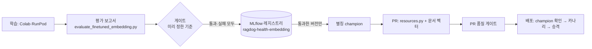

# 모델 레지스트리: 평가 게이트 → 등록 → 승격

건강 질문 임베딩 모델이 평가에서 앱까지 가는 길이다(`scripts/model_registry.py`, 2026-11-11). 모델 호출은 없다. 평가 보고서에 이미 채점된 결과를 읽는다.



## 1. 게이트

`embedding-finetune.md`에 GIST 실험 전에 적어 둔 기준을 그대로 코드로 옮겼다. 앱 모델 B와 비교한다.

| 조건 | 값 |
| --- | --- |
| 짧은 질문(사람이 쓴 holdout, `short`+`short2` 합산) McNemar | p < 0.05 |
| 짧은 질문에서 얻은 문항 | 잃은 문항보다 많음 |
| 긴 상담 `useful@3` | B 이상 |

세트가 겹치지 않으므로 세트별로 엇갈린 문항 수를 더해 정확 McNemar(이항 검정)를 다시 계산한다. 2026-11-09에 손으로 낸 결과(p 0.119)와 같다.

## 2. 등록

통과 여부와 상관없이 모든 후보를 MLflow(DagsHub)의 등록 모델 `ragdog-health-embedding`에 한 버전으로 넣는다. 실패한 후보도 기록으로 남기려는 것이다.

- **가중치는 복사하지 않는다.** AI Hub 자료로 학습한 가중치라 비공개 Hugging Face 저장소에만 둔다. 버전에는 가리키는 값(저장소, 커밋, 하위 폴더, ONNX 파일)과 게이트 숫자를 태그로 두고, 평가 보고서를 아티팩트로 둔다.
- 실험 `health-embedding-registry`에 등록할 때마다 실행 하나가 남는다.

## 3. 승격

- **통과한 버전만** 별칭 `champion`을 받는다. 직전 champion은 `previous`가 된다. 처음 한 번은 지금 앱 모델을 기준(`--reference`)으로 넣어 champion으로 둔다.
- **앱은 실행 중에 레지스트리를 읽지 않는다.** 모델을 바꾸면 문서 벡터(Chroma, Supabase)도 그 모델로 다시 만들어야 한다. 그래서 바꾸는 일은 `src/resources.py`와 벡터를 함께 바꾸는 PR이고, PR 품질 게이트(`resources.py`가 답변 경로라 실제 모델로 돈다)와 배포 카나리가 확인한다.
- **배포가 막는 것:** `deploy-cloud-run.yml`의 첫 단계가 `model_registry.py check`로 `src/resources.py`의 모델이 champion인지 본다. 다르면 배포를 멈춘다. 레지스트리를 못 읽으면(DagsHub 장애) 경고만 하고 배포한다. 레지스트리 장애로 고치는 배포가 막히지 않게 하려는 것이다.

## 2026-11-11 상태

| 버전 | 별칭 | 게이트 | 모델 | 짧은 질문 얻음/잃음, p | 긴 상담 |
| --- | --- | --- | --- | --- | --- |
| v1 | champion | 기준 | `ko-sroberta-dograg-b@8c90f9c` (앱) | - | 0.85 |
| v2 | | 실패 | `ko-sroberta-dograg-gist@f0c2ab5/gist-s13-e3` | 11/4, p 0.1185 | 0.82 |

v2를 승격하려 하면 "gate failed"로 거절한다.

## 명령

```powershell
uv run --group tools python scripts/model_registry.py register --report output/experiments/finetuned_embedding_short2.json --candidate gist-s13-e3 --repo blanden77/ko-sroberta-dograg-gist --revision <커밋> --subfolder gist-s13-e3
uv run --group tools python scripts/model_registry.py promote <버전>
uv run --group tools python scripts/model_registry.py status
python scripts/model_registry.py check
```

## 넣지 않은 것

- **레지스트리에서 모델을 받아 실행 중에 바꾸기:** 문서 벡터가 모델과 짝이라 모델만 바꿀 수 없다. 코드와 벡터가 함께 바뀌는 PR이 더 안전하다.
- **답변 프롬프트의 등록:** 프롬프트는 코드와 함께 바뀌고 해시(`src/prompt_versions.py`)로 기록된다. 병합 게이트가 이미 그 승격 단계다.
