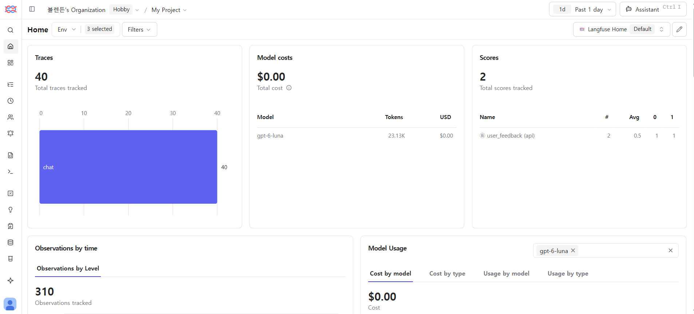
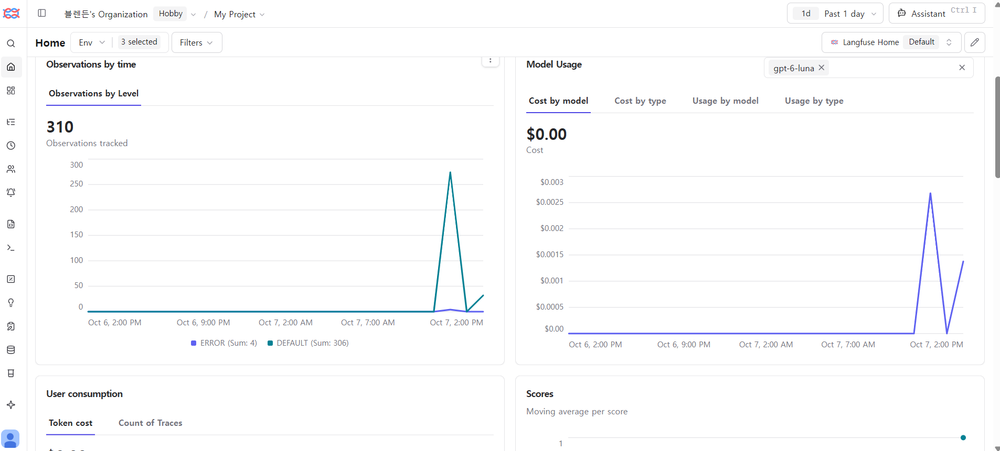
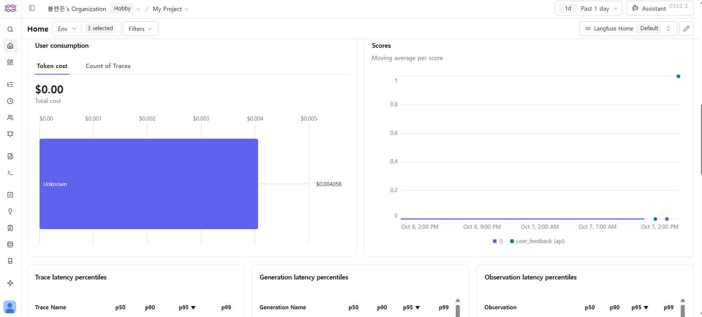
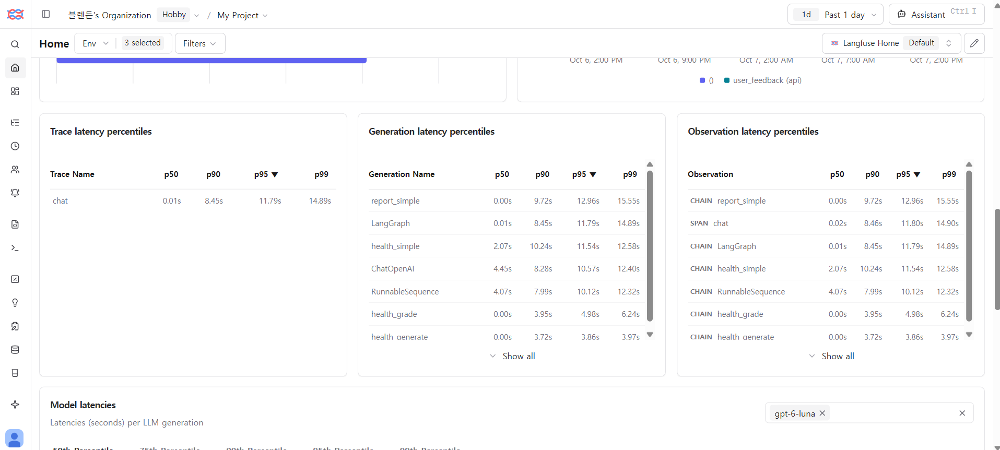

# 운영 모니터링 (Langfuse)

2026-10-07부터 챗봇 실행마다 Langfuse 트레이스를 하나 남긴다. 구현은 `src/tracing.py`, 연결 지점은 `src/chat_graph.py`의 `run_chat()`.

## 무엇을 남기나

| 위치 | 내용 |
| --- | --- |
| 루트 span `chat`의 입력 | 질문의 SHA-256 앞 16자리와 글자 수 |
| 루트 span `chat`의 출력 | `output/chat_runs.jsonl`과 같은 실행 기록: 경로(route), CRAG 판정, 재작성 횟수, 보류 여부, 후보·채택 문서 ID, 모델별 토큰, 지연 |
| 하위 span (LangChain 콜백) | 그래프 노드(classify, health_retrieve, health_grade, …)와 모델 호출마다 시간, 모델 호출의 토큰·비용 |
| 세션 | 브라우저 세션의 무작위 ID를 한 번 더 해시한 값. 같은 탭의 질문들이 한 세션으로 묶인다 |
| 환경 | Streamlit Cloud(`/mount/src/…`)면 `production`, 그 외 `development`. `LANGFUSE_TRACING_ENVIRONMENT`로 바꿀 수 있다 |

## 답변 피드백 (2026-10-07)

- 이번 탭에서 받은 답변 아래에 👍/👎(`st.feedback`)를 보여 준다. 트레이싱이 켜져 있을 때만 보인다.
- 누르면 그 실행의 트레이스에 `user_feedback` BOOLEAN 점수(👍=1, 👎=0)가 붙는다.
- 점수 ID를 `<trace id>-user_feedback`으로 정해 두었다. 그래서 투표를 바꾸면 점수가 하나 더 생기지 않고 덮어써진다. 실제 프로젝트에서 👍 → 👎로 바꾼 뒤 조회해 점수 1개(False)만 남는 것을 확인했다.
- 보내는 값은 숫자 하나와 무작위 트레이스 ID뿐이다. 의견을 글로 받는 칸은 두지 않았다. 글을 받으면 서버에 사용자 텍스트가 남기 때문이다.
- 다시 연 예전 대화에는 버튼이 없다. 대화 기록에는 트레이스 ID를 저장하지 않는다.
- 대시보드에서는 Scores 메뉴나 트레이스 목록의 점수 열에서 경로(route) 태그와 함께 본다. 예: 근거 판정이 `incorrect`(보류)인 답변의 만족도.
- 점수를 읽을 때 새 조직은 `GET /api/public/v3/scores`(SDK: `client.api.scores_v3.get_many_v3`)를 쓴다. 예전 scores API는 막혀 있다.

## 개인정보: 텍스트는 서버를 떠나지 않는다

기존 원칙은 "서버에 대화 원문을 남기지 않는다"이다(대화는 브라우저에만 저장, 실행 로그는 질문 해시만). 트레이싱도 같은 원칙을 따른다.

- Langfuse SDK의 `mask` 훅(`mask_text`)이 SDK가 보내는 모든 입력·출력·메타데이터를 거친다.
- 숫자·참거짓·구조는 남기고, 문자열은 `[masked 32 chars]`처럼 길이만 남긴다.
- 예외는 `SAFE_KEYS`(route, decision, step, 문서 ID, 메시지 role, 모델 이름 등)에 해당하는 값뿐이다. 앱이 정한 값이거나 공개 데이터셋의 ID다.
- 그래서 질문, 답변, 반려견 프로필, 검색된 상담 본문, 대화 이력은 마스킹된다.

**검증:**

- `tests/test_tracing.py`가 실제 Langfuse 클라이언트에 메모리 내 exporter를 붙여 한 번 실행한 뒤, 보낼 span 전체에 질문·답변·문서의 단어(이름, 증상, 전화번호 형식)가 없는지 확인한다.
- 실제 프로젝트에도 질문 3개(건강·시설·보고서)를 보낸 뒤 v2 Observations API로 다시 읽었다. 23개 observation 중 질문 단어가 들어 있는 것은 0개였다(2026-10-07).

## 비용

- `langfuse` import로 메모리 약 11MB 증가(로컬 측정). 키가 없으면 import하지 않는다.
- 전송은 SDK의 백그라운드 스레드가 묶어서 보낸다. 답변 지연에는 영향이 없다.
- 트레이싱 설정·전송이 실패해도 답변은 그대로 나간다. 경고 로그만 남는다.

## 질문 횟수 제한 (2026-10-15)

로그인 없는 공개 앱이라, 누가 반복해서 질문하면 OpenAI 비용이 그대로 나간다. 한 사람이 **한 시간에 10번, 하루 30번**까지 물을 수 있다(사용자 결정). `src/rate_limit.py`.

- **한 사람 = 브라우저 하나:** 브라우저 저장소(localStorage)의 무작위 ID(`ragdog:v1:client`)로 센다. 저장소를 읽기 전에는 이번 세션 ID로 센다.
- **같은 접속 주소(IP)에는 따로 넉넉한 제한:** 한 시간 60번, 하루 200번이다.
  - 브라우저 기록을 지우면 ID가 새로 생기기 때문에 필요하다.
  - IP만으로 사람 수를 세면 학원·회사처럼 한 주소를 여럿이 쓰는 곳에서 10번을 나눠 쓰게 된다. 그래서 IP는 더 큰 상한만 둔다.
  - 접속 주소는 `X-Forwarded-For`의 첫 값이다. 두 배포 모두 프록시 뒤에 있어 Streamlit의 접속 주소는 프록시 주소일 수 있다.
- **세는 것:** 채팅 질문 하나, 방문 준비 보고서 하나가 각각 1번이다. 보고서는 모델 호출이 10~20번이라 세션당 3번 제한도 그대로 둔다.
- **세지 않는 것:**
  - 로컬 실행
  - 테스트, 평가 스크립트, PR 품질 검사, 주간 회귀: 페이지를 거치지 않고 코드를 직접 부른다.
  - keep-alive 배포 확인: user agent에 `RagDogCheck`가 붙는다.
- **넘으면:** 모델을 부르지 않고 "약 N분 뒤에 다시"를 안내한다. 응급 신호 규칙(모델 호출 없음)에 걸리면 응급 안내와 가까운 병원은 그대로 먼저 보여 준다.
- **저장:** Supabase 표 `ragdog_rate_limit`에 해시(DB 주소를 소금으로 쓴 SHA-256)와 시각만 남긴다. 공개 REST API는 닫혀 있다. 48시간이 지난 행은 지운다. 화면 안내 문구에도 적었다.
- **DB가 없거나 안 되면:** 이 프로세스의 메모리에서 같은 한도로 센다. 앱이 재시작하거나 잠들면 초기화되지만, 반복 호출을 막기에는 충분하다.
  - DB가 없는 경우: Supabase 없이 자체 Chroma 검색으로 도는 Streamlit 백업 앱(`streamlit-backup` 브랜치, 2026-10-15)이다.
  - 처음에는 DB가 안 되면 질문을 그냥 허용했다. 백업 앱에 제한이 없으면 공개 앱의 비용 위험이 그대로라서 바꿨다(사용자 결정).
- **측정:** 실제 Supabase에서 같은 ID로 11번 물었다. 10번 허용, 11번째 "약 60분 뒤"였다. 확인 한 번에 처음 0.48초가 걸려서, 조회 4번을 1번으로 합치고 오래된 행 삭제를 20번에 1번으로 줄여 **0.12초**로 낮췄다. 시험 행은 지웠다.

## 켜고 끄기

- `LANGFUSE_PUBLIC_KEY`, `LANGFUSE_SECRET_KEY`가 있으면 켜진다(`.env` 또는 Streamlit secrets). 주소는 `LANGFUSE_BASE_URL`.
- `LANGFUSE_TRACING_ENABLED=false`면 끈다.
- 테스트 실행 중에는 자동으로 꺼진다. `.env`에 실제 키가 있어도 테스트의 가짜 질문이 프로젝트에 쌓이지 않게 하기 위해서다.
  - 처음 통합할 때 이 처리가 없어서, 전체 테스트 1회분의 가짜 실행(마스킹됨, `development`)이 프로젝트에 들어갔다.
- 로컬 평가 스크립트(`scripts/*.py`)도 기본으로 꺼진다. Langfuse 실험(`scripts/langfuse_experiments.py`)만 예외다. 추적이 필요하면 `LANGFUSE_TRACING_ENABLED=true`로 켠다. 아래 "무료 사용량 한도" 참고.

## 무료 사용량 한도 (2026-10-12)

**무슨 일:** Langfuse 무료 플랜의 월 50,000 이벤트를 넘었다는 메일을 받았다(50,652, 초기화 11월 6일). 넘으면 유예 기간 뒤 수집이 멈추고, 들어오는 트레이스·점수가 버려진다. 앱 답변과 주간 회귀 판정은 영향이 없다. 판정 스크립트는 로컬 결과 파일을 읽는다.

**어디서 나왔나 (10/6~10/12 관측 45,843개):**

| 환경 | 관측 | 비중 |
| --- | ---: | ---: |
| `sdk-experiment` (Langfuse 실험: 주간 회귀, 로컬 실험 실행) | 26,287 | 57% |
| `development` (로컬 평가 스크립트, 로컬 앱) | 15,961 | 35% |
| `production` (Streamlit Cloud) | 2,299 | 5% |
| `default` | 1,003 | 2% |
| `cloudrun` | 293 | 1% |

- 실제 사용은 6%뿐이다. 대부분 평가가 만든 이벤트다.
- 주간 회귀 1회는 2,851개였다(10/12 예약 실행). 10/8의 큰 수치는 수동 실행과 로컬 실험이 겹친 날이다.
- 관측 하나하나가 이벤트다. 질문 하나에 LangChain 단계마다 관측이 생긴다.

**바꾼 것:**
1. **로컬 평가 스크립트는 추적을 끈다** (`tracing._evaluation_script`). 평가 결과는 스크립트가 파일로 남기므로 추적이 필요 없다.
2. **LangChain 군더더기 span을 보내지 않는다.** `should_export_span`에 SDK 기본 필터를 쓰고, 다음 단계만 뺀다.
   - 빼는 것: `ChatPromptTemplate`, `StrOutputParser`, `RunnableLambda`, `route_after_*`(다음 노드를 고르는 함수), 에이전트 미들웨어의 `before_model`/`after_model`
   - 남기는 것: 그래프 노드, 모델 호출(토큰·비용), 루트 `chat`, `RunnableSequence`(모델 호출의 부모)
   - 비중: 최근 3시간 관측 9,017개 중 35%(실험 28%, 앱 36~40%)
   - 이 단계들은 모두 자식이 없다. 그래서 빼도 부모를 잃는 관측은 0개였다. 테스트(`tests/test_tracing.py`)가 이것을 확인한다.

**예상:** 주간 회귀 월 4~5회(필터 후 약 9천)와 배포 앱·점검(6일에 약 3,600개, 필터 후 월 1만 남짓)을 더해 월 2만 안팎. 로컬 실험을 많이 돌리는 달은 다시 본다.

**다시 잼 (2026-10-14, `GET /api/public/v2/metrics`, 관측과 점수):**
- 10/6 이후 누적: 관측 46,906 + 점수 2,634 = 49,540. 여기에 트레이스(실행 수)가 더해져 메일의 50,652와 맞는다. 이번 주기(11월 6일 초기화)는 이미 한도에 닿았다.
- 큰 덩어리는 모두 #100 병합(10/12 06:48 UTC) 직전이었다. 10/12 05~07시에 `development` 5,978개, `sdk-experiment` 2,851개(주간 회귀)가 나왔다. 그 뒤로 `development`는 하루 10개 안쪽이다. 로컬 평가 스크립트를 끈 것이 실제로 효과가 있었다.
- 그 뒤 하루 사용량은 배포 두 곳뿐이다.
  - 8시간마다 도는 배포 점검(#123 이후 날짜 + 건강 질문) 1회: 배포마다 관측 14개, 두 배포 합 28개 → 하루 약 84개
  - 직접 확인한 질문, 사용자 질문: 건강 질문 1개당 관측 약 14개
  - 예외: 10/13 지역 비교 측정(`cloudrun-us-central1`)이 360개였다.
- **예상 (다음 주기):** 점검 월 약 2,500 + 트레이스, 주간 회귀 월 4~5회(필터 후 회당 약 1,800, 월 약 8~9천), 사용자 질문을 더해 **월 1만 5천 안팎**이다. 한도의 30% 정도다. 로컬 실험을 Langfuse로 돌리는 달(`LANGFUSE_TRACING_ENABLED=true`, `scripts/langfuse_experiments.py`)만 다시 본다.
- **이번 주기 남은 기간:** 한도를 넘어 유예 기간 뒤 수집이 멈출 수 있다. 10/13에도 관측이 들어왔다. 멈추면 11월 6일까지 Langfuse 화면에 새 기록이 안 보일 뿐이고, 앱 답변, 배포 점검(DB 확인 포함), 주간 회귀 판정은 영향이 없다. 주간 회귀 판정은 로컬 결과 파일을 읽는다.

## 알아 둘 점

- **모델 이름:** 통합 직후에는 Langfuse 콜백이 `ChatOpenAI`의 모델 이름을 찾지 못해 generation의 model 칸이 비었다. 2026-10-07에 다시 확인하니 챗봇(Chat Completions)·방문 준비 팀(Responses API)·실험 실행의 generation 139개(production 6, development 133)에 모두 `gpt-6-luna`가 들어 있고, 새로 만든 호출에서도 경고 없이 기록됐다. 그래서 따로 고치지 않는다. 비용 계산도 이 모델 이름으로 이뤄진다.
- **조회 API:** 2026-09-16 이후 만든 Langfuse 조직은 예전 `GET /api/public/traces`를 쓸 수 없다(410). 데이터를 읽을 때는 `GET /api/public/v2/observations`(SDK: `client.api.observations.get_many`)를 쓴다.

## 대시보드 (2026-10-07 캡처)

하루치 기본 대시보드다. 환경은 `production`과 `development`를 모두 포함했다.

- 트레이스 40건, 모델 비용 표에는 `gpt-6-luna` 토큰 23.13K가 잡혔다.
- 비용은 $0.00으로 표시된다. 사용자별 비용 차트로 보면 하루 합계가 $0.004056이라 반올림된 값이다.
- 점수는 `user_feedback` 2건(평균 0.5)이다. 개발 환경 확인용 👎 1건과 배포 앱 👍 1건이다.

- observation 310건 중 ERROR 레벨이 4건이다.
- 처음 통합할 때 테스트가 실제 프로젝트로 보낸 실행(일부러 실패시키는 테스트 포함)이 여기에 섞였다. 지금은 테스트 실행 중 트레이싱이 꺼진다.

- 사용자 ID를 보내지 않으므로 사용자별 비용은 "Unknown" 하나로 모인다. 의도한 동작이다.

- **트레이스 `chat`:** p50 0.01초, p90 8.45초, p99 14.89초. 시설 검색과 일반 대화는 LLM 호출이 없어 거의 0초이고, 건강·보고서 답변이 꼬리를 만든다.
- **노드별 p90:**

  | 노드 | p90 |
  | --- | ---: |
  | `health_simple` | 10.24초 |
  | `report_simple` | 9.72초 |
  | `health_grade`(CRAG 근거 평가) | 3.95초 |
  | `health_generate` | 3.72초 |
  | 모델 호출 `ChatOpenAI` | 8.28초 |

- 다음에 줄일 곳은 모델 호출 자체다. 그래프 오버헤드(`LangGraph` 대비 노드 합)는 작다.

## 실험 비용 미리 보기 (2026-10-15)

2026-10-15 하루 동안 평가 실험으로 모델 호출이 평소보다 훨씬 많았다. 주로 판사 검증, 자동 기억, 라우팅 평가였고, 흔들림을 보려고 2~10번씩 반복했다. 그래서 자주 쓰는 평가 스크립트가 실행 전에 예상 호출 수를 보여 주고, 많으면 멈추게 했다(`scripts/cost_guard.py`).

- **보여 주는 것:** `[모델 호출 예상] judge_validation bias: 약 360번 · 오늘 실험 누계 168번`. 누계는 이 컴퓨터의 `output/experiments/model_calls.jsonl`에 쌓는다.
- **멈추는 기준:** 200번을 넘으면 멈춘다. `--yes`(또는 `RAGDOG_EVAL_YES=1`)를 붙이거나 터미널에서 y라고 답해야 진행한다. GitHub Actions(`CI=true`)는 그대로 진행한다. CI는 PR 품질 검사와 주간 회귀로 이미 횟수가 정해져 있다.
- **적용한 스크립트:** `judge_validation.py`(judge 204, bias 360, ragas-bias 270), `evaluate_profile_memory.py`(offer 32, use 66, food-names 10×반복), `evaluate_care_routing.py`(질문×반복, 최대치), `evaluate_answer_quality.py`(generate 약 300, judge 반복×지표×300), `relevance_set.py build`(100)
- 숫자는 모델 호출 횟수의 추정이다. 토큰이나 비용이 아니다. 긴 근거가 들어가는 호출(답변 생성, 쌍 비교, 후보 묶음 채점)은 한 번이 짧은 판단 호출보다 훨씬 비싸다.

## 평가 데이터셋과 실험 (2026-10-07)

로컬 스크립트와 JSON으로만 하던 평가를 Langfuse 데이터셋과 실험으로도 돌린다. 실행 결과는 Langfuse의 Datasets → 해당 데이터셋 → Runs에서 나란히 비교한다. 재현: `scripts/langfuse_experiments.py`.

| 데이터셋 | 원천 | 기대값 |
| --- | --- | --- |
| `ragdog-crag-60` | `tests/data/crag_eval_questions.json` | 답변(answer) 또는 보류(abstain), 보고서 질문은 정답 페이지 |
| `ragdog-place-routing-36` | `tests/data/place_routing_questions.json` | 경로(route), 시설 종류(kind) |
| `ragdog-visit-prep-12` | `tests/data/visit_prep_consultations.json` | 응급 여부, 반려견/다른 동물. 방문 준비 팀 실행 결과(`passed`, `urgent_correct`, `scope_handled`, `hospitals_listed`, `rounds`, `latency_s`) |

- **항목 점수:** `correct_behavior`, `gold_page_hit`, `latency_s`, `route_correct`, `kind_correct`
- **실행 점수:** `accuracy`, `over_abstain`(답할 질문을 보류한 비율), `missed_abstain`(보류할 질문에 답한 비율), `latency_p50_s`, `latency_p90_s`
- **실행 메타데이터:** 모델, 추론 강도, 커밋을 남긴다. 실행끼리 무엇이 달랐는지 화면에서 바로 보인다.
- **항목 ID:** 고정했다. 다시 올려도 항목이 늘지 않고 갱신된다.
- **올리는 데이터:** 데이터셋에는 우리 평가 문항(AI Hub 검증 Q&A와 직접 만든 질문)만 올린다. 사용자 대화는 올리지 않는다. 실험 실행의 트레이스도 앱과 같은 마스킹을 거쳐서 답변은 길이로만 보인다. 결과는 점수로 남는다.

**첫 실험 결과**

| 실행 | 품질 | accuracy | 품질 | over_abstain | 품질 | missed_abstain | gold_page_hit | p50 | p90 |
| --- | ---: | ---: | ---: | ---: | ---: | ---: |
| `review-medium` (근거 평가 기본 추론) | 0.900 | 1/38 | 5/22 | 0.667 | 8.5초 | 16.7초 |
| `review-none` (근거 평가 추론 끔, 적용) | 0.883 | 2/38 | 5/22 | 0.667 | **7.0초** | **10.6초** |
| 시설 라우팅 `rules-only` | 경로 1.00, 종류 1.00 | | | | | |
| 시설 라우팅 `rules-plus-llm` | 경로 1.00, 종류 1.00 | | | | | |

- 근거 평가에서 추론을 끄면 p90이 6초 줄었다. 정확도 차이는 60문항 중 1문항이다.
- 질문별 단계 시간 측정(`deployment-resources.md`)과 결론이 같다.
- 두 실행을 같은 데이터셋에서 비교하므로 다음 변경(예: h06 과잉 보류 수정)도 같은 방식으로 잰다.

## 운영 설정: 트레이스 구분과 배포 버전 (2026-10-08)

멀티에이전트 실행은 일반 답변보다 기록이 훨씬 많다. 무엇을 어떻게 구분해 남길지 정했다(day56 교안 01의 운영 설정 표 기준).

| 설정 | 값 | 어디서 |
| --- | --- | --- |
| trace 이름·태그 | 챗봇 `chat` / 태그 `chat`, 방문 준비 팀 `visit-prep` / 태그 `visit-prep` | `src/tracing.py`의 `run_trace` |
| 세션 | 브라우저 세션 id를 한 번 더 해시한 값. 같은 사람의 챗봇 답변과 방문 보고서가 한 세션으로 묶인다 | `tracing.session_id` |
| release | 배포된 커밋(`.git`에서 읽음, 예 `2d7c606`). `LANGFUSE_RELEASE`로 덮어쓸 수 있다 | `tracing.release()` |
| sample_rate | 1.0(모두 남김). `LANGFUSE_SAMPLE_RATE`로 조절. 빠진 실행은 나중에 볼 수 없어서 사용량이 문제 될 때만 낮춘다 | `tracing.sample_rate()` |
| environment | 배포 앱 `production`, 로컬 `development`, 정기 평가 `ci`, 실험 `sdk-experiment` | 기존 |
| mask | 모든 문자열을 길이로 바꿈(앱이 정한 값만 예외) | 기존 |

- 방문 준비 팀 trace의 출력은 실행 기록이다: 상태, 조사 결과(`complete`/`degraded`/`held`), 반복 횟수, 조사 종류, 실패한 조사 종류, 근거 있는/없는 주장 수, 시간. 오류 메시지는 요청 문장을 인용할 수 있어 마스킹된다.
- **확인:** 실제 실행 1건으로 Langfuse API에서 `traceTags = visit-prep`과 `release = 2d7c606` 필터가 그 실행을 찾는 것, 상담 문장·전화번호가 어떤 span에도 없는 것을 확인했다(테스트 `tests/test_tracing.py`도 같은 내용을 메모리 내 exporter로 검사).
- **쓰임새:** 화면 위 검색에 `traceTags:visit-prep`으로 팀 실행만 보고, release로 배포 전후의 지연·오류율을 비교한다.

## 정기 회귀 평가 (2026-10-07)

평가 실험을 사람이 손으로 돌리지 않고 GitHub Actions가 매주 돌린다(`.github/workflows/regression-eval.yml`).

- **언제:** 매주 월요일 09:23(KST), 그리고 Actions 화면에서 수동 실행.
- **무엇을:** CRAG 60문항, 시설 라우팅 36문항, 방문 준비 팀 상담 12개(2026-10-08 추가)를 Langfuse 실험으로 실행한다. 건강 긴 상담 100문항의 답을 수의사 답과 대조한다(Answer Correctness, 2026-10-14 추가, [safety-and-evidence.md](safety-and-evidence.md)). 실행 이름은 `ci-<날짜>-<커밋>`이고 환경은 `ci`라서 Langfuse에서 개발·배포 트레이스와 섞이지 않는다.
- **판정:** `scripts/check_regression.py`가 실행 점수를 기준과 비교한다. 하나라도 넘으면 작업이 실패하고 GitHub가 알림을 보낸다. 결과 표는 작업 요약(Job summary)에, 문항별 결과는 아티팩트로 남는다.

| 구분 | 지표 | 기준 | 병합된 결과 |
| --- | --- | --- | ---: |
| accuracy | ≥ 0.85 | 0.900~0.917 |
| over_abstain | ≤ 0.10 | 0.026 |
| missed_abstain | ≤ 0.35 | 0.18~0.23 |
| 경보 | latency_p90_s | ≤ 25초 | 12.3~12.6초 |
| 품질 | 건강 답변 정확도 `answer_correctness` (수의사 답과 대조, 100문항, 2026-10-14 추가) | ≥ 0.25 | 0.27~0.29 |
| 품질 | route_accuracy / kind_accuracy | ≥ 0.94 / 1.0 | 1.0 / 1.0 |
| 품질 | 방문 팀: 반려견 통과율 / 대상 처리 / 응급 판정 / 병원 목록 | ≥ 0.8 / 0.83 / 1.0 / 0.88 | 1.0 / 1.0 / 1.0 / 1.0 |
| 경보 | 방문 팀: 반복 의심 비율 (`repeat_suspect_rate`) | ≤ 0.34 | 0.167 |
| 경보 | 방문 팀: latency_p90_s | ≤ 120초 | 65.5초 |
| 경보 | 방문 팀: 답 없이 끝나 다시 물은 조사가 있던 실행 비율 (`reask_rate`) | ≤ 0.25 | 0 |
| 경보 | 방문 팀: 다시 물어도 답이 없던 조사가 있던 실행 비율 (`no_answer_rate`) | ≤ 0.09 | 0 |

- **품질과 경보 (2026-10-14):** 지표를 둘로 나눴다. **품질**은 변경을 판단하는 지표이고, 세트마다 강한 신호 몇 개(5개 이하)만 둔다. **경보**는 지연·반복·무응답 같은 운영 점검이다. 둘 다 넘으면 작업이 실패한다. 경보도 실제 고장을 잡기 때문이다. 결과 표의 "구분" 열에 나온다.
  - 근거: DeepEval은 결정에 쓰는 지표를 5개 이하로 권한다([Metrics introduction](https://deepeval.com/docs/metrics-introduction)). Ragas는 약한 신호의 지표 여러 개보다 강한 신호 몇 개를 고르라고 한다([Metrics overview](https://docs.ragas.io/en/stable/concepts/metrics/overview/)).
  - 나누기 전에는 방문 팀 세트 하나에 기준이 8개였다. 품질만 세면 CRAG 3개, 라우팅 2개, 방문 팀 4개다. 세트마다 품질이 5개를 넘지 않는지 테스트가 확인한다(`tests/test_check_regression.py`).
- **판사 모델 기록 (2026-10-15):** LLM이 채점하는 결과에는 판사 모델 이름이 남는다. 답변 정확도는 `answer_<실행>.json`과 요약의 `judge_model`, 검색 관련성 세트는 `health_relevance_100.json`의 `judge.model`(gpt-6-luna)에 남는다.
  - 판사가 바뀌면 점수의 눈금도 바뀐다. 그래서 답변 정확도 기준(0.25)을 잰 판사(`check_regression.JUDGES`)와 다른 판사로 채점한 실행은 실패로 표시한다. 기준을 그 판사로 다시 잰 뒤에 바꾼다(Day 60 "판사를 바꾸면 성적표부터 다시").
  - 관련성 판사는 이제 앱 모델(`CHAT_MODEL_NAME`)을 따라가지 않는다. 앱 모델을 바꿔도 판사는 그대로라, 바뀐 것이 앱인지 판사인지 섞이지 않는다.
- **결과 이력 (2026-10-15):** 주간 회귀와 배포 확인 결과가 Supabase 표 `ragdog_eval_history`에 한 줄씩 쌓인다(`scripts/eval_history.py`). 공개 REST API는 닫혀 있다.
  - 왜: 결과가 GitHub 작업 요약과 Langfuse에만 있었다. Langfuse 무료 플랜은 보관 기간이 짧고, CI의 `output/`은 작업이 끝나면 사라진다. 추세(정확도가 조금씩 내려가는지, 냉시동이 길어지는지)를 볼 곳이 없었다.
  - **regression**(주간 회귀): 세트마다 점수와 판사 모델
  - **deploy**(8시간마다, main 병합 뒤): 배포마다 첫 화면까지 걸린 초, 날짜·건강 답변 초, 배포된 커밋, 문제 목록
  - **database**: 문서 수, DB 용량, 색인 사용
  - **기록 조건:** 워크플로가 `RAGDOG_EVAL_HISTORY=1`을 줄 때만 기록한다. DB 주소만으로는 기록하지 않는다. `src/settings.py`가 `.env`의 주소를 환경에 올리기 때문에, 처음 만들 때 단위 테스트의 가짜 점수 14줄이 표에 들어갔다(지움). 로컬 실행, 테스트, PR 품질 검사는 기록하지 않는다. 기록 실패는 검사를 실패시키지 않는다.
  - **보기:** `uv run --with "psycopg[binary]" python scripts/eval_history.py --days 60 [--kind deploy]`
  - 2026-10-07부터의 과거 실행(keep-alive, 주간 회귀 2회)은 GitHub 로그에서 옮겨 넣었다(`run`이 `backfill:<실행 번호>`, `metrics.backfilled`).
  - 옮겨 넣은 뒤 처음 본 추세(2026-10-15까지):

    | 배포 | 확인 횟수 | 첫 화면까지 중앙값 / 최대 | 건강 답변 중앙값 / p90 | 실패 |
    | --- | ---: | --- | --- | --- |
    | Cloud Run (10-11부터) | 42 | 15초 / 27초 | 11.2초 / 15.1초 | 0 |
    | Streamlit Cloud (10-07부터) | 71 | 6초 / 18초 | 12.1초 / 13.4초 | 3 |

    - Streamlit 실패 3회는 모두 재부팅이 필요한 경우였다: 10-13 배포 커밋 불일치 2회, 10-15 ImportError 1회.
    - Cloud Run의 첫 화면이 더 느린 것은 사용자가 없을 때 인스턴스를 0개로 줄였다가 다시 띄우는 냉시동 때문이다.
- **답 없이 끝난 조사원 (2026-10-10 추가):**
  - API가 추론만 하고 답 없이 끝나는 응답(`status: incomplete`, `max_messages`)을 받으면, 조사원에게 한 번 더 묻는다.
  - 다시 물은 조사는 `result.json`의 `reasks`와 Langfuse 트레이스의 `reasks`에 남는다.
  - 다시 물어도 답이 없으면 `NoAnswer` 실패로 기록하고 기본 안내로 대신한다.
  - 병합 시 상담 12개 실행 두 번에서는 0이었다. 진료비 조사원 하나만 따로 돌렸을 때는 19번 중 4번 생겼다.
  - 다시 물어서 회복된 경우는 12개 중 3개(0.25)까지 허용한다. 끝내 답이 없는 경우는 1개(0.083)까지만 허용한다.
  - 모델이나 API가 바뀌어 이런 응답이 흔해지면, 보고서 품질 지표가 떨어지기 전에 여기서 먼저 걸린다.
  - 작성자와 검수자는 아직 세지 않는다.
- 기준은 병합 시 결과보다 조금 느슨하게 잡았다. 같은 설정도 모델 호출마다 60문항 중 1~2문항이 바뀌기 때문이다(실험 기록 참고).
- **비용:** 한 번에 챗봇 답변 약 60회 + 라우팅 판정 36회 + 방문 팀 실행 12회(모델 호출 약 200회, 약 10분).
- **필요한 저장소 시크릿:** `OPENAI_API_KEY`, `LANGFUSE_PUBLIC_KEY`, `LANGFUSE_SECRET_KEY`, `LANGFUSE_BASE_URL`. 없으면 첫 단계에서 실패하며 무엇이 빠졌는지 알려 준다.

## 자료에 없던 주제 모으기 (2026-10-14)

**왜:** "초콜릿을 얼마나 먹으면 위험한가"처럼 상담 자료에 기준이 없는 질문은 답을 못 한다. 어떤 자료를 보강할지 정하려면 실제로 무엇이 자주 비는지 알아야 한다.

**방법** (`src/data_gaps.py`): 답변 규칙 5에 따라 모델은 빠진 것을 직접 밝힌다("검색된 자료에는 ○○은 없습니다"). 이 문장을 모은다.
- 답변마다 그런 문장을 3개까지(200자까지) 저장한다. 개인정보는 가린다. 질문 원문은 저장하지 않는다. 거절한 답은 문장 없이 `abstained` 한 줄을 남긴다.
- 건강·보고서 경로만 대상이다. **배포 앱에서만** 모은다(`settings.deployed()`). 로컬 실행, 테스트, CI 평가 실행은 평가 세트로 표를 채우므로 뺀다.
- 저장 위치: Supabase 표 `ragdog_data_gaps`. 공개 REST API는 닫는다. 저장은 백그라운드 스레드에서 하므로 답변을 늦추거나 깨지 않는다.
- 화면 안내를 고쳤다. 전에는 "서버에는 남지 않습니다"였다. 이 문구는 Streamlit Cloud 저장소가 휘발성이던 때 정한 것이라, 지금 서버에 남는 두 가지(답변 속 '자료에 없다' 문장, 👎 뒤 직접 보낸 대화)를 밝혔다.

**문장 고르기 정확도** (긴 상담 답변 200개, 답변 품질 측정 때 만든 것):
- 200개 중 142개(71%)에서 문장이 나와 164줄이 된다.
- 처음 패턴은 40개 표본 중 2개를 잘못 골랐다. "자료에서는 … 호전되지 않**거나** … 안내합니다", "자료에 따르면 … 없**어도** 안심할 수 없습니다"는 자료의 내용이지 빈칸이 아니다. 끝맺음을 "없습니다·없고·나와 있지 않·다루지 않"으로 좁히고, "자료에 따르면"과 "~할 수 없습니다"를 뺐다. 다른 40개 표본에서는 40/40이 실제 빈칸 문장이었다(`tests/test_data_gaps.py`).
- 자주 나온 빈칸: 초콜릿 종류·양별 위험도, 구체적인 치료비, 집에서 할 피부·귀 관리법, 재투여·재활 시점

**보는 법:** `uv run --with "psycopg[binary]" python scripts/report_data_gaps.py --days 30`. 경로·종류별 줄 수와, 빈칸 문장에 자주 나온 낱말을 예문과 함께 보여 준다.

## PR 품질 검사: 답변 경로를 바꿀 때만 (2026-10-14)

주간 회귀는 병합된 **뒤**에 돈다. 병합하면 Cloud Run이 바로 배포되므로, 답변을 바꿀 수 있는 수정은 병합 **전**에 확인한다(`.github/workflows/pr-quality.yml`). 모델 호출 비용과 시간이 들어 모든 PR에 돌리지는 않는다(사용자 결정).

- **언제 도나:** 다음 파일을 바꾼 PR, 또는 `quality-check` 라벨을 붙인 PR
  - `src/tools/router.py`, `src/tools/places.py`: 경로 판단
  - `src/tools/health.py`, `src/tools/report.py`, `src/tools/general.py`: 답변 프롬프트·검색·일반 대화
  - `src/crag.py`, `src/chat_graph.py`, `src/chatbot.py`: 거절 판단과 전체 흐름
  - `src/resources.py`, `src/supabase_store.py`, `src/hybrid_retrieval.py`: 검색 저장소와 모델
  - `src/pii.py`: 입력 가림
- **무엇을:** CRAG 60문항과 시설 라우팅 41문항(10-19부터, 처음 36)(모델 호출 약 100회, 10~15분). 주간 회귀와 같은 기준(`scripts/check_regression.py`)과 비교한다.
- **나머지 PR:** 작업이 "건너뜀"으로 끝난다. 이 검사를 브랜치 보호의 필수 검사로 지정해도, 건너뛴 작업은 통과로 셈해 병합을 막지 않는다.
- **병합을 실제로 막으려면:** 저장소 Settings → Branches(또는 Rules)에서 main의 필수 상태 검사에 `quality`를 넣는다. 저장소 설정이라 사람이 한다.
- 기준이 흔들림 때문에 거짓 경보를 내지 않는지는 CRAG를 3번 돌려 확인했다(정확도 0.883~0.917, 기준 0.85, [safety-and-evidence.md](safety-and-evidence.md)).
- main 규칙(ruleset)에 `test`, `decide`, `quality`가 필수 검사로 들어 있다(2026-10-16 확인).

### 병합 조건 네 가지 (2026-10-19)

처음에는 고정 기준(절대 하한) 하나만 봤다. 그래서 문항이 빠지거나, 기준선보다 많이 떨어져도 하한 위면, 또는 늘 맞던 문항이 틀려도 통과했다. 이제 기준선이 있는 세트(CRAG, 라우팅)는 아래 네 가지를 모두 통과해야 `quality`가 성공한다(`scripts/check_regression.py`).

| 검사 | 무엇을 | 실패하는 경우 |
| --- | --- | --- |
| 1. 완전성 | 문항 id가 기준선과 같고, 문항마다 출력과 점수가 있다 | 문항이 빠지거나 더해짐, 문항이 오류로 끝나 출력·점수가 없음 |
| 2. 절대 하한 | 지표마다 고정 기준 (`LIMITS`) | 예: CRAG accuracy < 0.85 |
| 3. 상대 하한 | 품질 지표가 기준선 평균에서 허용 폭 안 (`DROPS`) | CRAG accuracy가 기준선 −0.05 아래, missed_abstain이 +0.10 위, 라우팅 정확도가 −0.03 아래 등 |
| 4. 회귀 | 기준선의 **안정 문항**(기준선 실행에서 매번 통과)이 이번에도 통과 | 안정 문항이 실패하고, 다시 2번 물었을 때도 한 번 이상 실패 |

- **재확인 (2026-10-20 추가):** 첫 PR(#218)에서 코드가 같은데도 실행마다 다른 안정 문항 하나씩(r20, 그다음 u20)이 실패했다.
  - 근거 평가 모델의 판정이 흔들린 것이다. 기준선 3번 모두 "근거 없음"이던 r20을, 그 실행에서는 "애매함"으로 보고 부분 답을 했다.
  - 3번 모두 통과한 문항도 실행마다 52개 중 한 개쯤은 뒤집혀서, 이대로면 답변 경로 PR 대부분이 막힌다.
  - 그래서 안정 문항이 실패하면 그 문항만 2번 더 묻는다(`scripts/recheck_items.py`, 문항당 채팅 2번). 두 번 모두 통과하면 흔들림으로 표에 따로 적고, 한 번이라도 실패하면 회귀다.
  - r20·u20을 다시 물으니 2번 모두 통과했다. 진짜 회귀라면 다시 물어도 실패한다.
  - PR 품질 검사와 주간 회귀 모두 같은 방식이다. 첫 비교가 실패하면 재확인 단계가 다시 판정한다.

- **기준선 (`tests/data/baselines/crag.json`, `routing.json`):** 병합된 코드로 같은 세트를 3번 돌린 결과다. 문항 id, 지표 평균과 범위, 문항별 통과 횟수가 들어 있고 질문 글은 없다.
  - 한 번 실행은 한두 문항씩 흔들린다. 그래서 3번 모두 통과한 문항만 "안정"으로 본다. 흔들리는 문항이 틀려도 회귀로 치지 않는다.
  - 만들기: `uv run python scripts/check_regression.py --make-baseline crag <run1> <run2> <run3>`
- **기준선 기록:** 2026-10-19 처음 만듦(CRAG 안정 52/60). 2026-10-20 다른 동물 규칙(#222) 뒤 다시 만듦(안정 **53**/60, accuracy 0.900~0.917). 다른 동물 질문(u08~u17)은 규칙으로 3번 모두 같고, 경계 문항 r20은 안정 문항에서 빠졌다. u01·u02·u04·u06(지어낸 상황·가짜 약)은 3번 모두 답해 버려 처음부터 안정 문항이 아니다(남은 과제).
- **기준선을 다시 만들 때:** 평가 세트를 바꾸거나, 의도적으로 답변을 바꾼 PR을 병합한 뒤.
  - 그 PR 자체는 이전 기준선과 비교되므로 상대 하한이나 회귀에서 실패할 수 있다.
  - 그때는 기준선 갱신을 같은 PR에 넣고, 바뀐 문항을 PR에 적는다.
- **절대 하한만 보는 세트:** 방문 팀(visit)과 건강 답변 정확도(answer)는 주간 회귀에서만 돌고 기준선이 없다.
- **적용 범위 (사용자 결정, 2026-10-19):** 지금처럼 답변 경로를 바꾼 PR에만 돈다. 다른 PR은 `quality`가 건너뜀으로 끝나 병합을 막지 않는다. 주간 회귀도 같은 네 가지로 판정하고, 실패하면 `alert` 이슈가 열린다.
- **답변 경로에 더한 것 (2026-10-19):**
  - `src/tools/care_guides.py`(돌봄 지침 검색)와 `src/private_data.py`(비공개 데이터 버전)를 더했다.
  - #236은 지침 문맥 창과 리플릿 글을 고쳐 답을 바꿨지만, 데이터 버전만 올렸기 때문에 게이트가 건너뛰었다.
  - 데이터 버전이 바뀌면 답변의 근거 자료가 바뀌므로 병합 전에 검사한다.
  - 자료를 만드는 스크립트(`scripts/build_care_guides.py`)는 넣지 않았다. 그 결과는 데이터 버전을 올릴 때만 운영에 닿고, 그때 `private_data.py`가 바뀐다.

## 👎 이유와 동의한 대화 모으기 (2026-10-14)

Langfuse에는 질문·답변 원문을 보내지 않는다. 그래서 지금까지 👎는 "어느 답이 별로였다"만 남고 **왜**인지 알 수 없었다. Day 59 교안의 운영 중 평가("낮은 점수 답변을 사람이 확인해 골든셋 보강")를 원문 없이 할 방법이 없었다.

**바꾼 것** (`app_pages/rag.py`, `src/feedback_store.py`, `src/tracing.py`):
1. **이유 고르기:** 👎를 누르면 "어떤 점이 아쉬웠나요?" 아래에 다섯 가지가 나온다. "틀린 정보 / 질문과 다른 답 / 근거가 부족해요 / 너무 길어요 / 기타". 고른 값은 Langfuse 점수 `user_feedback_reason`(CATEGORICAL)으로 남는다. 다섯 가지는 교안의 진단과 이어진다. 틀린 정보는 Answer Correctness, 질문과 다른 답은 Answer Relevancy, 근거가 부족해요는 검색 쪽이다.
2. **동의한 경우만 저장:** 보호자가 "이 질문과 답변을 개선에 쓰도록 보내기"에 체크하고 보내기를 누를 때만 저장한다. 저장하는 것은 질문(개인정보를 가린 상태, `src/pii.py`), 답변, 이유, 경로, 근거의 라벨(나이 단계·진료과·페이지 등)이다. 상담 원문이나 수의사 답변 같은 긴 근거 글은 저장하지 않는다.
   - 저장 위치: Supabase 표 `ragdog_feedback`. 처음 쓸 때 만들고, 검색 표와 같이 공개 REST API를 닫는다(RLS 켬, 공개 역할 권한 회수).
   - `SUPABASE_DB_URL`이 없으면 저장 체크박스를 보여 주지 않는다. 저장에 실패해도 채팅은 그대로다.
- 확인: 로컬 앱에서 "강아지가 기침을 해요 제 번호 010-1234-5678"에 👎 → "근거가 부족해요" → 동의 → 보내기를 눌렀다. 표에 "…제 번호 [전화번호]"로 저장되고, 이유와 경로가 함께 남았다. 표의 RLS 켜짐, 공개 역할 권한 0개도 확인했다. 시험 행은 지웠다.

**모인 대화를 쓰는 법:** 저장된 행을 사람이 읽고, 정답 답변을 써서 평가 세트(`tests/data/`)에 넣는다. 이유별로 세면 어느 단계를 먼저 고칠지(검색 / 생성) 근거가 된다.
- **도구 (2026-10-15):** `scripts/review_feedback.py`(모델 호출 없음)
  - 기본 실행: 이유·경로별 개수와 각 행(이유, 경로, 가린 질문, 답변 앞부분)을 보여 준다.
  - `export`: `output/feedback/candidates.json`에 평가 후보를 쌓는다. 이미 내보낸 행은 건너뛴다.
  - 후보에는 평가 세트 모양(id, question, route)에 앱 답변·이유·근거 라벨을 더하고, `expected`와 `reference`는 비워 둔다. 사람이 채워 맞는 세트로 옮긴다. 자동으로 `tests/data`에 넣지는 않는다.
  - 시험 행 1개를 실제 저장 경로(`feedback_store.save_review`)로 넣었다. 전화번호가 가려진 채 저장됐고, 보기·내보내기가 됐으며, 두 번째 내보내기에서 중복이 없었다. 시험 행은 지웠다.
